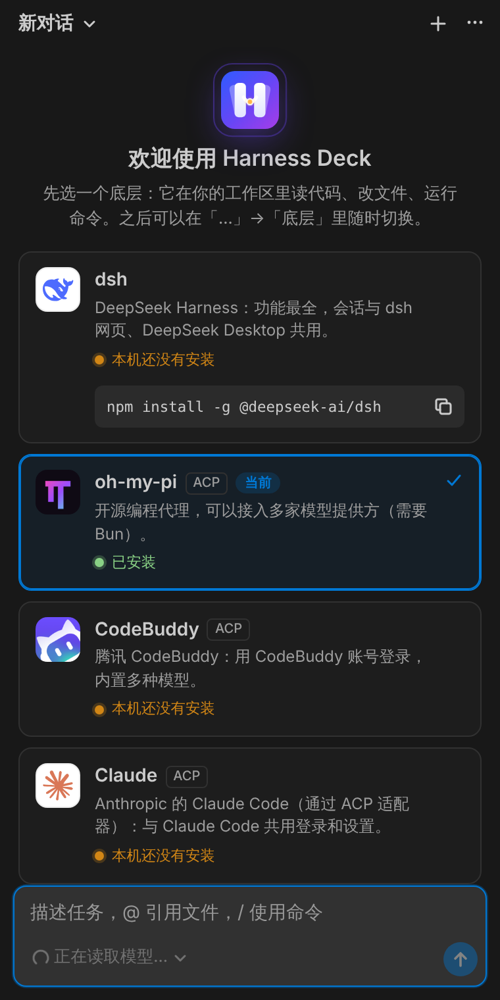
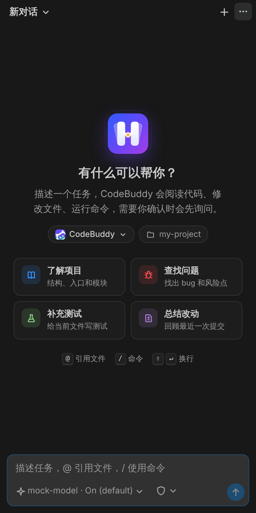
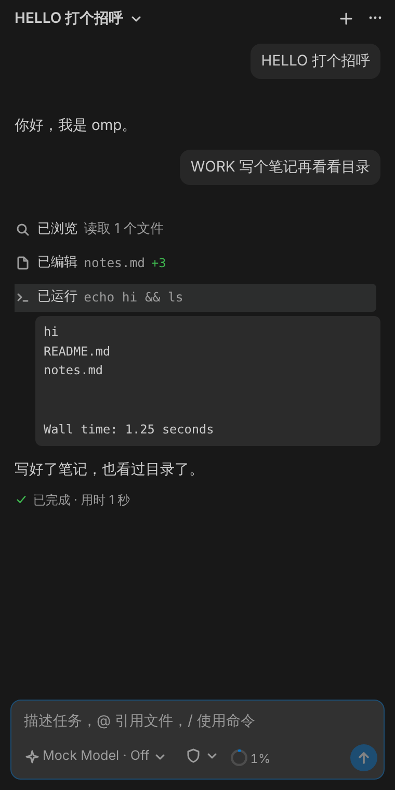
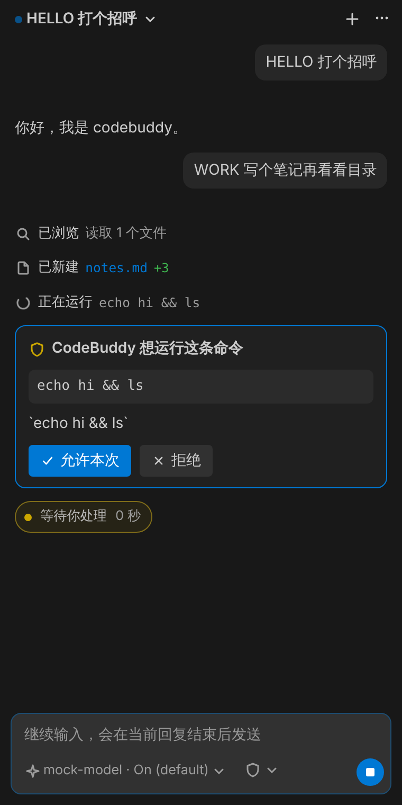
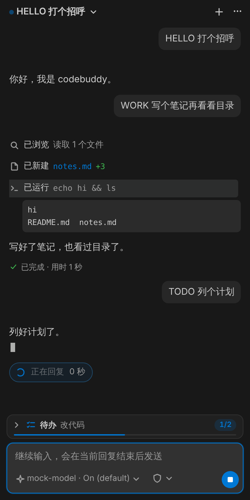
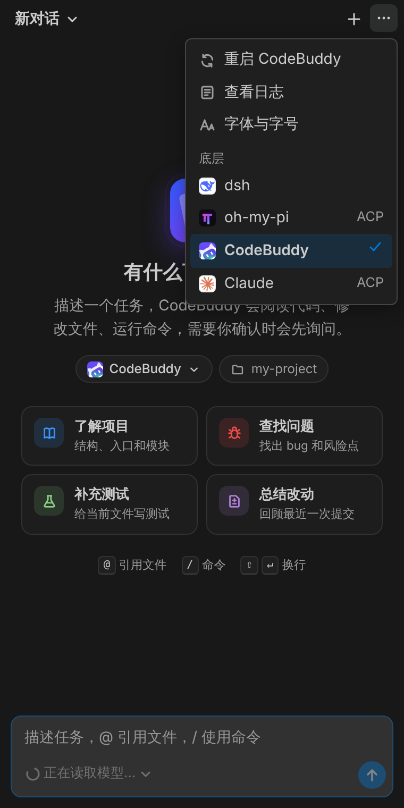

<p align="center"></p>

<h1 align="center">Harness Deck</h1>

<p align="center">
  编程代理的 VS Code 对话面板：一个界面，换着用不同的底层。<br>
  DeepSeek · Claude · oh-my-pi · CodeBuddy · 任何支持 ACP 的代理
</p>

<p align="center">
  <a href="https://github.com/izrio/dsh-vscode-copilot/releases/latest"><b>下载安装包</b></a> ·
  <a href="./packages/extension/README.md">使用说明</a> ·
  <a href="./packages/extension/CHANGELOG.md">更新记录</a> ·
  <a href="#english">English</a>
</p>

<table>
  <tr>
    <td></td>
    <td></td>
    <td></td>
  </tr>
  <tr>
    <td align="center">第一次打开时选底层，显示是否已安装</td>
    <td align="center">首页：当前底层、工作区、示例任务</td>
    <td align="center">紧凑的工具行，点开看命令输出</td>
  </tr>
  <tr>
    <td></td>
    <td></td>
    <td></td>
  </tr>
  <tr>
    <td align="center">需要确认的操作先问你</td>
    <td align="center">待办和运行状态贴在输入框上方</td>
    <td align="center">随时切换底层，会话分开保存</td>
  </tr>
</table>

截图使用本地假模型，内容仅为演示。

## 特性

- **底层可以换**：同一个面板背后可以是 DeepSeek（dsh）、Claude、oh-my-pi、CodeBuddy，或任何支持 [ACP（Agent Client Protocol）](https://agentclientprotocol.com)的代理；每个底层的会话分开保存。
- **侧边栏对话**：逐字流式回复和推理，紧凑的工具活动行（读文件和搜索合并成「浏览」、命令带输出、修改带增删行数），运行状态和用时，停止生成，回复中继续发的消息自动排队。
- **审批与模式**：需要确认的操作弹出审批卡片；在输入框里切换权限 / 模式（含计划模式），模型和思考等级级联选择。
- **VS Code 集成**：在 Diff 编辑器里查看每次改动；当前编辑器和选区作为上下文；`@` 引用文件、`/` 命令；编辑器右键「解释 / 修复 / 写测试」；粘贴图片。
- **多开标签和改动栏**：每个会话一个标签，后台会话继续回复；输入框上方的改动栏列出本会话改过的文件，点开看累计 Diff。所有底层都支持。
- **DeepSeek（dsh）独有**：每轮改动汇总（含命令造成的改动）、子代理卡片、提问卡片、消息插队、`/goal`、在浏览器中打开 dsh 网页。
- **细节**：中英文界面，跟随 VS Code 主题，默认护眼配色（正文颜色柔和），对话字号和字体可调；翻看历史时一键滚动到底部。

## 支持的底层

| 底层 | 接入方式 | 安装 | 登录 / 模型 |
| --- | --- | --- | --- |
|  **DeepSeek**（dsh，[DeepSeek Harness](https://github.com/deepseek-ai/deepseek-harness)） | 内置：HTTP + WebSocket | [DeepSeek Desktop](https://www.deepseek.com/en/download/) 菜单「管理 dsh 命令…」，或 `npm install -g @deepseek-ai/dsh` | 第一次使用时引导配置 DeepSeek API Key |
|  **oh-my-pi** | ACP：`omp acp` | `bun install -g @oh-my-pi/pi-coding-agent` | omp 自己的模型提供方配置 |
|  **CodeBuddy** | ACP：`codebuddy --acp` | `npm install -g @tencent-ai/codebuddy-code` | 浏览器登录，或 `CODEBUDDY_API_KEY` |
|  **Claude** | ACP：`claude-agent-acp` | `npm install -g @agentclientprotocol/claude-agent-acp` | `claude` → `/login`，或 `ANTHROPIC_API_KEY` |
| 其他 ACP 代理 | 设置 `harnessDeck.backends` | 按代理的说明 | 按代理的说明 |

各底层的功能差别、设置项和常见问题见[使用说明](./packages/extension/README.md)。

## 安装

1. 在 [Releases](https://github.com/izrio/dsh-vscode-copilot/releases/latest) 下载 `harness-deck-<版本>.vsix`，在 VS Code 扩展视图「⋯ → 从 VSIX 安装…」，或执行：

   ```bash
   code --install-extension harness-deck-<版本>.vsix
   ```

2. 至少装好一个底层（见上表）。
3. 打开右侧辅助侧边栏里的 Harness Deck（或命令「Harness Deck: 打开对话」）。第一次打开时会让你选底层，之后在首页点底层标签或「…」→「底层」切换。

从 DSH Copilot 升级：原来的 `dsh.*` 设置会自动搬到 `harnessDeck.*` 下；Harness Deck 是新的扩展 id，装好后可以卸载 DSH Copilot。

## 工作方式

```
VS Code 插件（Harness Deck）
├── 界面：侧边栏 Webview（React），只认识与底层无关的视图模型
└── 底层控制器（同一个接口，把底层的数据投影成视图模型）
    ├── dsh：启动 dsh Host 子进程 ── HTTP /api + WebSocket ──▶ dsh
    └── ACP：启动代理子进程 ── stdio JSON-RPC（ACP v1）──▶ oh-my-pi / CodeBuddy / Claude / …
                                                              │
                              Agent 循环、工具、审批、会话持久化都在底层里
                                                              ▼
                                                模型 API（由底层自己发出）
```

插件本身不发模型请求，也不保存 Key：它负责启动和连接底层、把会话显示成界面，并补上 VS Code 的集成（Diff、选区、右键菜单、未保存保护）。

## 文档

| 文档 | 内容 |
| --- | --- |
| [packages/extension/README.md](./packages/extension/README.md) | 使用说明：各底层的准备、功能差别、设置、常见问题 |
| [docs/DESIGN.md](./docs/DESIGN.md) | 整体方案：架构、模块、界面设计原则、运行时管理、安全、测试、里程碑；第 15 节是多底层与各 ACP 代理的适配 |
| [docs/DSH-INTEGRATION.md](./docs/DSH-INTEGRATION.md) | dsh 调研：启动与认证、线上格式、Remote 方法、会话事件、版本策略 |
| [CHANGELOG](./packages/extension/CHANGELOG.md) | 更新记录 |

## 开发

需要 Node ≥ 20.19 和 pnpm 10。

```bash
pnpm install
```

```bash
pnpm typecheck
```

```bash
pnpm test
```

```bash
pnpm build
```

```bash
pnpm package
```

`pnpm package` 产出 `packages/extension/harness-deck-<版本>.vsix`。调试时先执行 `pnpm dev`（监听并重新构建），再用 VS Code 打开 `packages/extension` 按 F5 启动扩展开发宿主。

### 测试

下面的测试都用本地假模型，不需要 API Key 或账号，也不会读取你的会话。界面测试需要先 `pnpm build`，本机装有 playwright 和 Chromium；截图保存在仓库根目录的 `.e2e-screenshots/`（已忽略）。

dsh 冒烟测试（协议客户端，无界面；加 `--record` 重新录制 fixture。本机 Node 低于 24.9 时用 `--node-bin <Node 24 的 bin 目录>`）：

```bash
pnpm smoke -- --dsh "$(command -v dsh)"
```

dsh 界面端到端测试（真实 dsh + 插件的 Host 侧逻辑 + Chromium 中的界面）：

```bash
pnpm --filter harness-deck e2e -- --dsh "$(command -v dsh)"
```

ACP 底层的界面端到端测试（真实的 oh-my-pi、CodeBuddy 或 Claude 适配器）：

```bash
pnpm --filter harness-deck acp-e2e -- --omp "$(command -v omp)"
```

```bash
pnpm --filter harness-deck acp-e2e -- --codebuddy "$(command -v codebuddy)"
```

```bash
pnpm --filter harness-deck acp-e2e -- --claude "$(command -v claude-agent-acp)"
```

在真实 VS Code 中验证（需要先 `pnpm package`，并安装 code-server）：

```bash
pnpm --filter harness-deck vscode-e2e -- --code-server "$(command -v code-server)" --dsh "$(command -v dsh)"
```

CI 每次提交跑类型检查、单元测试和 dsh 的测试；`acp-compat` 每天对 oh-my-pi、CodeBuddy、Claude 适配器的固定版本和最新版本各跑一次界面端到端测试。

### 目录结构

```
packages/
├── shared/        Host 与 Webview 共用的视图模型和消息类型（@harness-deck/shared）
├── extension/     VS Code 插件（Extension Host）
│   ├── src/backend/      底层：配置（内置 + 设置）、dsh 与 ACP 两种底层的启动和生命周期
│   ├── src/acp/          ACP 连接（stdio JSON-RPC）、会话投影、ACP 控制器
│   ├── src/dsh/          dsh 协议客户端、会话事件日志、连接与会话服务
│   ├── src/runtime/      定位、版本检查、启动和监控子进程
│   ├── src/vm/           dsh 事件 → 界面条目的投影、对话控制器、Diff 还原（不依赖 vscode）
│   ├── src/webview/      侧边栏视图宿主
│   ├── src/workbench/    打开 Diff、未保存文件、确认框的 vscode 实现
│   ├── media/            标志、插件图标、侧边栏图标
│   ├── scripts/          构建、冒烟测试、界面端到端、真实 VS Code 验证
│   └── test/             单元测试、假模型、录制的 fixture（含各 ACP 代理的真实帧）
└── webview-ui/    侧边栏界面（React + Vite，@harness-deck/webview-ui）
```

## 开发历程

| 版本 | 内容 |
| --- | --- |
| M0–M5（v0.1） | dsh 对接：协议客户端与运行时管理，对话界面，工具行、审批与提问、Diff，VS Code 上下文与右键菜单，排队与计划审阅，中英文界面，多版本兼容 CI |
| v0.2 | 会话改动栏、多开标签、输入框拖动、主题强调色、浏览器打开 dsh、待办与提问卡片美化、运行状态和用时、粘贴图片、字体设置、子代理 |
| v0.3 | 改名 Harness Deck，多底层：dsh + ACP（oh-my-pi、CodeBuddy），第一次打开时选底层，新首页和标志 |
| v0.3.1 | Claude 底层；ACP 代理发消息时要求登录的处理；内部包改名 `@harness-deck/*`，README 重写 |

里程碑细节见 [DESIGN.md 第 12 节](./docs/DESIGN.md#12-里程碑与任务拆解)，每个版本的改动见 [CHANGELOG](./packages/extension/CHANGELOG.md)。

## 与参考项目的关系

社区项目 [HarcoChen/dsh-vsc-integration](https://github.com/HarcoChen/dsh-vsc-integration) 最早验证了 dsh 的对接路线。本项目借鉴它的技术做法（运行时发现、令牌处理、从会话日志还原 Diff、未保存保护等），**重新设计了对话界面**，之后扩展成可以接入多个底层的面板。详见 [DSH-INTEGRATION.md 第 4 节](./docs/DSH-INTEGRATION.md#4-参考项目分析)和 [DESIGN.md 3.1](./docs/DESIGN.md#31-界面设计原则)。

底层图标归各自的所有者，只用来标明对应的产品，来源见 [assets/backends/README.md](./packages/webview-ui/src/assets/backends/README.md)。

---

## English

**Harness Deck** is a VS Code chat panel for coding agents with a switchable backend: [dsh (DeepSeek Harness)](https://github.com/deepseek-ai/deepseek-harness), [oh-my-pi](https://github.com/can1357/oh-my-pi), [CodeBuddy](https://www.codebuddy.ai/cli), [Claude Code](https://github.com/agentclientprotocol/claude-agent-acp), or any agent that speaks the [Agent Client Protocol](https://agentclientprotocol.com). It streams replies, shows compact tool rows, asks before actions that need approval, and opens every change in the VS Code diff editor.

- **Install**: download `harness-deck-<version>.vsix` from [Releases](https://github.com/izrio/dsh-vscode-copilot/releases/latest) and run `code --install-extension harness-deck-<version>.vsix`, then install at least one backend (see the table above). The panel asks which backend to use on first open.
- **Usage, backend differences and settings**: [packages/extension/README.md](./packages/extension/README.md).
- **Architecture**: the webview only knows a backend-neutral view model; each backend has a controller that projects its sessions into it. dsh is reached over HTTP and WebSocket, ACP agents over stdio JSON-RPC. The extension itself makes no model requests. See [docs/DESIGN.md](./docs/DESIGN.md), section 15.
- **Development**: `pnpm install`, `pnpm typecheck`, `pnpm test`, `pnpm build`, `pnpm package`. End-to-end tests run real agents against a local mock model (no keys needed): `pnpm --filter harness-deck e2e -- --dsh …` and `pnpm --filter harness-deck acp-e2e -- --omp … | --codebuddy … | --claude …`.
