# Harness Deck（原 DSH Copilot）

编程代理的 VS Code 对话面板，交互参考 Codex：侧边栏对话、逐字流式回复、紧凑的工具活动行、审批与提问、用 VS Code Diff 查看每次改动。

面板背后的底层可以切换：内置的 [DeepSeek Harness（dsh）](https://github.com/deepseek-ai/deepseek-harness)，或任何支持 [ACP（Agent Client Protocol）](https://agentclientprotocol.com) 的代理——默认配好了 [oh-my-pi](https://github.com/can1357/oh-my-pi)。Agent 能力都由底层提供；插件负责启动和连接底层，把会话数据转换成界面，并补上 VS Code 集成。

> 安装包在 [Releases](https://github.com/izrio/dsh-vscode-copilot/releases) 下载（`harness-deck-<版本>.vsix`，VS Code 扩展视图「⋯ → 从 VSIX 安装…」）。使用说明和不同底层的差别见 [packages/extension/README.md](./packages/extension/README.md)，更新记录见 [CHANGELOG](./packages/extension/CHANGELOG.md)。

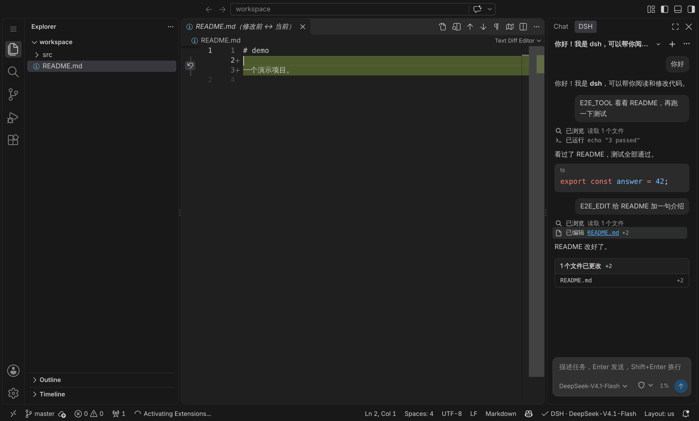

<table>
  <tr>
    <td>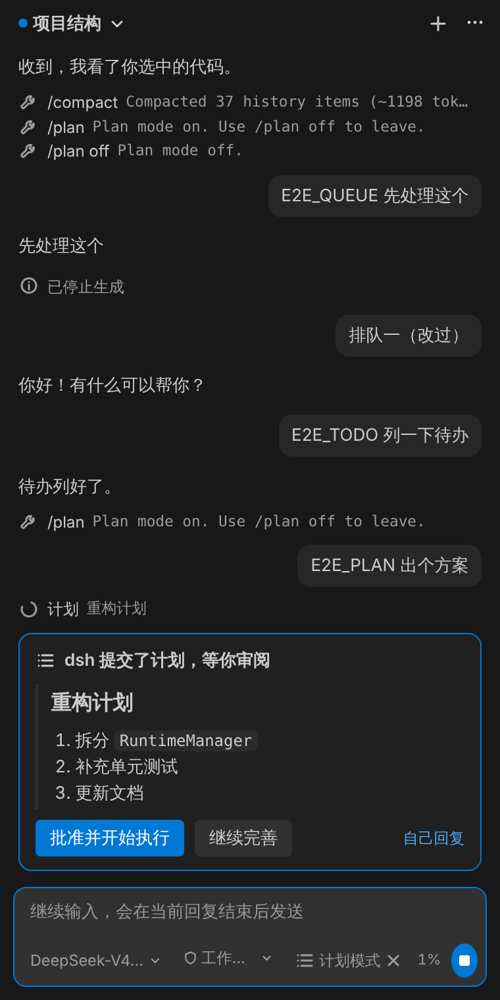</td>
    <td>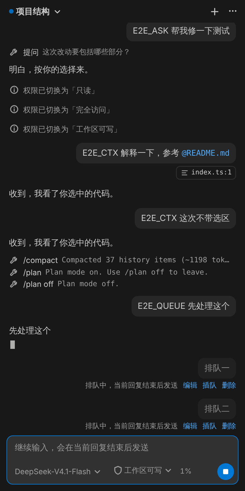</td>
    <td>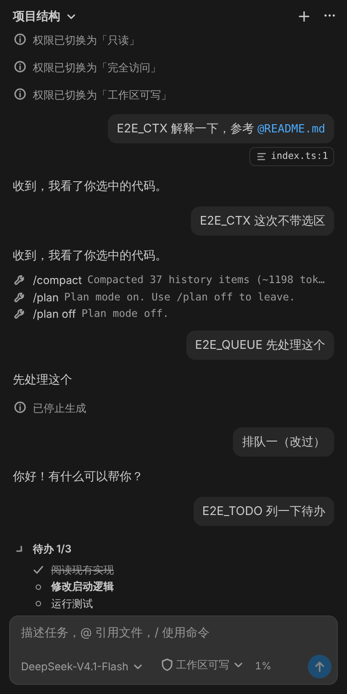</td>
  </tr>
  <tr>
    <td>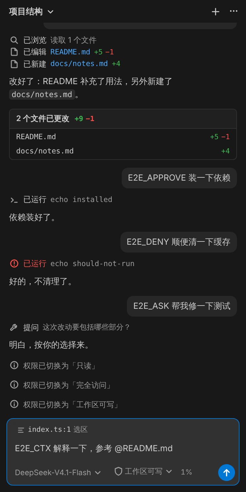</td>
    <td>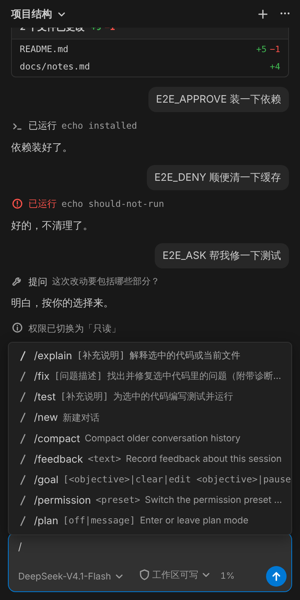</td>
    <td>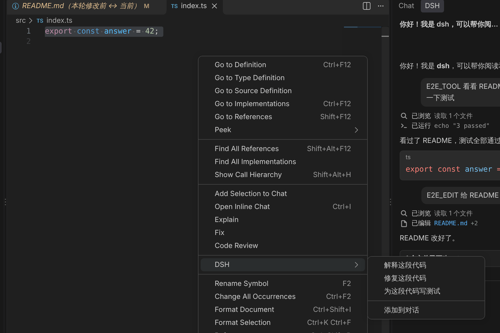</td>
  </tr>
  <tr>
    <td>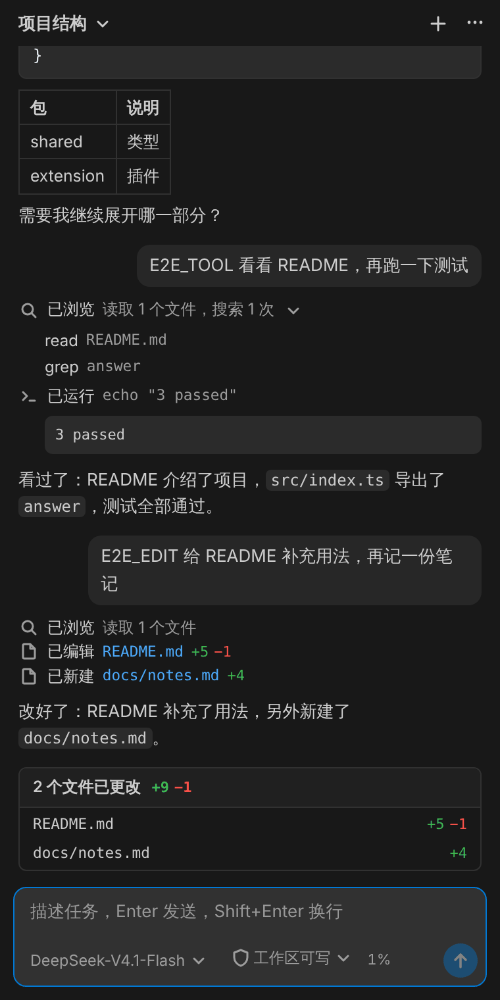</td>
    <td>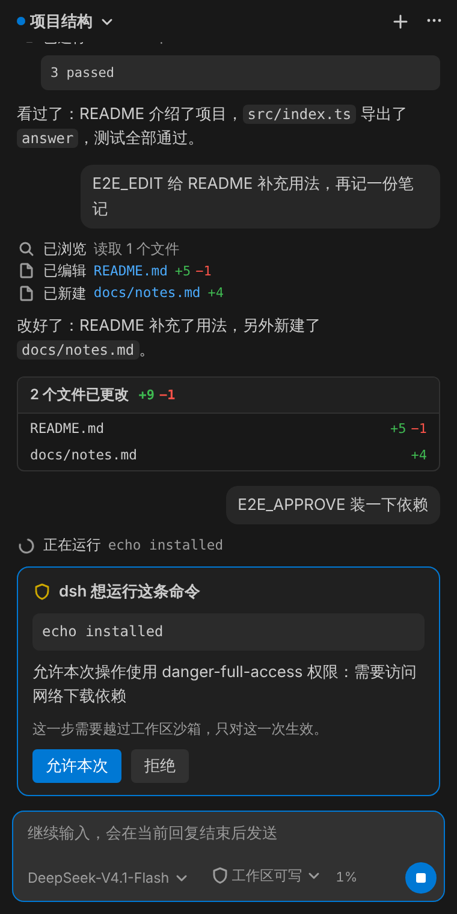</td>
    <td>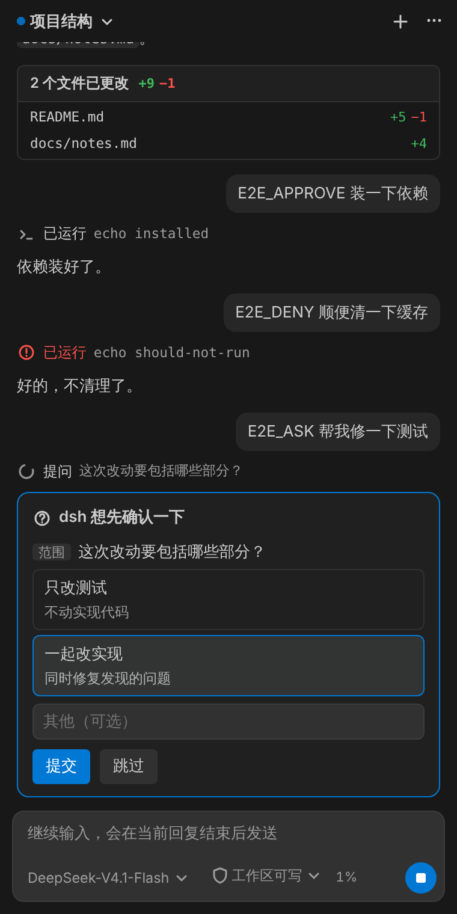</td>
  </tr>
</table>

<table>
  <tr>
    <td>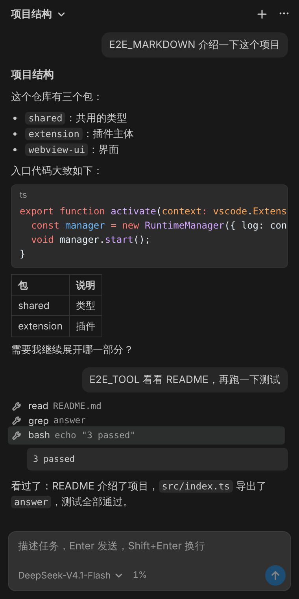</td>
    <td>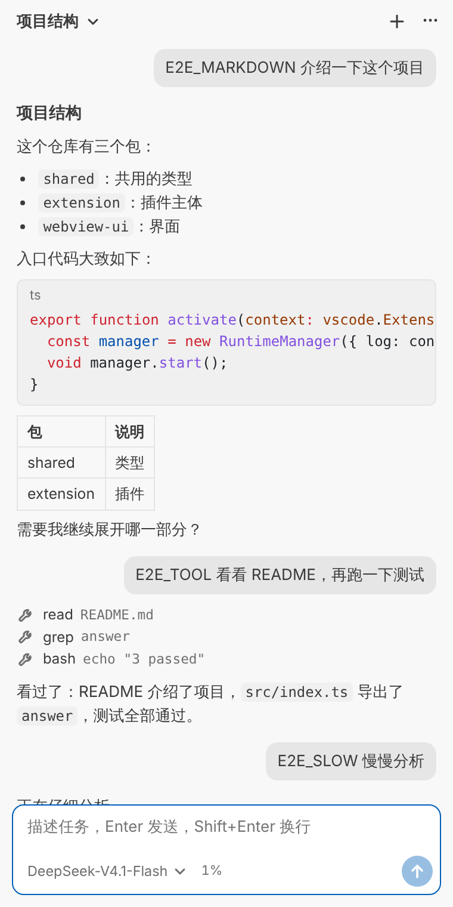</td>
  </tr>
</table>

截图使用本地假模型，内容仅为演示。

## 文档

| 文档 | 内容 |
| --- | --- |
| [docs/DESIGN.md](./docs/DESIGN.md) | 整体方案：对接方式、界面设计原则、架构、模块、运行时管理、安全、工程结构、测试、里程碑 |
| [docs/DSH-INTEGRATION.md](./docs/DSH-INTEGRATION.md) | dsh 调研结果、参考项目分析、启动与认证、线上格式、Remote 方法、会话事件、版本策略、M0–M4 验证结果 |

## 工作方式

```
VS Code 插件（Codex 风格 UI）
    │  HTTP /api + WebSocket /api/remote.mux
    ▼
dsh Host 子进程（dsh --profile web --no-open --host 127.0.0.1 --port 0）
    │  Agent 循环 · 工具 · 沙箱 · 审批 · 会话持久化
    ▼
模型 API（DeepSeek 等）
```

使用前需要能在终端运行 `dsh`（支持 `0.2.1-rc.5` 及以上，已测试到 `0.2.2-alpha.3`）：推荐安装 [DeepSeek Desktop](https://www.deepseek.com/en/download/) 并在它的菜单「管理 dsh 命令…」中安装 `dsh` 命令（自带运行时），也可以 `npm install -g @deepseek-ai/dsh`（需要 Node ≥ 24.9）。第一次使用时插件会引导配置 DeepSeek API Key（保存到 dsh 的凭据存储）。

## 开发

需要 Node ≥ 20.19 和 pnpm 10。

```bash
pnpm install
```

```bash
pnpm typecheck
```

```bash
pnpm test
```

```bash
pnpm build
```

```bash
pnpm package
```

`pnpm package` 产出 `packages/extension/dsh-copilot-<版本>.vsix`。调试时先执行 `pnpm dev`（监听并重新构建），再用 VS Code 打开 `packages/extension` 按 F5 启动扩展开发宿主。

### 用真实 dsh 测试

下面的测试都使用临时 `DSH_HOME` 和本地假模型，不需要 API Key，也不会读取你的会话。本机 Node 低于 24.9 时，用 `--node-bin <Node 24 的 bin 目录>` 指定 dsh 使用的 Node。

冒烟测试（协议客户端，无界面；加 `--record` 重新录制 fixture）：

```bash
pnpm smoke -- --dsh "$(command -v dsh)"
```

界面端到端测试（真实 dsh + 插件的 Host 侧逻辑 + Chromium 中的界面，需要先 `pnpm build`，本机装有 playwright 和 Chromium）：

```bash
pnpm --filter harness-deck e2e -- --dsh "$(command -v dsh)"
```

在真实 VS Code 中验证（需要先 `pnpm package`，并安装 code-server）：

```bash
pnpm --filter harness-deck vscode-e2e -- --code-server "$(command -v code-server)" --dsh "$(command -v dsh)"
```

截图默认保存在仓库根目录的 `.e2e-screenshots/`（已忽略）。

### 目录结构

```
packages/
├── shared/        Host 与 Webview 共用的视图模型和消息类型
├── extension/     VS Code 插件（Extension Host）
│   ├── src/runtime/      定位、版本检查、启动和监控 dsh
│   ├── src/dsh/          dsh 协议客户端、会话事件日志、连接与会话服务（唯一了解 dsh 协议的目录）
│   ├── src/vm/           事件 → 界面条目的投影、对话控制器、Diff 还原（不依赖 vscode）
│   ├── src/webview/      侧边栏视图宿主
│   ├── src/workbench/    打开 Diff、未保存文件、确认框的 vscode 实现
│   ├── scripts/          构建、冒烟测试、界面端到端、真实 VS Code 验证
│   └── test/             单元测试、假模型、录制的 fixture
└── webview-ui/    侧边栏界面（React + Vite）
```

## 与参考项目的关系

社区项目 [HarcoChen/dsh-vsc-integration](https://github.com/HarcoChen/dsh-vsc-integration) 已经验证了这条对接路线。本项目借鉴它的技术做法（运行时发现、令牌处理、从会话日志还原 Diff、未保存保护等），**重新设计对话界面**，并把首版范围收窄到核心体验。详见 [DSH-INTEGRATION.md 第 4 节](./docs/DSH-INTEGRATION.md#4-参考项目分析)和 [DESIGN.md 3.1](./docs/DESIGN.md#31-界面设计原则)。

## 开发计划

| 里程碑 | 内容 | 状态 |
| --- | --- | --- |
| M0 | 技术验证 + 脚手架：协议客户端、运行时管理、假模型、冒烟测试、CI | ✅ |
| M1 | 基础对话界面、follow 完整语义、断线重连、会话切换、模型选择 | ✅ |
| M2 | 工具活动行细化、审批与提问、权限切换、Diff、本轮改动、未保存保护 | ✅ |
| M3 | VS Code 上下文：选区、`@文件`、右键菜单、斜杠命令 | ✅ |
| M4 | 排队消息、计划审阅、状态条、API Key 引导、多根工作区、长会话性能 | ✅ |
| M5 | 中英文界面、多版本兼容 CI、安全与界面自查、用户文档、v0.1.0 | ✅（三平台手工验收待做） |

详见 [DESIGN.md 第 12 节](./docs/DESIGN.md#12-里程碑与任务拆解)。
