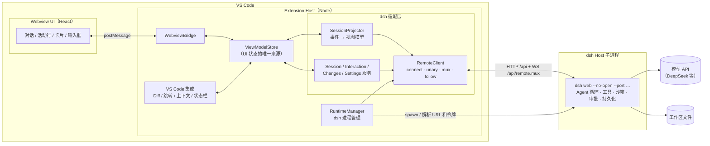
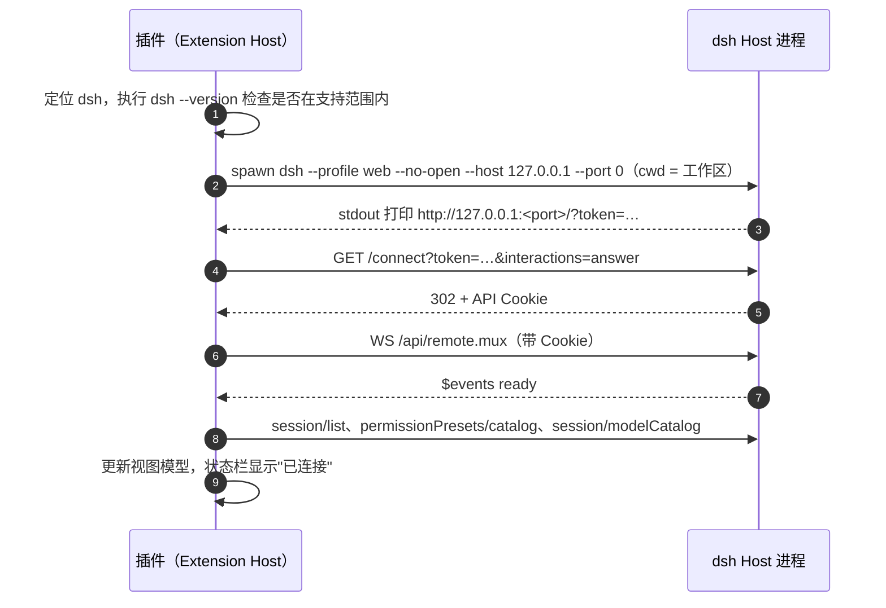
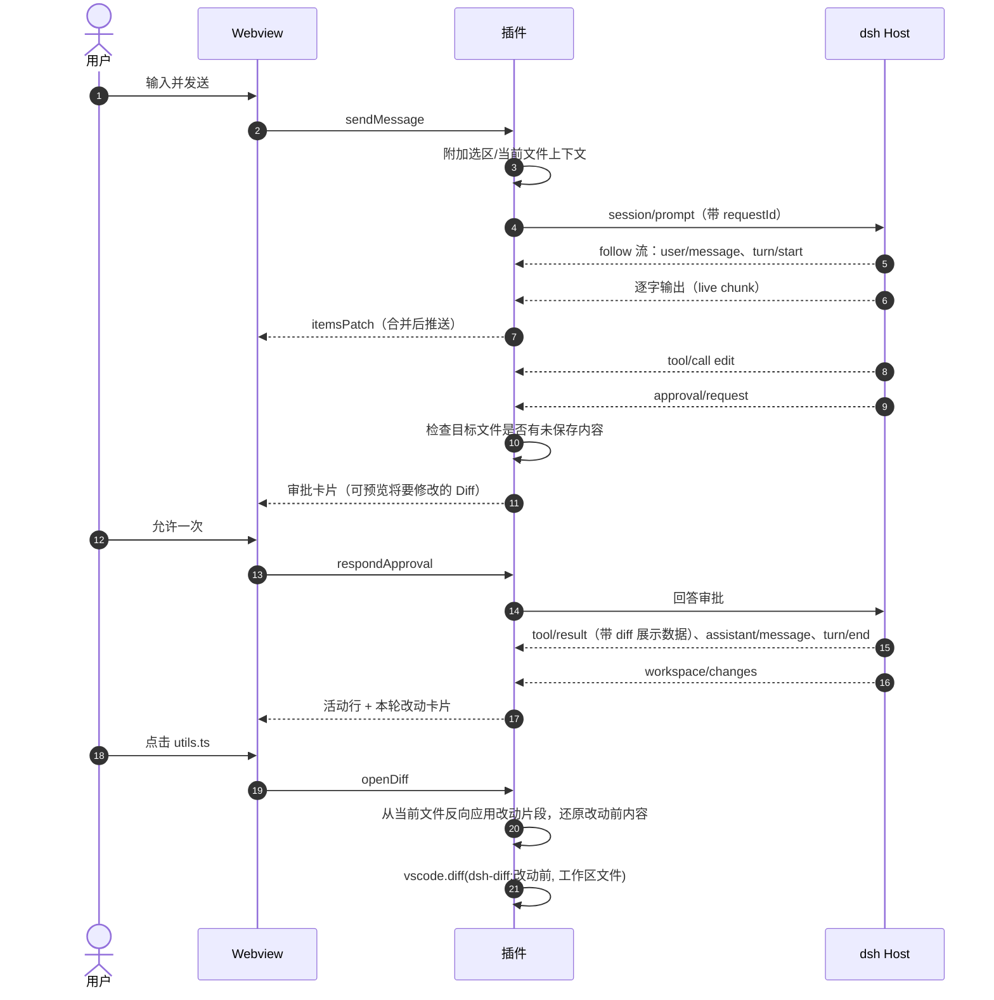

# DSH VS Code 插件整体方案

> 状态：v0.9（多底层：dsh + ACP，插件改名 Harness Deck）｜ 日期：2026-11-07 ｜ 后续开发以本文档为准，变更请同步更新本文档
>
> 相关文档：[dsh 对接说明](./DSH-INTEGRATION.md)（dsh 调研结果、参考项目分析、连接细节、M0 验证清单）

---

## 目录

0. [版本变更](#0-版本变更)
1. [背景与目标](#1-背景与目标)
2. [对接方式结论](#2-对接方式结论)
3. [产品形态](#3-产品形态)
4. [总体架构](#4-总体架构)
5. [模块设计](#5-模块设计)
6. [dsh 运行时管理](#6-dsh-运行时管理)
7. [安全设计](#7-安全设计)
8. [配置项与命令](#8-配置项与命令)
9. [工程结构与技术选型](#9-工程结构与技术选型)
10. [测试策略](#10-测试策略)
11. [构建、发布与 CI](#11-构建发布与-ci)
12. [里程碑与任务拆解](#12-里程碑与任务拆解)
13. [风险与应对](#13-风险与应对)
14. [待确认事项](#14-待确认事项)

---

## 0. 版本变更

| 版本 | 变化 |
| --- | --- |
| v0.1 | 假设 dsh 是一个协议未知的远程服务，插件自己执行工具、做审批、改文件，自定义一套协议 |
| v0.2 | 调研 dsh 源码和参考项目 [HarcoChen/dsh-vsc-integration](https://github.com/HarcoChen/dsh-vsc-integration) 后重写。dsh（DeepSeek Harness）是**完整的开源 Agent 运行时**，插件改为**薄壳**：启动 dsh、连接 dsh、把 dsh 的会话数据转换成 Codex 风格界面，再补上 VS Code 集成。删除自研的工具层、审批引擎、改文件和执行命令模块、本地 Agent 循环、自定义协议（原 `PROTOCOL.md`）。新增界面设计原则（针对参考项目的界面问题） |
| v0.3 | M0 完成：协议客户端在 dsh `0.2.1-rc.5` 和 `0.2.2-alpha.3` 上跑通（[对接说明第 9 节](./DSH-INTEGRATION.md#9-m0-验证结果)）。按实测修正：审批只在请求越过沙箱时触发；权限预设有三个；diff 数据来自 `tool/result.meta`；支持范围定为 `0.2.1-rc.5` 起。确认首版只支持 API Key、不做参考项目的周边功能 |
| v0.4 | M1 完成：基础对话界面、follow 完整结算语义、断线重连、会话切换、模型选择；在真实 VS Code 1.144（code-server）中验证（[对接说明 9.4](./DSH-INTEGRATION.md#94-m1-新发现)）。补充：运行状态以事件日志为准；断线期间保留旧内容；代码高亮不能用内联 style（CSP）；多窗口可并存，同一会话只能一处写 |
| v0.5 | M2 完成：按工具类型渲染活动行、审批与提问卡片、权限预设切换、VS Code Diff、本轮改动卡片、未保存保护（[对接说明第 10 节](./DSH-INTEGRATION.md#10-m2-验证结果)）。调整：审批卡片放在对话流末尾（不插在活动行下方）；还原失败时的片段视图放在编辑器里（只读的统一 diff 文档）而不是 Webview；Host 重启（端口变化）后丢弃改动汇总缓存，卡片退回按文件工具汇总 |
| v0.6 | M3 完成：编辑器上下文（当前文件/选区标签）、`@` 文件引用补全、斜杠命令（插件模板 + dsh 原生命令）、右键菜单（[对接说明第 11 节](./DSH-INTEGRATION.md#11-m3-验证结果)）。确定上下文的线上格式：dsh 的 prompt 没有附件概念，上下文作为 `<ide_context>` 块拼在消息末尾，显示时解析成标签；`@路径` 沿用 dsh 自己的语法。第 5.6、8 节按实现更新 |
| v0.7 | M4 完成：排队消息（dsh 的 `inbox` 队列：编辑、删除、插队、停止后现在发送）、计划审阅卡片、待办和目标状态条、会话重命名、API Key 配置引导、多根工作区选择文件夹、长会话性能（持久事件投影缓存、按对象比较增量、`content-visibility`）（[对接说明第 12 节](./DSH-INTEGRATION.md#12-m4-验证结果)）。会话搜索：dsh 的全文搜索在默认部署里关闭，保留按标题过滤。中英文界面推迟到 M5 |
| **v0.8** | M5 完成：中英文界面、多版本兼容 CI（冒烟 + 界面端到端 + 真实 VS Code）、安全与界面原则自查（结果见 7.1、3.1.1）、用户文档和 CHANGELOG，版本 0.1.0。第 5.6 节的 `locale` 消息、第 8 节的 `dsh.ui.language` 已补上 |
| **v0.9** | 多底层：插件改名 Harness Deck；dsh 成为底层之一，另可接入 ACP（Agent Client Protocol）代理，内置 oh-my-pi 和 CodeBuddy。结构见第 15 节，CodeBuddy 的适配见 15.1；设置从 `dsh.*` 改为 `harnessDeck.*`（第 8 节的旧名自动迁移） |

---

## 1. 背景与目标

dsh 已经包含 Agent 需要的一切：Agent 循环、读写文件、执行命令、沙箱与审批、会话持久化、上下文压缩、模型适配、MCP、skill、子 Agent、计划/目标模式（详见 [dsh 对接说明 1.1](./DSH-INTEGRATION.md#11-dsh-已经负责插件不需要再做的事)）。它自带两个面向人的前端：浏览器 UI（`dsh web`）和 DeepSeek Desktop。

**本插件是 dsh 在 VS Code 里的前端**，界面参考 Codex 的交互方式。社区已有一个同类插件 [dsh-vsc-integration](https://github.com/HarcoChen/dsh-vsc-integration)，它证明了对接路线可行，但界面体验不好（分析见 [3.1](#31-界面设计原则)）。本项目的重点是**把对话体验做好**。

### 1.1 目标

| 编号 | 目标 | 说明 |
| --- | --- | --- |
| G1 | Codex 风格、干净的对话界面 | 信息密度高但不吵：流式回复、紧凑的工具活动行、审批与提问、每轮改动汇总 |
| G2 | 只做 UI 转换 | Agent 能力全部由 dsh 提供，插件不重复实现任何 Agent 逻辑 |
| G3 | VS Code 原生集成 | 选区/当前文件/`@文件` 作为上下文，用 VS Code Diff 编辑器看改动，点击路径跳转，跟随主题 |
| G4 | 开箱即用 | 自动发现 dsh（优先用 DeepSeek Desktop 自带的 `dsh` 命令），管理 dsh 进程 |
| G5 | 能承受 dsh 的变化 | dsh 处于开发者预览阶段；兼容一个版本范围，按能力探测降级，dsh 相关代码集中在适配层 |

### 1.2 首版不做

- 不改写、不替代 dsh 的任何 Agent 行为
- dsh 的高级管理界面：插件管理/市场、定时任务、Agent Team、Agent 预设编辑、运行时终端、完整设置页。首版提供"在浏览器中打开 dsh"入口，直接用 dsh 自带的 Web UI
- 参考项目里的周边功能：Trace 面板、账号余额、Jev/Laya 集成、调试器状态上下文、运行时故障自动恢复。等核心体验稳定后再评估
- 行内补全（Inline Completion）
- 接入 VS Code 原生 Chat 视图（Chat Participant API），见 [D1](#d1-自定义-webview不用-chat-participant-api)

---

## 2. 对接方式结论

dsh 有五个对外入口：`dsh web`、Desktop、`dsh sdk`、`dsh acp`、`dsh headless`。逐一对比后（详见 [dsh 对接说明第 3 节](./DSH-INTEGRATION.md#3-为什么选-web-host-remote-api)），结论是：

**插件在 Extension Host 中启动 `dsh web`，以"API 调用方"身份接入它的 Remote API（HTTP `/api` + WebSocket `/api/remote.mux`）。**

- 这是唯一同时具备**逐字流式、停止生成、会话列表、审批、提问、改动对比**的入口，能力与 dsh Web UI 一致。
- SDK 没有取消方法，也没有逐字流；ACP 官方明确只面向自动化，不做 UI；直接嵌入 dsh Web UI 做不出 Codex 风格，而且在 Webview 里可能过不了 dsh 的 Cookie 认证。
- **参考项目 dsh-vsc-integration 走的就是这条路**（v0.11.1，已上架 VS Code 市场和 Open VSX），可行性已经得到验证。
- 协议客户端**自己写一个精简版**，不在运行时依赖 dsh 的客户端库，见 [D5](#d5-自写精简-remote-客户端兼容一个版本范围)。

---

## 3. 产品形态

### 3.1 界面设计原则

参考项目的功能很全，但对话界面问题明显。下表根据它 README 中的截图整理，右列是本项目的做法：

| 参考项目现状 | 问题 | 本项目做法 |
| --- | --- | --- |
| 每块内容上方都有"dsh / 你 / 工具"标签，右侧都有"trace"链接 | 视觉噪音大，读起来像日志 | 不显示角色标签；用户消息用浅底气泡区分；Trace 等调试信息放进"更多"菜单 |
| 每个工具调用一张大卡片，显示绝对路径和"完成 · 9 ms" | 占空间；长路径折行难读；耗时对用户没用 | 工具调用压成**单行活动行**：图标 + 动作 + 相对路径 + 增删行数；连续的只读操作合并为一行；点击展开详情 |
| 只有工具调用时出现"（无可见回答）"占位；每一步都有一个"思考过程 · 已完成" | 没有意义的重复内容 | 没有正文就不渲染；推理只在进行中显示一行"思考中…"，结束后折叠成一行 |
| 顶部两行：8 个图标的工具栏 + 状态/标题/搜索 | 拥挤，主次不分 | 顶部只有一行：会话标题（点击切换会话）+ 新建 + 更多 |
| 底部依次是 Tab 面板、模型行、输入框、快捷键提示 | 输入区占了将近三分之一高度 | 输入框是一张整宽卡片：上面多行输入，下面一行工具条（附件、权限、模型、上下文用量、发送/停止）；待办、子 Agent 等状态只在有内容时出现在输入框上方，可折叠 |
| 改动在底部"变更"Tab 里 | 和对话脱节 | 每轮结束时，在对话流中显示"本轮改动"卡片 |
| 用户消息画成输入框的样子 | 容易误以为可编辑 | 气泡样式，悬停时显示"复制 / 编辑后重发" |
| `chatView.ts`、`dshRuntime.ts` 各 4000 多行 | 难维护 | 按模块拆分（第 5 节），单文件尽量不超过 500 行 |

通用原则：

- **对话是主角**：除了输入框和一行顶栏，其他界面元素都要"有内容才出现"
- **一屏信息量**：一次典型的"读几个文件 → 改两个文件 → 跑测试"，在侧边栏里一屏能看完
- **路径一律相对**：相对于工作区显示，过长时省略中间部分
- **状态靠图标和颜色**：运行中显示旋转图标，失败显示红色，不写"完成"两个字
- **跟随 VS Code**：只用 `--vscode-*` 主题变量，字体和字号跟随编辑器设置

#### 3.1.1 M5 自查结果

| 原则 | 结果 |
| --- | --- |
| 不显示角色标签，用户消息用气泡 | ✅ |
| 工具调用压成单行活动行，只读操作合并 | ✅ |
| 没有正文不渲染，推理折叠 | ✅ |
| 顶部只有一行 | ✅ |
| 输入框整宽卡片 + 一行工具条，状态只在有内容时出现 | ✅ |
| 本轮改动卡片在对话流中 | ✅ |
| 用户消息悬停时"复制 / 编辑后重发" | 自查时发现没做，M5 补上（编辑后重发 = 放回输入框修改再发送，不分叉会话） |
| 单文件尽量不超过 500 行 | 部分：`ChatController` 从 1106 行拆到约 860 行（拆出 `viewHelpers`、`interactionViews`、`ViewPublisher`），剩下的是会话编排；`projector` 约 580 行。其余文件都在 400 行以内 |
| 路径相对显示，过长时省略中间 | 部分：相对路径 ✅；过长时省略的是末尾（CSS 省略号），没有做中间省略 |
| 状态靠图标和颜色，跟随 VS Code 主题 | ✅（深色、浅色主题都有截图验证） |

### 3.2 界面布局

插件注册到右侧辅助侧边栏（`viewsContainers.secondarySidebar`，参考项目已在用；VS Code 版本要求见 9.2）。也支持"在编辑器中打开"，以全宽面板显示。

```
┌──────────────────────────────────────────┐
│ 修复 parseDate 的时区问题 ▾        [+] [⋯] │  ← 一行顶栏
├──────────────────────────────────────────┤
│              ┌──────────────────────────┐ │
│              │ parseDate 在 UTC+8 下少一 │ │  ← 用户消息气泡
│              │ 天，帮我修一下            │ │
│              │ 📎 utils.ts:12-30        │ │
│              └──────────────────────────┘ │
│ 我先看一下实现和现有测试。                 │  ← 助手回复，逐字流式
│ ◦ 已查看 utils.ts、utils.test.ts，搜索 1 次 │  ← 只读操作合并为一行
│ ✎ utils.ts                        +3 −1  │  ← 文件修改，点击打开 Diff
│ ▸ pnpm test utils                         │  ← 命令（等待批准）
│ ┌──────────────────────────────────────┐ │
│ │ 运行命令需要批准                        │ │  ← 审批卡片
│ │ pnpm test utils   · 目录 ./            │ │
│ │           [拒绝]  [允许一次]            │ │
│ └──────────────────────────────────────┘ │
│ 已修复：用 UTC 解析日期字符串，测试通过。    │
│ ┌ 本轮改动 · 2 个文件 ──────────── 查看全部 ┐ │  ← 轮次末尾的改动汇总
│ │ utils.ts            +3 −1             │ │
│ │ utils.test.ts       +28               │ │
│ └──────────────────────────────────────┘ │
├──────────────────────────────────────────┤
│ ☑ 待办 3/3 · ⏳ 排队 1 条            ▾   │  ← 有内容才出现，可展开
│ ┌──────────────────────────────────────┐ │
│ │ 📎 utils.ts:12-30 ×                  │ │
│ │ 输入问题，@ 引用文件，/ 使用命令        │ │
│ │                                      │ │
│ │ [+] [workspace-write▾] [deepseek-…▾] 12%  (↑) │ │  ← 一行工具条，(↑)=发送，运行中变成停止
│ └──────────────────────────────────────┘ │
└──────────────────────────────────────────┘
```

### 3.3 功能清单

P0 是 MVP 必须有的，P1 是正式版需要的，P2 后续再做。"dsh 能力"一列说明数据从哪来，插件只负责展示和转发。

| 模块 | 功能 | dsh 能力 | 优先级 |
| --- | --- | --- | --- |
| 运行时 | 发现 dsh、启动、重启、退出 Host；找不到时引导安装 | CLI `dsh web --no-open --port …` | P0 |
| 对话 | 逐字流式回复、Markdown、代码高亮、复制 | `session/follow`（live chunk + 持久事件） | P0 |
| 对话 | 停止生成 | `session/cancel` | P0 |
| 对话 | 推理过程（可折叠） | `assistant/message` 中的推理内容 | P1 |
| 对话 | 排队消息：编辑、删除、插队 | `inbox` 投影 + `session/updateQueue` | P1 |
| 会话 | 新建、列表、切换、重命名、搜索 | `session/create` `list` `rename` `search` | P0 |
| 会话 | 从某一轮 fork、归档 | `session/fork`、`workspace/archiveSession` | P2 |
| 工具 | 按工具类型渲染活动行（见 5.3） | `tool/call` + `tool/result` | P0 |
| 交互 | 审批卡片 | `approval/request` 转发事件 | P0 |
| 交互 | 审批前预览将要修改的 Diff | 工具调用参数 | P1 |
| 交互 | 回答 `ask_user_question`（含超时后延迟回答） | user-questions 事件、`userQuestions/answer` | P0 |
| 交互 | 计划审阅（批准/反馈） | plan mode + user-questions | P1 |
| 改动 | 单次工具调用的 Diff（持久，不依赖 git） | `tool/result` 中的 diff 展示数据 | P0 |
| 改动 | 每轮改动汇总（含 shell 造成的改动） | `workspace/changes` | P1 |
| 改动 | 未保存保护：要修改的文件在 VS Code 中有未保存内容时提醒 | — | P0 |
| 上下文 | 自动附带当前文件/选区（可关闭） | 拼进 prompt 内容 | P0 |
| 上下文 | `@文件` 补全与引用 | `fileReferences/list` | P1 |
| 上下文 | `@problems`（VS Code 诊断信息）、git diff、粘贴图片 | prompt 文本 / 图片附件 | P2 |
| 设置 | 模型选择 | `session/modelCatalog` + `session/selectModel` | P0 |
| 设置 | 权限预设切换（`workspace-write` 等） | `permissionPresets/catalog` + 会话投影 | P0 |
| 设置 | 首次使用引导：配置 DeepSeek API Key | `credentials/set` 等，或跳转 dsh Web UI | P1 |
| 斜杠命令 | dsh 原生命令（`/compact` `/plan` `/goal` 等，实时从 dsh 获取） | `commands/list` + `commands/execute` | P1 |
| 斜杠命令 | 插件自带：`/new`、`/explain`、`/fix`、`/test`（转成提示词模板） | — | P1 |
| 其他 | 子 Agent、目标进度、后台任务 | subagents、goals、jobs | P2 |
| 其他 | 在浏览器中打开 dsh Web UI | 启动 URL | P0 |

### 3.4 权限与审批

插件**不定义任何权限规则**，全部沿用 dsh：

- **权限预设**：工具条上的下拉框显示 dsh 返回的预设目录（`permissionPresets/catalog`）。实测有 `read-only`、`workspace-write`（默认）、`danger-full-access` 三个，用户自定义的预设也会出现；当前设置不匹配任何预设时显示 `custom`。
- **切换到 `danger-full-access`**：插件先弹出确认框，再提交给 dsh。
- **什么时候会审批**：在 `workspace-write` 下，工作区内的读写和普通命令不需要审批；只有模型请求越过沙箱（`sandbox_permissions`）时，dsh 才发审批请求。
- **审批卡片**：dsh 的回答只有"允许一次 / 拒绝"（`allowed-once` / `rejected`），卡片显示请求自带的 `displayReason`（有中文），插件只负责展示和回传。
- **未保存保护**：审批一个会写文件的工具时，如果目标文件在 VS Code 里有未保存内容，卡片提示先保存并禁用"允许"，Host 收到允许时也会再检查一次（dsh 直接写磁盘，否则会和编辑器里的内容冲突；参考项目也是这样处理的）。另外，工作区里有未保存文件时，输入框上方显示一行提示和"全部保存"——dsh 读写的都是磁盘上的版本。
- **未受信任的工作区**：插件不启动 dsh，需要用户先信任工作区。

### 3.5 VS Code 集成点

| 集成点 | 做法 |
| --- | --- |
| 视图 | `viewsContainers.secondarySidebar` + `WebviewView`；另提供 `WebviewPanel` 编辑器形态 |
| Diff | `dsh-diff:` 只读虚拟文档提供改动前内容，用 `vscode.diff` 打开，右侧是磁盘上的真实文件（还原方法见 5.4） |
| 跳转 | 回复、活动行、改动列表中的路径可点击，用 `showTextDocument` 打开并定位到行 |
| 文件刷新 | dsh 直接写磁盘，VS Code 的文件监听会自动刷新已打开且没有未保存内容的编辑器 |
| 右键菜单 | `editor/context`：「DSH：问这段代码 / 解释 / 修复」 |
| 状态栏 | dsh 运行状态（启动中/已连接/断开）+ 当前模型，点击打开面板 |
| 快捷键 | 打开并聚焦输入框（默认键位开发时再定，避免冲突） |

---

## 4. 总体架构

### 4.1 架构图



### 4.2 分层

| 层 | 职责 | 依赖规则 |
| --- | --- | --- |
| **UI 层**（Webview） | 只渲染视图模型、收集用户操作 | 只通过 Bridge 消息与 Host 通信，不知道 dsh 的存在 |
| **视图模型层**（ViewModelStore） | 会话列表、当前会话条目、待处理的审批和提问、运行时状态 | 只依赖插件自己定义的视图模型类型 |
| **dsh 适配层** | 协议客户端；把 dsh 事件和 Remote 方法转换为视图模型和操作 | **唯一**了解 dsh 协议和数据结构的层 |
| **运行时层**（RuntimeManager） | 找到 dsh、启动并监控进程、提供 origin 和令牌 | 依赖 `child_process` |
| **VS Code 集成层** | Diff、跳转、上下文收集、命令、状态栏 | 依赖 VS Code API 和视图模型 |

### 4.3 关键设计决策

#### D1. 自定义 Webview，不用 Chat Participant API

Chat Participant（在 Copilot Chat 里 `@dsh`）依赖用户安装 Copilot Chat，界面也受限，做不出审批卡片、改动汇总、排队消息和会话列表。**主界面用自定义 Webview**。参考项目额外注册了一个 Chat Participant 作为轻量入口，以后可以评估是否也加。

#### D2. 接入 Web Host Remote API，不用 SDK 或 ACP

见[第 2 节](#2-对接方式结论)。

#### D3. 协议客户端跑在 Extension Host，不跑在 Webview

- dsh 支持 Node 侧的 API 调用方（`/connect` 接口）
- 避开 Webview 中的跨站 Cookie、Origin 检查和 CSP 限制
- VS Code 集成（Diff、跳转、未保存检查）本来就在 Host 侧
- Webview 刷新或隐藏不影响连接和进行中的轮次

逐字流经过一次 `postMessage` 转发，Host 侧按约 16ms 合并后推送，开销可以忽略。

#### D4. 每个 VS Code 窗口一个 dsh Host 子进程

- 用户第一次打开面板时启动，窗口关闭时退出
- 默认使用 `web` profile（与参考项目一致），模型、API Key、权限预设、已装插件都和用户自己的 `dsh web` 共用；可通过设置改成其他 profile
- 只绑定 `127.0.0.1`，端口由系统分配
- 多窗口共用一个 Host 可以节省资源。参考项目实现了跨编辑器共享（广播文件 + 启动互斥锁），但逻辑复杂，留到后续优化
- 同一个会话不能同时被两个 Host 写（dsh 有会话写锁）。遇到 `session/writer-held` 时提示"该会话正在其他窗口或 dsh 中打开"

#### D5. 自写精简 Remote 客户端，兼容一个版本范围

| | 复用 dsh 官方客户端库 | 自写精简客户端（采用） |
| --- | --- | --- |
| 版本要求 | 必须与运行时**完全同版本** | 支持一个版本范围，按能力探测降级 |
| 和 DeepSeek Desktop 配合 | Desktop 自带的 `dsh` 随 Desktop 自动更新，版本经常对不上 | 无此问题 |
| Extension Host 兼容 | 待验证（全是 ESM，Node 版本要求未知） | 只依赖 `ws`，没有兼容风险 |
| 协议细节 | 官方实现，有测试 | 要自己实现 connect、unary、mux、follow；参考项目已经做到 |
| 升级成本 | 改依赖版本，编译期发现类型变化 | 每个 dsh 版本要核对协议变化（参考项目每个 RC 都写了适配报告） |

**结论**：自写，只实现插件用到的方法；所有入站数据用 zod 校验，不认识的字段忽略，不认识的事件跳过；方法不存在（404 / `-32601`）时隐藏对应功能。官方客户端库作为**实现参考**，特别是 follow 流的结算和缺口修复逻辑，照着它的行为写并补齐测试。dsh 和参考项目都是 MIT 协议，借鉴代码时保留版权声明。

版本策略详见 [dsh 对接说明第 8 节](./DSH-INTEGRATION.md#8-版本策略)。

#### D6. 插件不读写工作区文件、不执行命令

所有文件修改和命令执行都在 dsh 里进行，受 dsh 的沙箱和审批约束。插件只**展示** dsh 记录的改动，用 VS Code Diff 编辑器呈现。读取磁盘上的当前文件内容只用于还原 Diff，不做任何写入。这样插件就不会绕开 dsh 的安全边界。

#### D7. Extension Host 持有视图状态，Webview 只渲染

- Webview 刷新或重新显示时，发 `ready` 拿一次完整快照，之后只接收增量
- 不开启 `retainContextWhenHidden`，降低内存占用
- 输入框草稿和问答卡片里没提交的选择保存在 Webview 的 `setState` 中，Host 推送状态时不覆盖它们

#### D8. dsh 相关代码集中在适配层

dsh 的协议和数据结构只出现在 `packages/extension/src/dsh/` 目录下。视图模型由插件自己定义，不直接暴露 dsh 的事件结构。dsh 出现破坏性变更时，只需要改这一层。

### 4.4 时序

**启动与连接**



**一轮对话**



---

## 5. 模块设计

### 5.1 Extension Host 模块

已实现的模块（M1）：

| 模块 | 职责 |
| --- | --- |
| `extension.ts` | 组装：`RuntimeManager` → `DshConnection` → `ChatController` ↔ `ChatViewProvider`；注册命令、状态栏 |
| `runtime/RuntimeManager` | 定位 dsh、版本检查、启动、就绪检测、崩溃重启（稳定运行 60 秒后才清零失败计数）、退出（见第 6 节） |
| `runtime/launch`、`locate`、`version` | 启动参数与就绪 URL 解析、PATH 查找、SemVer 比较 |
| `dsh/remote/connect`、`unary`、`mux`、`events` | `/connect` 握手、`POST /api` 一元调用、`/api/remote.mux` 多路复用流、`$events` 转发事件（emit / waterfall 回答） |
| `dsh/remote/follow` | follow 帧的 zod schema（宽松解析，保留未知字段）和流片段合并 |
| `dsh/session/journal` | 单个会话的事件日志：按官方语义结算逐字流（暂存到 `end` 帧再发布）、序号/revision/下标检查、历史分页合并 |
| `dsh/session/SessionStream` | 单个会话的 follow 生命周期：要求 rebaseline 时重开（带退避）、加载更早的历史 |
| `dsh/DshConnection` | 连接管理：端点变化换连接、mux 断开后按退避重连、迟到的旧连接丢弃 |
| `dsh/SessionService` | 绑定在一次连接上：工作区注册、会话列表（只列当前目录、非子 Agent、非空白）、`session/control` 投影、发送/停止/选择模型、本地回显 |
| `dsh/DshClient` | 组合上面的协议模块，提供插件用到的方法；`session/page` 与 `session/events`、两种 control 帧格式的兼容在这里处理 |
| `vm/projector` | 事件 → 界面条目（纯函数，见 5.2、5.3） |
| `vm/ChatController` | 对话面板的控制器：会话切换、新对话延迟创建、断线期间保留旧内容、按 id 计算增量、错误翻译成提示；审批/提问卡片、权限、改动汇总的读取与缓存、打开 Diff |
| `dsh/InteractionService`（M2） | 审批（`approval/request`）和提问（`user-questions/request`）waterfall：挂起等用户答复后回传；dsh 取消时撤掉；看不懂的请求交给下一个回答方（`next`） |
| `vm/diffs`（M2） | 纯函数：增删行数、从当前文件反向应用工具片段或 hunk 还原改动前内容、审批前预览、兜底的统一 diff |
| `vm/workbench`（M2） | 控制器需要的编辑器能力接口（打开 Diff、未保存文件、确认框），控制器因此不依赖 vscode |
| `workbench/VscodeWorkbench`（M2） | 上述接口的 vscode 实现：`dsh-diff:` 内容提供方、`vscode.diff`、未保存文件跟踪、模态确认；M3 加上当前编辑器与选区（含诊断信息）、`@` 补全的文件搜索 |
| `vm/context`（M3） | 纯函数：上下文块的拼接与解析、斜杠命令解析、插件模板 |
| `webview/ChatViewProvider` | `WebviewViewProvider`：生成带 CSP 的 HTML，校验并转发 Bridge 消息 |
| `util/redact` | 令牌和认证 Cookie 脱敏 |

后续里程碑要加的模块：

| 模块 | 职责 | 里程碑 |
| --- | --- | --- |

M1 中确定的几条规则：

- **运行状态**：当前会话的 follow 流就绪后，只看事件日志里的 `turn/start` / `turn/end`；会话列表里的 `running` 靠通知触发刷新，会滞后，只在 follow 就绪前使用。
- **新对话**：第一条消息发送时才在 dsh 里创建会话，避免每次打开面板都留下空会话。
- **断线重连**：连接断开时只停止旧会话服务和 follow 的 I/O，继续显示旧内容；新连接初始化完成、follow 拿到快照后再替换。
- **恢复上次的会话**：每个工作区记住上次打开的会话（`workspaceState`）；只校验恢复时的那个会话是否还存在，初始化期间新建的会话不参与校验。

M2 中确定的几条规则：

- **审批详情**：waterfall 请求只带 `toolName`、`callId` 和原因；要执行的命令、要改的文件从会话日志里同一 `callId` 的 `tool/call` 参数里取。原因优先用 `displayReason.zh`。
- **卡片位置**：审批和提问卡片显示在对话流末尾；有卡片时不显示"思考中"；其他会话有待处理请求时，会话列表里标记。
- **回答只回传一次**：卡片按钮点击后立即禁用；dsh 已经取消或别处已回答的请求，再回答只提示"已经结束"。断线时挂起的请求全部作废，由 dsh 在新连接上重新转发。
- **权限**：新对话选择的预设在创建会话时用 `/permission <预设>` 应用；切换到 `danger-full-access` 先由 VS Code 弹模态确认框。
- **改动汇总**：每个 `workspace/changes` 事件读一次 `/api/changes.summary`，结果按 `会话:seq` 缓存；没读到前不显示卡片（避免先显示一份再变）。Host 重启后（origin 变化）清掉缓存重新读取，404 时卡片退回按本轮文件工具汇总，Diff 改用会话日志里的片段。

M3 中确定的几条规则：

- **上下文的线上格式**：dsh 的 prompt 只有文本和图片，没有附件。插件把上下文拼成消息末尾的 `<ide_context>` 块（说明是参考数据、不是指令）：当前文件只给路径（`<active-file path="…" />`，模型需要时自己读，与 `@` 引用一致）；选区带路径、行号、语言和代码（单个选区最多 2 万字，整块 6 万字）；`/fix` 另外附带与选区重叠的错误和警告（`<diagnostics>`）。显示时把这个块从正文里去掉，解析成附件标签；历史消息也一样。
- **当前编辑器标签**：输入框上方显示当前文件或选区，默认附带（设置 `dsh.context.includeActiveEditor`），点击切换本条是否附带，换了文件或选区恢复默认。只算磁盘上的文件（`file:` scheme）。
- **`@` 引用**：语法与 dsh 一致（`@path`、`@"带空格的路径"`、目录以 `/` 结尾）。有会话时候选来自 `fileReferences/list`（与 dsh 的排除规则一致）；新对话还没有会话，用 VS Code 的文件搜索（只有文件）。光标停在一个完整的引用或命令名后面时不打开补全，Enter 直接发送。
- **斜杠命令**：`/explain`、`/fix`、`/test` 是插件模板，展开成提示词并附带上下文，没有上下文也没写说明时提示；`/new` 新建对话；其余名字在 dsh 的命令目录里的交给 `commands/execute`（新对话先创建会话），不认识的按普通消息发送。dsh 命令目录读一次缓存（各会话相同），`/export` 在 VS Code 里没有意义，不列出。
- **命令在对话里的样子**：dsh 为命令持久化 `command/run` / `command/done`，渲染成一行"/compact  Compacted 3 history items"；`/permission`（多数来自权限菜单）渲染成"权限已切换为「只读」"的提示。
- **右键菜单**：编辑器右键「DSH」子菜单：解释、修复、写测试（带上选区立即发送）、添加到对话（固定为标签，下一条消息附带，发送后清空）。命令先同步取下选区，再切换焦点到对话视图。

M4 中确定的几条规则：

- **排队消息以 dsh 的队列为准**：运行中发送的消息进入 dsh 的 `inbox`（`next-turn` 等当前回复结束，`next-step` 是插队后在下一步送达），从 `inbox` 投影显示，所以别的窗口发的也能看到。进入队列后撤掉本地回显，否则从队列删除的消息会以回显的形式冒出来。编辑只改正文，原消息末尾的上下文块原样保留。
- **停止生成后的队列**：dsh 取消当前轮次但保留队列，也不会自己开始新的一轮，要等下一条消息一起送达。这时排队的消息显示"已停止，这条消息还没发出"，提供"现在发送"（从队列取出，作为新消息发送）。
- **计划审阅**：`exit_plan_mode` 通过提问通道请求审阅，问题带 `intent: { kind: 'plan-review' }`，计划 Markdown 在 `detail` 里。卡片显示计划，"批准并开始执行"回答批准选项；"继续完善"回答另一个选项并附上反馈（`custom`）；"自己回复"取消提问，dsh 结束本轮。计划工具那一行显示审阅结果，"继续完善"不算失败。
- **状态条**：`todos` 投影（`todo_write` 的最新列表）和 `goal` 投影显示在输入框上方；`todo_write` 不在对话流里出现。
- **API Key**：模型目录为空（DeepSeek 官方服务没有 Key 时不列模型）时空状态显示配置引导；轮次以 `MISSING_CREDENTIAL` 结束时提示里有"配置 API Key"。Key 用 VS Code 的密码输入框输入，不经过 Webview，通过 `credentials/set` 存到 dsh 的凭据存储，立即生效。凭据名取 `MISSING_CREDENTIAL` 消息里 dsh 给出的名字（用户可能配置了别的 `apiKeyEnv`），默认 `DEEPSEEK_API_KEY`。
- **多根工作区**：默认第一个文件夹；「DSH：选择对话对应的文件夹」切换后会话列表、新建会话、路径显示都换到那个文件夹，每个文件夹记住自己上次打开的会话。
- **长会话性能**：持久事件的投影按 journal 的事件数组缓存，流式输出时只重算末尾（6400 个事件的会话：每次重算 13 ms，流式输出时 0.02 ms）；推送增量时同一个对象不再序列化比较；增删行数按片段对象缓存；Webview 里屏幕外的条目用 `content-visibility: auto` 跳过布局和绘制。

### 5.2 会话事件 → 界面条目

事件说明见 [dsh 对接说明第 7 节](./DSH-INTEGRATION.md#7-会话事件模型)：

| dsh 事件 / 状态 | 界面条目 |
| --- | --- |
| `user/message` | 用户消息气泡：末尾的上下文块解析成附件标签，`@路径` 显示成可点击的引用 |
| `command/run` + `command/done` | 斜杠命令一行（`/permission` 是一行提示） |
| live chunk（follow 流中的客户端条目） | 正在生成的回复，逐字追加 |
| `assistant/message` | 完整回复，替换对应的流式条目；推理内容折叠成一行；正文为空时不渲染；被中断时标注"已停止" |
| `assistant/attempt` | 失败/重试时显示一行提示 |
| `tool/call` + `tool/result` | 活动行，按工具名渲染（见 5.3）；结果到达前显示旋转图标 |
| `tool/result.error` | 活动行标红，展开后显示错误信息 |
| `turn/start` / `turn/end` | 控制"发送/停止"按钮；`turn/end` 原因为中断或错误时显示一行提示 |
| `approval/request` | 审批卡片，显示在对话流末尾 |
| user-questions 事件 / 投影 | 问答卡片（单选/多选/自由输入，按 dsh 给出的选项） |
| 计划审阅（提问带 `intent: plan-review`） | 计划审阅卡片（批准 / 继续完善并反馈 / 自己回复） |
| `workspace/changes` | 本轮改动汇总卡片，放在本轮末尾 |
| `inbox` 投影 | 对话末尾的排队消息（可编辑、删除、插队） |
| `todos` / `goal` 投影 | 输入框上方的状态条 |
| `system/message`、`developer/message`、`request/*` | 不展示 |
| 未知事件类型 | 不展示，写调试日志 |

### 5.3 工具 → 活动行

工具名来自 dsh 的工具目录（`docs/tool-catalog.zh.md`）。没有专门样式的工具一律用通用活动行（工具名 + 参数摘要，展开看结果）。

| dsh 工具 | 活动行 | 展开后 |
| --- | --- | --- |
| `read` `read_image` `glob` `grep` `ls` | 连续多个合并为一行："已浏览 读取 2 个文件，搜索 1 次"（中间出现正文、命令等时断开） | 每个操作的工具名和路径或搜索词 |
| `edit` `write` `apply_patch` | "已编辑 utils.ts +3 −1" / "已新建 notes.md +4"，点击打开 Diff | 失败时显示错误 |
| `bash` `pwsh` | "已运行 pnpm test utils"，失败时标红 | 输出（截断到 4000 字） |
| `terminal_*` `job_*` | "终端：dev server · 运行中" | 状态和最近输出 |
| `todo_write` | 不在对话流里出现，更新输入框上方的待办状态条 | — |
| `subagent` | "子任务：分析依赖 · 运行中/完成" | 任务描述和结果摘要 |
| `web_search` `web_fetch` | "搜索网页：xxx" / "读取网页：域名" | 结果列表 |
| `ask_user_question` | 等待回答时由问答卡片接管；回答后是一行"提问 改动范围？" | "回答：只改测试" |
| `exit_plan_mode` | 等待审阅时由计划审阅卡片接管；之后是一行"计划 重构计划 已批准 / 继续完善" | — |
| `create_goal` `update_goal` `get_goal` | 更新输入框上方的目标状态 | — |
| `present` | "交付文件：report.md"，点击打开 | — |
| `skill` | "使用 skill：xxx" | — |
| MCP 工具及其他 | "工具名 · 参数摘要" | 参数和结果 |

### 5.4 改动与 Diff

改动数据有两个来源，互相补充：

| 来源 | 内容 | 持久性 | 用途 |
| --- | --- | --- | --- |
| **单次工具调用**：`edit`/`write` 等工具的 `tool/result.meta` = `{ operation?, path, diffs: [{ oldText, newText }] }`，每个片段带三行上下文；新建文件时 `operation: 'create'`、`diffs` 为空，改动后内容取工具参数里的 `content`（[对接说明 7.3](./DSH-INTEGRATION.md#73-改动数据)） | 这一次调用改了什么 | **写在会话日志里**，Host 重启、重新打开会话都还在；不依赖 git | 活动行的增删行数、点击打开 Diff（P0） |
| **每轮汇总**：`workspace/changes` 事件 + 摘要/对比接口 | 本轮所有改动的文件，包括 shell 命令造成的改动 | **只在 Host 内存中**，Host 重启后失效 | 本轮改动卡片（P1）；失效时退回"按工具调用汇总" |

**还原改动前内容**（VS Code Diff 编辑器需要完整的改动前文件）：

1. 读取磁盘上的当前文件内容
2. 把这一轮（或这一次调用）的改动片段**从后往前**反向应用：找到 `newText`，换回 `oldText`；上下文行用来定位
3. 某个片段在当前内容中找不到或出现多次时，**不猜测**，放弃还原（参考项目的原则："错的 Diff 比没有 Diff 更糟"）
4. 还原失败时，在编辑器里打开只读的统一 diff 文档（`dsh-diff:` + `diff` 语言），显示这次的改动片段

**按文件的改动历史还原**（会话改动栏、本轮汇总卡片）：投影时为每个文件记下按时间排列的"步"——有汇总的轮次是 `{ seq, index, 本轮修改它的工具调用, 汇总的增删行数 }`，没有汇总的轮次（汇总不可用、进行中的一轮）只有工具调用。打开某一步的 Diff 时从当前文件开始逐步往回撤：

1. 每一步先用会话日志里的工具片段在本地撤回；撤回前后的增删行数与 dsh 汇总一致时采用（说明这一轮对该文件的改动全部来自文件工具），**不请求 dsh**
2. 对不上（有命令造成的改动）时才读 `/api/changes.diff` 的 hunk 撤回；结果按 `会话:seq:index` 缓存，超时 15 秒
3. 本轮 Diff 的右侧是这一轮结束时的内容（之后没再改过时直接用磁盘文件）；会话 Diff 的右侧是当前文件
4. 任何一步撤不回时退回原来的方式（最后一次修改的 Diff / 统一 diff 片段）

改动汇总同时最多读 2 个（新的轮次先读），避免打开长会话时几十个请求把 dsh 堵住、点开 Diff 要排队。会话改动栏的增删行数是各轮之和（同一处改了几次会重复计算），只统计已加载的历史。

**会话标签**：Host 维护打开的标签（会话 id 或一个新对话），按工作区保存在 `workspaceState`。「+」/`/new` 新开标签（已有空的新对话标签时切过去），会话列表里选中的会话已在标签里时切过去，否则新开。切走的标签把 follow 流留在后台继续跟随（最多 4 个，超出时关掉最早切走的），切回时直接复用；重连时后台流全部关掉，切回时重新打开。标签上的运行状态取会话列表的 `running`，提醒点取等待处理的审批/提问。

**审批前预览**：对 `edit`/`write` 的审批，用工具调用参数和当前文件内容生成"将要写入"的 Diff，审批卡片上提供"预览修改"按钮；`old_string` 找不到或不唯一（且没有 `replace_all`）时不预览。

CRLF 文件先统一成 LF 计算，结果再转回 CRLF。增删行数用 jsdiff 的 `diffLines`，比较前给两边补齐结尾换行，避免把没有换行的最后一行算成修改。

### 5.5 Webview UI

- **技术栈**：React 18 + TypeScript + Vite；状态管理用 zustand；Markdown 用 `react-markdown` + `remark-gfm`；代码高亮用 `shiki`（按需加载语言）
- **样式**：只用 VS Code 主题 CSS 变量，自动适配亮色、暗色和高对比度主题；遵循 [3.1](#31-界面设计原则) 的原则
- **主要组件**：
  - `Header`：会话标题（下拉切换会话、搜索）、新建、更多菜单
  - `ThreadView`：条目列表，长会话用虚拟列表，滚动到顶部时加载更早的历史
  - `UserBubble`、`AssistantMessage`、`ReasoningLine`
  - `ActivityRow` 及各工具专用渲染（见 5.3）
  - `ApprovalCard`、`QuestionCard`、`PlanReviewCard`
  - `TurnChangesCard`：本轮改动
  - `StatusStrip`：输入框上方的待办、排队、子任务、目标，有内容才出现
  - `Composer`：输入框、附件标签、`@` 补全、`/` 命令、工具条（权限、模型、上下文用量、发送/停止）
  - `RuntimeBanner`：dsh 未安装、版本不支持、启动中、断线重连、未配置 API Key 等状态
- **无障碍**：全部操作可用键盘完成，卡片有 ARIA 标签
- **国际化**：中文、英文两套文案，跟随 VS Code 显示语言

### 5.6 Host ↔ Webview 消息协议

统一格式：

```ts
interface BridgeMessage<T extends string = string, P = unknown> {
  type: T;
  payload: P;
  requestId?: string; // 需要响应时带上
}
```

**Webview → Host**

| type | 说明 |
| --- | --- |
| `ready` | Webview 加载完成，请求快照 |
| `sendMessage` | `{ text, includeActive? }`；以 `/` 开头时由 Host 判断是不是斜杠命令 |
| `interrupt` / `newSession` / `switchSession` / `loadOlder` | 停止、会话管理、加载更早的历史 |
| `selectModel` / `selectPermission` | 切换模型 / 权限预设 |
| `retryPending` / `discardPending` | 发送失败的消息：重试 / 删除 |
| `respondApproval` / `previewApproval` / `answerQuestion` | 审批、审批预览、回答提问 |
| `openDiff` / `openFile` | 打开改动的 Diff / 打开文件（可带行范围） |
| `searchFiles` | `{ requestId, query }`：`@` 补全 |
| `removeAttachment` | 移除固定的上下文标签 |
| `queueAction` | `{ action: 'edit' \| 'remove' \| 'steer' \| 'send', itemId, text? }`：排队消息 |
| `renameSession` / `configureApiKey` / `selectFolder` | 由 Host 弹出 VS Code 的原生输入框或选择框 |
| `saveAll` / `openExternal` / `openWebUI` / `restartRuntime` / `showLogs` | 其他操作 |

**Host → Webview**

| type | 说明 |
| --- | --- |
| `snapshot` | 完整状态：运行时、连接、会话列表、当前会话、条目、模型、待处理交互、权限、未保存文件数、上下文标签、斜杠命令 |
| `items` | 条目增量（按 id 替换，带顺序；切换会话时整体重置） |
| `runtimeStatus` / `connection` / `sessions` / `session` / `models` | 对应部分变化 |
| `interactions` / `permissions` / `workspace` / `context` / `commands` | 对应部分变化 |
| `fileCandidates` | `{ requestId, items }`：`@` 补全结果，Webview 只用最新一次请求的 |
| `toast` / `focusComposer` | 提示 / 聚焦输入框 |
| `locale` | 界面语言变化（`zh` / `en`），快照里也带 |

消息类型和 zod schema 定义在 `packages/shared`，Host 和 Webview 共用，收到消息先校验再处理。

### 5.7 视图模型

插件自己的类型，不直接使用 dsh 的事件结构：

```ts
interface SessionSummary {
  id: string;            // dsh sessionId
  title: string;
  updatedAt: number;
  running: boolean;
  needsAttention: boolean; // 有待处理的审批或提问
}

interface SessionView {
  id: string;
  items: Item[];
  hasOlder: boolean;
  queue: QueuedMessage[];
  interactions: PendingInteraction[];
  status: { todos?: TodoView; subagents?: SubagentView[]; goal?: GoalView };
  model?: { provider: string; model: string };
  permissionPreset?: string;       // 如 'workspace-write'、'custom'
  running: boolean;
}

type Item =
  | { kind: 'user'; id: string; text: string; attachments: AttachmentView[] }
  | { kind: 'assistant'; id: string; markdown: string; reasoning?: string; streaming: boolean; interrupted?: boolean }
  | { kind: 'activity'; id: string; callIds: string[]; icon: ActivityIcon; label: string; status: 'running' | 'ok' | 'error'; stats?: { additions: number; deletions: number }; detail?: ActivityDetail }
  | { kind: 'turnChanges'; id: string; turn: number; files: ChangedFile[]; source: 'workspace' | 'tools' }
  | { kind: 'notice'; id: string; level: 'info' | 'warning' | 'error'; text: string };

interface ChangedFile {
  path: string;      // 工作区相对路径（工作区外为绝对路径）
  additions?: number;
  deletions?: number;
  flags?: ('binary' | 'oversized')[];
}

type PendingInteraction =
  | { kind: 'approval'; id: string; callId?: string; toolName: string; summary: string; reason?: string; options: { id: string; label: string }[]; previewable: boolean; dirtyFiles: string[] }
  | { kind: 'question'; id: string; questions: QuestionView[]; deadline?: number }
  | { kind: 'planReview'; id: string; planMarkdown: string };
```

---

## 6. dsh 运行时管理

### 6.1 定位 dsh

按顺序查找：

1. 设置项 `dsh.runtime.path` 指定的可执行文件
2. `PATH` 中的 `dsh`：**DeepSeek Desktop 安装的 `dsh` 命令**（推荐，自带运行时，不需要用户装 Node），或 npm 全局安装的 `@deepseek-ai/dsh`
3. 都找不到时，界面引导用户二选一：
   - 安装 DeepSeek Desktop，并在它的菜单「管理 dsh 命令…」里安装 `dsh` 命令
   - `npm install -g @deepseek-ai/dsh`（需要 Node ≥ 24.9）

插件不自己下载 dsh 运行时（参考项目做过托管下载，后来废弃了，改为引导安装 Desktop）。

### 6.2 版本检查

启动前执行 `dsh --version`：

- 在支持范围内：正常启动
- 低于最低版本：提示升级，不启动
- 高于已测试的最高版本：照常启动，状态栏提示"dsh 版本较新，部分功能可能不可用"；靠能力探测决定显示哪些功能

### 6.3 启动

```bash
dsh --profile web --no-open --host 127.0.0.1 --port 0
```

- 端口：`--port 0` 由系统分配，实际端口从就绪 URL 中读取（M0 实测可用）；启动器参数（如 `--patch`）必须放在 `--no-open` 之前
- `cwd` 设为当前工作区文件夹；远程开发时 dsh 运行在远端（插件声明 `"extensionKind": ["workspace"]`）
- 环境变量：继承 VS Code 进程环境；VS Code 配置了 `http.proxy` 时，传 `HTTPS_PROXY` / `HTTP_PROXY`；可通过 `dsh.runtime.env` 追加
- **就绪**：从 stdout 解析带 `?token=` 的 URL 行；60 秒内没出现视为启动失败，显示 stderr 最后几十行
- 子进程放进独立进程组，退出时能连同它的子进程一起结束

### 6.4 运行中

- dsh 进程意外退出：自动重启，指数退避（1s、2s、4s…），连续失败 3 次后停止并提示用户
- 重启后令牌会变：重新 `/connect`，重新打开当前会话的 follow 流；每轮改动汇总失效，回退到按工具调用汇总
- 连接断开但进程还在：按退避策略重连（500ms 起，最长 10s）

### 6.5 退出

- `deactivate` 或用户执行"重启 dsh"：先发 SIGTERM，等待最多 5 秒，再强制结束整个进程组（Windows 下结束进程树）
- 只结束插件自己启动的进程，不碰用户手动运行的 dsh
- 有任务在运行时，面板中提示"关闭窗口会中断正在进行的任务"

---

## 7. 安全设计

dsh 负责沙箱、审批和文件/命令边界，插件负责下面这些：

| 风险 | 措施 |
| --- | --- |
| 启动令牌泄露 | 令牌只保存在内存中；日志、界面、错误信息里统一脱敏（`token=<redacted>`） |
| 端口被其他人访问 | dsh 只绑定 `127.0.0.1`；不提供修改绑定地址的设置项 |
| 不受信任的工作区 | 声明 `capabilities.untrustedWorkspaces: { supported: false }`；未受信任时不启动 dsh |
| 误开最高权限 | 切换到 `danger-full-access` 时插件弹出确认框 |
| 覆盖用户未保存的修改 | 审批写文件前检查未保存内容（[3.4](#34-权限与审批)） |
| Webview 注入 | 严格 CSP：`default-src 'none'`；入口脚本带 nonce，按需加载的高亮语言包只允许插件目录；样式只允许插件目录，**不开 `'unsafe-inline'`**。Markdown 渲染禁用原始 HTML，不用 `innerHTML`（代码高亮用 React 元素渲染，颜色通过 CSSOM 设置，不受 CSP 拦截）；链接由 Host 校验后再用 `vscode.env.openExternal` 打开 |
| 消息伪造 | Host 用 zod 校验 Webview 消息；审批和提问的 ID 一次性有效，过期答复丢弃 |
| 绕过 dsh 安全边界 | 插件本身不写工作区文件、不执行命令（[D6](#d6-插件不读写工作区文件不执行命令)） |
| 数据外发 | 模型请求由 dsh 发出；插件说明哪些上下文会被附加，并允许关闭"自动附带当前文件" |

### 7.1 M5 自查结果

| 项目 | 结果 |
| --- | --- |
| 启动令牌 | ✅ 只在内存里；dsh 的 stdout/stderr、启动失败信息先脱敏再写日志。自查后补充：插件自己的日志也统一脱敏，并增加 `sk-…` API Key 和 `Bearer` 令牌的脱敏规则 |
| 端口 | ✅ 启动参数固定 `--host 127.0.0.1`，没有修改绑定地址的设置 |
| 未受信任的工作区 | ✅ `untrustedWorkspaces.supported: false`，未受信任时不启动（说明文字已本地化） |
| 最高权限 | ✅ 切换到 `danger-full-access` 前 VS Code 模态确认（真实 VS Code 测试覆盖） |
| 未保存内容 | ✅ 审批写文件前检查，卡片和 Host 两处拦截 |
| Webview 注入 | ✅ CSP 没有 `'unsafe-inline'`，端到端测试用生产 CSP 并检查没有违规；Markdown 不渲染原始 HTML，图片不加载；外部链接只放行 http(s)，由 Host 打开 |
| 消息伪造 | ✅ Webview 消息用 zod 校验；审批和提问回答一次后作废，dsh 取消的请求再回答只提示 |
| API Key | ✅ 用 VS Code 的密码输入框，不经过 Webview；只传给 dsh 的 `credentials/set`，不写日志 |
| 插件不写工作区文件、不执行命令 | ✅ 唯一的写操作是用户点击"全部保存"时调用 VS Code 保存 |
| 数据外发 | ✅ 插件只连本机的 dsh；附带的上下文在输入框上方可见，可逐条关闭，设置可整体关闭 |

---

## 8. 配置项与命令

模型、API Key、默认权限预设等**都保存在 dsh 中**（与 dsh Web UI、Desktop 共用），不在 VS Code 设置里重复一份。

### 8.1 配置项（`dsh.*`）

| 配置 | 类型 / 默认值 | 说明 |
| --- | --- | --- |
| `dsh.runtime.path` | string / `""` | 指定 dsh 可执行文件；为空时在 `PATH` 中查找（`machine-overridable`，远程场景写在远端的 Machine 设置里） |
| `dsh.runtime.profile` | string / `"web"` | 启动用的 dsh profile |
| `dsh.context.includeActiveEditor` | boolean / `true` | 发送时默认附带当前编辑器：有选区时附带代码和行号，否则只附带路径 |
| `dsh.ui.language` | `auto` / `zh` / `en`，默认 `auto` | 界面语言；`auto` 跟随 VS Code 的显示语言 |
| `dsh.ui.fontSize` | number / `0` | 对话面板字号（px）；`0` 跟随 VS Code，比工作台字号大 1px |
| `dsh.ui.fontFamily` / `dsh.ui.codeFontFamily` | string / `""` | 对话面板字体 / 代码与路径的字体；为空时跟随 VS Code。通过 `appearance` 消息下发，Webview 设置成 CSS 变量 |

计划中：`dsh.runtime.env`（追加环境变量）、`dsh.ui.showReasoning`、`dsh.log.level`。

### 8.2 命令

| 命令 ID | 标题 | 入口 |
| --- | --- | --- |
| `dsh.openChat` | DSH：打开对话 | 命令面板、状态栏 |
| `dsh.newSession` | DSH：新建对话 | 命令面板 |
| `dsh.explainSelection` | DSH：解释这段代码 | 命令面板、编辑器右键「DSH」 |
| `dsh.fixSelection` | DSH：修复这段代码 | 命令面板、编辑器右键「DSH」 |
| `dsh.testSelection` | DSH：为这段代码写测试 | 命令面板、编辑器右键「DSH」 |
| `dsh.addToChat` | DSH：添加到对话 | 命令面板、编辑器右键「DSH」 |
| `dsh.renameSession` | DSH：重命名会话 | 命令面板、更多菜单 |
| `dsh.configureApiKey` | DSH：配置 API Key | 命令面板、更多菜单、空状态、缺少 Key 的提示 |
| `dsh.selectFolder` | DSH：选择对话对应的文件夹 | 命令面板（多根工作区）、更多菜单 |
| `dsh.interrupt` | DSH：停止生成 | 命令面板 |
| `dsh.selectModel` | DSH：切换模型 | 命令面板 |
| `dsh.openWebUI` | DSH：在浏览器中打开 dsh | 命令面板、更多菜单 |
| `dsh.restartRuntime` | DSH：重启 dsh | 命令面板、状态提示 |
| `dsh.showLogs` | DSH：查看日志 | 命令面板、更多菜单 |

计划中：在编辑器中打开对话。

---

## 9. 工程结构与技术选型

### 9.1 目录结构

pnpm workspace 管理多包：

```
dsh-vscode-copilot/
├── package.json                 # workspace 根：build、test、typecheck、smoke、package、dev
├── pnpm-workspace.yaml
├── tsconfig.base.json
├── vitest.config.ts
├── docs/
│   ├── DESIGN.md                # 本文档
│   ├── DSH-INTEGRATION.md       # dsh 对接说明
│   └── images/                  # 界面截图
├── packages/
│   ├── shared/                  # 视图模型类型、Bridge 消息与校验（Host 和 Webview 共用）
│   ├── extension/               # VS Code 插件主体（Extension Host）
│   │   ├── package.json         # 插件清单：contributes 等
│   │   ├── src/
│   │   │   ├── extension.ts
│   │   │   ├── runtime/         # RuntimeManager、启动、定位、版本
│   │   │   ├── dsh/             # dsh 适配层（唯一了解 dsh 协议的目录）
│   │   │   │   ├── remote/              # connect、unary、mux、events、follow schema
│   │   │   │   ├── session/             # journal（事件日志与结算）、SessionStream
│   │   │   │   ├── DshClient.ts
│   │   │   │   ├── DshConnection.ts
│   │   │   │   ├── InteractionService.ts  # 审批、提问
│   │   │   │   └── SessionService.ts
│   │   │   ├── vm/              # projector（事件 → 条目）、ChatController、diffs（Diff 还原）、workbench（编辑器能力接口）
│   │   │   ├── webview/         # ChatViewProvider（HTML/CSP、消息校验）
│   │   │   ├── workbench/       # VscodeWorkbench：dsh-diff: 文档、vscode.diff、未保存文件、确认框
│   │   │   └── util/            # 脱敏
│   │   ├── scripts/             # 构建、冒烟测试、界面端到端、真实 VS Code 验证
│   │   ├── media/
│   │   └── test/
│   │       ├── fixtures/m0/     # 从真实 dsh 录制的 follow 帧
│   │       ├── mock-model/      # 本地假模型服务
│   │       └── support/         # 隔离的 dsh 测试环境
│   └── webview-ui/              # React + Vite，构建产物输出到 extension/dist/webview
│       └── src/
│           ├── components/      # Header、Thread、Items、Composer、Markdown、CodeBlock 等
│           ├── store.ts         # Host 快照与增量的合并
│           └── styles.css
└── .github/workflows/
    ├── ci.yml
    └── dsh-compat.yml           # 定时用多个 dsh 版本跑冒烟测试
```

### 9.2 技术选型

| 方面 | 选择 | 理由 |
| --- | --- | --- |
| 语言 | TypeScript（strict） | VS Code 插件生态标准，和 dsh 同语言 |
| 包管理 | pnpm workspace | 多包共享类型 |
| 插件打包 | esbuild（CJS，`vscode` 设为 external） | 快，产物单文件 |
| Webview 构建 | Vite | 开发时热更新，生产构建体积小 |
| UI | React 18，状态用 `useSyncExternalStore` | 状态由 Host 推送，Webview 只做按 id 的增量合并，不需要状态库 |
| Markdown / 高亮 | react-markdown + remark-gfm + shiki（JS 正则引擎，语言包按需加载，输出 token 由 React 渲染） | 与 VS Code 高亮效果一致；不用 innerHTML，不受 CSP 的内联样式限制 |
| dsh 协议 | 自写精简客户端 + `ws` | 见 [D5](#d5-自写精简-remote-客户端兼容一个版本范围) |
| 数据校验 | zod | dsh 入站数据和 Bridge 消息都校验 |
| 单元测试 | vitest | — |
| 集成测试 | `@vscode/test-cli` + `@vscode/test-electron` | 官方方案 |
| 代码规范 | ESLint + Prettier | — |
| 发布 | `@vscode/vsce` | 产出 `.vsix` |
| VS Code 版本 | `engines.vscode: ^1.106.0` | 参考项目同版本，已支持 `secondarySidebar`；M1 在 VS Code 1.144（code-server 4.144）中实测 |

---

## 10. 测试策略

所有用到真实 dsh 的测试都使用临时 `DSH_HOME` 和本地假模型服务（`test/mock-model/`，兼容 Anthropic Messages API，按消息里的标记返回回复和工具调用），不需要真实 API Key，也不读取用户数据（`test/support/dshEnv.ts`）。

| 层级 | 范围 | 做法 | 命令 |
| --- | --- | --- | --- |
| 单元测试 | 协议客户端（connect、unary、mux、事件、两种 control 帧）、journal 结算规则、事件 → 视图模型（含按工具类型渲染、浏览合并、改动卡片及其回退、命令行、附件解析）、上下文块拼接与解析、斜杠命令、工具摘要、连接重连、控制器（增量推送、延迟创建会话、断线保留、初始化竞态、审批/提问/权限/Diff、Host 重启后的改动汇总）、Diff 还原、排队消息与队列操作、计划审阅、状态条、重命名、API Key 配置、切换文件夹、投影缓存与现算一致、版本比较、启动与重启 | vitest；follow 相关的输入用从真实 dsh 录制的帧（fixture） | `pnpm test` |
| 冒烟测试 | 插件的协议客户端对真实 dsh：流式、写/改文件、命令、审批允许/拒绝、提问、停止、能力探测 | 无界面 | `pnpm smoke` |
| 界面端到端 | Host 侧全部真实（RuntimeManager、DshConnection、ChatController），界面在 Chromium 中加载构建产物，CSP 与生产一致；覆盖流式渲染、代码高亮、浏览合并与命令行、文件修改与 Diff 还原（对照磁盘上的真实文件）、本轮改动卡片、审批允许/拒绝、提问、权限切换、未保存提示、停止、新对话与切换、Webview 重载、选区标签与 `@` 补全（检查 dsh 实际发给模型的文本）、`/` 命令（`/compact`、`/plan`）、固定标签、排队消息（编辑、删除、插队、停止后现在发送）、待办状态条、计划审阅（继续完善 → 批准）、重命名、不带 API Key 启动后从提示配置并直接对话、杀掉 dsh 后自动恢复（含重启后打开历史 Diff）、浅色主题 | Playwright（用本机安装的版本），每步截图 | `pnpm --filter harness-deck e2e` |
| 真实 VS Code | 在 code-server 中安装打包好的 vsix：命令面板打开视图、对话、工具活动行、CSP 下的高亮、状态栏、点击修改行和改动卡片打开 Diff 编辑器、切换到完全访问时的模态确认、编辑器右键「DSH → 解释这段代码」（检查 dsh 收到的路径、行号和代码）、命令面板切换模型 | Playwright 驱动 code-server | `pnpm --filter harness-deck vscode-e2e` |
| 兼容测试 | 用最低支持版本、`latest`、`alpha` 三个 dsh 版本跑冒烟测试 | GitHub Actions 定时任务 | `.github/workflows/dsh-compat.yml` |
| 手工验收 | 每个里程碑的验收项（见第 12 节） | Windows / macOS / Linux + Remote-SSH | — |

`@vscode/test-electron` 需要从 `update.code.visualstudio.com` 下载 VS Code，M1 的开发环境访问不了，所以用 code-server 代替；能访问时可以补上基于 `@vscode/test-cli` 的集成测试。

fixture 录制方法：用真实 dsh 跑典型场景（纯问答、改文件、跑命令、审批、提问、计划模式、子 Agent、中途停止），通过 `session/page` 导出事件，存到 `packages/extension/test/fixtures/`。dsh 升级时重新录制并比较差异。

---

## 11. 构建、发布与 CI

- **本地开发**：`pnpm dev` 同时启动 esbuild watch 和 Vite watch；用 VS Code 打开 `packages/extension` 按 F5 启动扩展开发宿主。本机需要能运行 `dsh` 并配置好 API Key（或使用假模型服务）
- **打包**：`pnpm package` → 构建 webview-ui → 构建 extension → `vsce package --no-dependencies`（依赖已由 esbuild 打进产物）
- **不打包 dsh 运行时**：由 6.1 的方式获取
- **CI**（GitHub Actions）：
  - PR：lint、类型检查、单元测试、集成测试（Linux 下用 xvfb）、打包
  - 定时：多版本 dsh 兼容测试
  - 打 tag：产出 `.vsix` 上传到 Release
- **版本**：插件自己用语义化版本；`CHANGELOG.md` 写明每个版本支持的 dsh 版本范围

---

## 12. 里程碑与任务拆解

工期按 1 名全职开发估算，仅供参考。

### M0：技术验证 + 脚手架（已完成）

- [x] 工程脚手架：pnpm workspace、侧边栏 Webview（显示运行时状态）、CI（类型检查、单测、构建、打包）
- [x] 协议客户端骨架：启动 `dsh web`、解析 URL → `/connect` → unary 调用 → mux 连接 → `$events`
- [x] 跑通：列出会话、新建会话、发 prompt、收到逐字流、停止
- [x] 本地假模型服务驱动 dsh 跑完带工具调用的对话：写文件、改文件、命令、审批（允许/拒绝）、提问
- [x] 确认方法名和数据结构，结果见 [dsh 对接说明第 9 节](./DSH-INTEGRATION.md#9-m0-验证结果)
- [x] 支持范围：最低 `0.2.1-rc.5`，已测试到 `0.2.2-alpha.3`

**留给 M1**：follow 流完整结算语义、在真实 VS Code 中加载验证、多窗口并发（[对接说明 9.3](./DSH-INTEGRATION.md#93-留给后续里程碑确认的事项)）。

### M1：运行时 + 基础对话（已完成）

- [x] `RuntimeManager`：定位、版本检查、启动、就绪检测、重启、退出、安装引导（找不到 dsh 时面板内提示安装方式）
- [x] follow 流：逐字流结算（与官方语义对齐）、序号/revision/下标缺口时重新打开、断线重连、加载更早的历史
- [x] `SessionService`：新建、列表、切换、发送、停止；本地回显
- [x] 视图模型：用户消息、流式回复、完整回复、推理、工具活动行（通用样式）、轮次结束提示
- [x] UI：Header、ThreadView、Composer、RuntimeBanner、Toast、状态栏；按 3.1 原则完成视觉设计
- [x] 模型选择（输入框工具条 + 命令面板）
- [x] 错误提示：缺少 API Key 时给出中文提示和"打开 dsh 设置"入口；会话被其他窗口占用等常见错误翻译成可操作的提示

**验收结果**：界面端到端测试 27/27（dsh `0.2.1-rc.5` 和 `0.2.2-alpha.3`）、真实 VS Code 7/7、冒烟测试 33/33、单元测试 95 个，覆盖流式对话、停止、新对话与切换、Webview 重载、杀掉 dsh 后自动恢复。截图见 `docs/images/`。

**没有做到或推迟的**：

- 长会话的"加载更早的消息"已实现，但测试用的会话都不长，还没在真实长会话上验证（M4 性能工作一并处理）
- 长会话虚拟列表、推送合并以外的性能优化（M4）
- API Key 配置引导目前跳转到 dsh Web UI，插件内配置放在 M4
- 多根工作区固定用第一个文件夹（M3）
- Windows、macOS 和 Remote-SSH 手工验收（M5）

### M2：工具、交互与改动（已完成）

- [x] 活动行：只读合并、文件修改（增删行数、新建标记）、命令、通用；提问工具回答后显示可读的回答
- [x] 审批卡片（命令/文件、中文原因、允许本次/拒绝、预览修改）、问答卡片（单选/多选/自由输入、跳过）
- [x] 权限预设切换（含 `danger-full-access` 模态确认；新对话的选择在创建会话时应用）
- [x] 单次工具调用 Diff：改动前内容还原、`dsh-diff:` 文档、还原失败时的片段视图
- [x] 未保存保护：审批卡片按文件拦截，输入框上方提示并可全部保存
- [x] 本轮改动卡片（`workspace/changes`，Host 重启后回退到按文件工具汇总）

**验收结果**：界面端到端测试 50/50（dsh `0.2.1-rc.5` 和 `0.2.2-alpha.3`）、真实 VS Code 13/13、冒烟测试 33/33、单元测试 133 个。"读代码 → 改两个文件 → 跑命令（需审批）"的流程一屏能看完；Diff 在 VS Code 的 Diff 编辑器里打开，左侧还原的内容与改动前的文件逐字一致；杀掉 dsh 重启后，历史改动的 Diff 仍能打开。截图见 `docs/images/m2-*.png`。

**没有做到或推迟的**：

- 提问的"超时后延迟回答"：rc.5 默认阻塞等待，`userQuestions` 投影一直为空（[对接说明 10.2](./DSH-INTEGRATION.md#102-发现)），没有可以延迟回答的场景，等 dsh 启用非阻塞模式再做
- 计划审阅卡片（M4）
- `apply_patch` 的审批预览：rc.5 的文件工具里没有 `apply_patch`
- 同一轮多次修改同一文件时，回退汇总里的 Diff 只显示最后一次修改

### M3：VS Code 上下文集成（已完成）

- [x] 自动附带当前文件和选区（输入框上方的标签，可逐条关闭；设置项控制默认值）
- [x] `@文件` 补全与引用（dsh 的候选；新对话用 VS Code 文件搜索），消息里的引用可点击
- [x] 右键菜单「DSH」：解释 / 修复（附带诊断信息）/ 写测试 / 添加到对话
- [x] 斜杠命令：dsh 原生命令（`commands/list` + `commands/execute`，结果显示在对话里）+ 插件模板（`/explain`、`/fix`、`/test`、`/new`）
- [x] 计划模式标记（`/plan` 后输入框显示，点击退出）

**验收结果**：在真实 VS Code 中选中代码右键「DSH → 解释这段代码」，dsh 发给模型的消息里有 `<selection path="src/index.ts" lines="1" language="typescript">` 和选中的代码（`scripts/vscode-e2e.ts` 直接检查假模型收到的文本）。界面端到端测试 66/66（dsh `0.2.1-rc.5` 和 `0.2.2-alpha.3`）、真实 VS Code 16/16、冒烟测试 33/33、单元测试 154 个。截图见 `docs/images/m3-*.png`。

**没有做到或推迟的**：

- 多根工作区仍固定用第一个文件夹（M4）
- `@problems`、git diff、粘贴图片（P2）
- 新对话的 `@` 补全只有文件、没有目录（VS Code 的文件搜索不返回目录）；会话创建后与 dsh 一致
- 斜杠命令的参数补全（例如 `/permission` 后列出预设）

### M4：完善（已完成）

- [x] 排队消息（编辑、删除、插队、停止后现在发送）、计划审阅；审批前预览 Diff 已在 M2 完成
- [x] 输入框上方状态条：待办、目标
- [x] 会话重命名；按标题搜索（M1 已有）；加载更早的历史（M1 已有）
- [x] 首次使用引导：检测未配置 API Key，用原生密码输入框配置
- [x] 多根工作区：选择对话对应的文件夹
- [x] 长会话性能：持久事件投影缓存、增量按对象比较、`content-visibility`

**验收结果**：界面端到端测试 87/87（dsh `0.2.1-rc.5` 和 `0.2.2-alpha.3`）、真实 VS Code 16/16、冒烟测试 33/33、单元测试 165 个。截图见 `docs/images/m4-*.png`。

**没有做到或推迟的**：

- 中英文界面（M5）：界面文字较多，放到发布前统一处理
- 子 Agent 状态（P2）：`subagentCatalog` 投影已确认可用，界面没做
- dsh 的会话全文搜索：默认部署关闭（`session-query` 的 `openAt` 为 `never`），`session/search` 返回错误；保留按标题过滤
- 多根工作区切换文件夹只有单元测试，没有在真实 VS Code 里跑
- 没有 API Key 时，空状态的引导写入默认的 `DEEPSEEK_API_KEY`；改过 `apiKeyEnv` 的用户要先发一条消息，从 `MISSING_CREDENTIAL` 的提示里配置（那里带着 dsh 要求的名字）

### M5：稳定性与发布（已完成，除手工验收）

- [x] 中英文界面：跟随 VS Code 显示语言，设置 `dsh.ui.language` 可以覆盖；命令和设置说明用 `package.nls*.json`
- [x] fixture 回归测试（单元测试回放录制的 follow 帧）+ 多版本兼容 CI：`dsh-compat.yml` 每天用最低版本、`latest`、`alpha` 跑冒烟和界面端到端，用 `latest` 跑真实 VS Code（code-server）
- [x] 安全自查（7.1）、界面原则自查（3.1.1），发现的问题已修
- [ ] 三平台 + Remote-SSH 手工验收（需要在 Windows、macOS 和 Remote-SSH 环境里手工完成，见下方清单）
- [x] 用户文档（`packages/extension/README.md`，中英文）、CHANGELOG、版本 0.1.0

**验收结果**：界面端到端测试 91/91（dsh `0.2.1-rc.5` 和 `0.2.2-alpha.3`，含英文界面）、真实 VS Code 17/17（英文界面）、冒烟测试 33/33、单元测试 169 个。

**手工验收清单**（每个平台）：安装 vsix → 找到 dsh（含 `dsh.runtime.path`）→ 配置 API Key → 对话、停止 → 改文件并打开 Diff → 审批允许/拒绝 → 右键解释选区 → 切换会话 → 关闭再打开 VS Code 恢复会话 → 结束 dsh 进程后自动恢复。Windows 额外检查 `dsh.cmd` 的启动和进程退出；Remote-SSH 检查 dsh 在远端启动、设置写在远端。

**说明**：
- `dsh-compat.yml` 里新增的界面端到端和真实 VS Code 两个任务，命令在本地都跑通过，但还没在 GitHub Actions 上运行过，第一次运行可能需要调整环境（例如 code-server 的依赖）
- 发布到扩展市场需要先确定许可证（`package.json` 现在是 `UNLICENSED`、`private: true`）和发布者账号；`pnpm package` 产出的 vsix 可以直接安装

**合计约 8.5 周**。

---

## 13. 风险与应对

| 风险 | 影响 | 应对 |
| --- | --- | --- |
| dsh Remote API 是内部预稳定接口，升级可能破坏兼容 | 部分功能不可用 | 宽松解析 + 能力探测降级；适配层隔离；多版本兼容 CI；关注 dsh 的 release notes，也可以参考 dsh-vsc-integration 的适配报告 |
| 自写的 follow 流在边界情况下出错（结算、缺口、重连） | 消息重复、丢失或错位 | 照着 dsh 官方客户端的行为实现；fixture 覆盖中断、重试、断线等场景；出现序号异常时整段重新拉取 |
| 用户没有 dsh，或没有 Node ≥ 24.9 | 用不了 | 推荐安装 DeepSeek Desktop（自带运行时和 `dsh` 命令）；面板内给出清晰的安装指引 |
| 改动前内容还原失败（文件之后又被改过） | Diff 打不开 | 不猜测，退回片段视图；每轮汇总可用时优先用它 |
| 多窗口或与用户自己的 dsh 争用同一会话 | 会话打不开 | 识别 `session/writer-held` 并给出明确提示；后续考虑共享 Host |
| 远程开发场景 | 远端缺 dsh 或访问不了模型 API | dsh 跑在远端；文档写明远端要求；启动失败时显示 dsh 的报错 |
| Webview 长会话卡顿 | 体验差 | Host 合并流式推送；虚拟列表；只读操作合并；代码高亮放到空闲时执行 |
| 功能范围膨胀（参考项目功能非常多） | 核心体验做不精 | 首版严格按 3.3 的 P0/P1 范围；新功能先评估是否值得占用界面 |

---

## 14. 待确认事项

| # | 问题 | 结论 / 当前假设 |
| --- | --- | --- |
| Q1 | 运行时获取方式：推荐用户安装 DeepSeek Desktop（自带 `dsh` 命令），同时支持 npm 安装，可以吗？ | 假设可以；插件不自己下载 dsh |
| Q2 | 默认共用用户的 `web` profile，还是用独立 profile？ | 假设共用 `web`（与参考项目一致，配置互通） |
| Q3 | 首版是否需要 DeepSeek 平台账号登录和余额显示，还是只支持 API Key？ | **已确认**：只支持 API Key |
| Q4 | 参考项目里有哪些功能是你首版一定要的？ | **已确认**：首版都不做，先把核心对话体验做好 |
| Q5 | 你们会不会 fork 或定制 dsh（比如加插件、改默认配置）？ | 假设不 fork，直接用官方发布版本 |
| Q6 | 分发方式：VS Code 市场 / Open VSX / 内部 vsix？ | 假设先出 vsix，稳定后再上市场 |
| Q7 | 插件的开源协议？ | 未定，`package.json` 暂写 `UNLICENSED` |


## 15. 多底层（dsh + ACP）

插件改名为 Harness Deck 后，对话面板背后的「底层」可以切换。界面和视图模型（`shared/viewModel`）与底层无关；每种底层有自己的控制器，实现同一个接口 `ChatBackendController`（`backend/types.ts`），把底层的数据投影成视图模型、处理 Webview 消息。

```
extension.ts ── 底层列表（dsh + 内置 ACP 代理 + 设置 harnessDeck.backends）── 当前底层 RunningBackend
                                                         ├─ dsh：RuntimeManager → DshConnection → ChatController
                                                         └─ ACP：AcpConnection（stdio JSON-RPC）→ AcpController
```

| 模块 | 职责 |
| --- | --- |
| `backend/types.ts` | 控制器接口、底层配置、正在运行的底层 |
| `backend/profiles.ts` | 内置的 ACP 代理（oh-my-pi、CodeBuddy），解析设置里的 ACP 底层（校验、去重、默认 id、同 id 覆盖内置项） |
| `backend/dsh.ts` / `backend/acp.ts` | 两种底层的生命周期：启动、状态、重启、停止 |
| `acp/connection.ts` | 启动代理进程，按行分隔的 JSON-RPC 2.0；回答代理的请求、转发 `session/update` |
| `acp/projection.ts` | 一个 ACP 会话的投影：回复和推理按 messageId 拼接，工具调用按 kind / 工具名渲染（读和搜索合并成「浏览」、命令带输出、修改带增删行数和 diff），plan → 待办，usage、命令、config option、标题 |
| `acp/AcpController.ts` | 会话（`session/new` 草稿会话、`session/list`、`session/load` 回放）、发送（编辑器上下文、图片、一轮进行中时本地排队）、`session/cancel`、审批（`session/request_permission`）、模型 / 思考等级 / 模式（`session/set_config_option`）、Diff |

约定：

- 同一时间只运行一个底层；切换时停掉旧的、启动新的，Webview 重新取快照。会话和标签按底层分开保存在 workspaceState。
- 新对话先建草稿会话（`session/new`），这样发消息前就能看到代理的模型、模式和斜杠命令；第一条消息发出后草稿成为正式会话。
- 代理的 config option 按 category 对应界面：model → 模型选择，thought_level → 思考等级（挂在当前模型下），mode → 权限选择（显示代理给的名称）；mode 为 plan 时显示计划模式标记。
- 文案里的「dsh」换成当前底层的名称（Webview 文案的 `{agent}` 占位）；只对 dsh 成立的内容（沙箱说明、API Key、浏览器打开）在其他底层不显示。
- ACP 没有的能力（每轮改动汇总、命令造成的改动、插队、子代理、提问卡片）在界面上自然不出现。
- 会话改动栏：投影把完成了的修改类工具调用按文件归并（片段增删行数的合计，第一次是新建时标出），按投影的 version 缓存；点文件时从磁盘上的当前内容倒着撤回本会话的 diff（`reverseToolDiffs`）还原会话开始前的内容，撤不回去时显示最后一次修改。
- 多开标签和 dsh 规则相同（只有一个新对话标签，新对话标签用草稿会话；打开已在标签里的会话时切过去；关掉最后一个换成新对话）。ACP 的每个会话都有自己的投影，后台标签继续收更新；关闭标签时取消它还在等的审批。单会话代理（CodeBuddy）切到别的标签发消息时仍要重启。
- 模型和思考等级是会话级的（Claude 的新会话总是 Default）：记住每个底层上次的选择（globalState），草稿会话建好后、或在别的会话里换了模型时，对还没用过的草稿会话套用；已有会话不动。
- 回复文字按时间顺序显示：同一个 messageId 的文字只接在最后一条后面（有的模型网关每次回复都给同一个 id）；后面出现工具调用时前面的回复结束流式（不再显示光标）。设置 `harnessDeck.backendTrace` 把 ACP 消息原文写到输出面板，排查代理实际发了什么。
- 内置的 ACP 代理写在代码里而不是设置的默认值里：用户改过 `harnessDeck.backends` 后默认值不再生效，新加的内置项会看不到。设置里 id 相同的一项替换内置项。
- 代理要求登录（`session/new` 返回 -32000）：只有一种方式时直接 `authenticate`；有多种时让用户选，`authenticate` 等浏览器登录完成，期间显示可以取消的进度。

### 15.0 Claude

Claude 通过 Claude Code 的官方 ACP 适配器 `claude-agent-acp`（`@agentclientprotocol/claude-agent-acp`，0.101 测试）接入，基本是标准 ACP，投影不需要改（帧见 `test/fixtures/claude/tools.json`）：工具带 `name`，TodoWrite 是 `plan` 更新，写入和修改带 diff，支持 `session/list`、`session/load`，同一进程可以同时有多个会话。

- 没有登录方式（`authMethods` 为空），没登录时 `session/prompt` 才返回 -32000。底层配置的 `signInHint` 用来在对话里说明怎么登录（`claude` → `/login`，或 `ANTHROPIC_API_KEY`）；有登录方式的代理则登录后重发这一轮。
- 默认模式是 Auto（由 Claude 判断要不要问）；`echo`、`ls` 这类只读命令在 Manual 模式下也不问。
- 端到端测试用 `ANTHROPIC_BASE_URL` 指向本地假模型，并且不把运行环境自己的 `ANTHROPIC_*` / `CLAUDE_*` 变量传给代理。

### 15.1 CodeBuddy 的差异

CodeBuddy（`codebuddy --acp`，2.181 测试）基本遵守 ACP，但有几处要适配（实测，帧见 `test/fixtures/codebuddy/tools.json`）：

| 现象 | 处理 |
| --- | --- |
| 工具名不在 `name`，在 `_meta['codebuddy.ai/toolName']`；第一帧 `kind` 是 other，之后同一个 id 再发一次完整的 `tool_call` | 工具名从 `_meta` 取；类型后来才知道是读 / 搜索时，把这一行改成「浏览」 |
| 参数生成完时，`tool_call_update` 的内容是参数 JSON 原样；完成时的内容只是「已写入」这样的文字 | 回显参数的内容不当输出；合并时保留之前的 diff |
| 命令结果在 `rawOutput.text`，格式 `Stdout: …\n\nStderr: …\nExit Code: N` | 只显示输出，非 0 退出码附在末尾 |
| 待办是 TaskCreate / TaskUpdate 工具，没有 `plan` 更新；完成帧的 `_meta['codebuddy.ai/rawResponse'].todos` 是整张表 | 待办工具不显示成行，整张表进状态条 |
| Edit 的 diff 是 old_string → new_string 片段 | 片段在磁盘文件里只出现一次时还原整个文件的修改前内容，Diff 显示整个文件 |
| 审批请求的 toolCall 只有 id 和参数 | 用已收到的工具调用补上标题、类型和路径 |
| 当前模型可以不在模型选项里（第三方模型、`--model`） | 补在选项最前面 |
| 不支持 `session/list` | 用本地记住的会话列表 |
| **一个进程只给一个会话推送实时更新**：最近 `session/new` 的会话，或新进程里第一个 `session/load` 的会话。之后再 load 别的会话只回放历史，回复、工具和审批都收不到（`takeWriter`、`session/resume` 都不能改变） | 底层配置 `singleSession`（CodeBuddy 内置为 true）。控制器记住绑定的会话：在没有绑定的会话里发消息时重启代理，新进程第一个加载这个会话后再发送；绑定的会话正在回复时不新建草稿会话（等这一轮结束再建），也不在别的会话里发送（提示等它结束或先停止） |

测试：`acp/projection` 的单元测试用真实 oh-my-pi 和 CodeBuddy 的帧；`scripts/acp-e2e.ts` 用真实的 `omp acp` / `codebuddy --acp` + 本地假模型（oh-my-pi 走 Anthropic Messages，CodeBuddy 用 `CODEBUDDY_BASE_URL` 走 OpenAI Chat Completions，都不需要账号）+ Chromium 里的 Webview 跑通对话、审批、工具行、待办、会话列表和回放、模式、停止，CodeBuddy 还覆盖切回旧会话时的重启和重新加载；CI（`acp-compat.yml`）每天对两者的固定版本和最新版本各跑一次。
