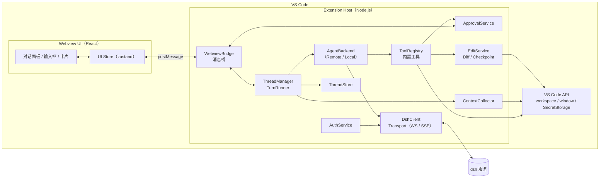
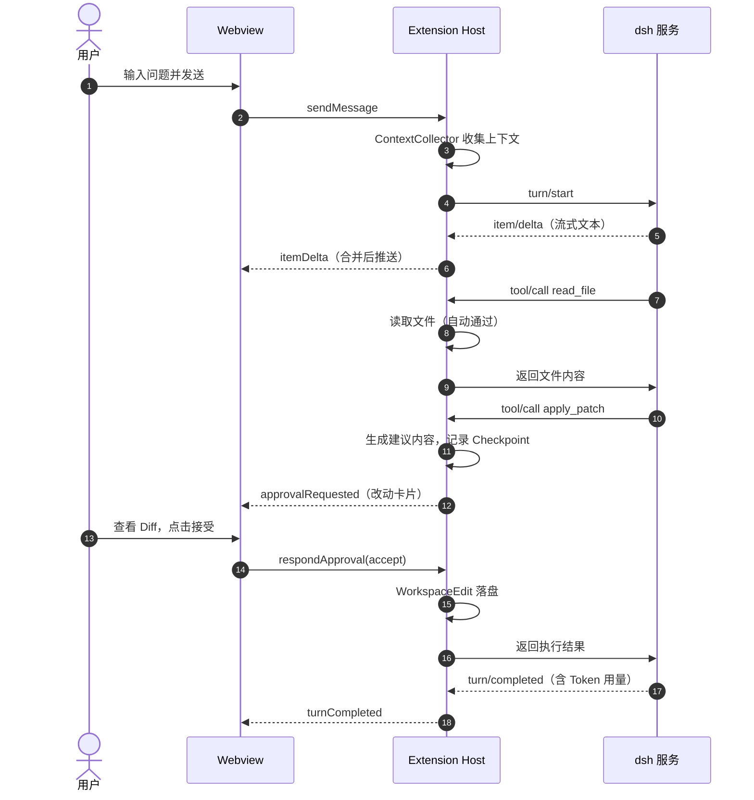

# DSH VS Code 插件整体方案

> 状态：草案 v0.1 ｜ 日期：2026-11-04 ｜ 后续开发以本文档为准，变更请同步更新本文档
>
> 相关文档：[DSH 服务接入协议（草案）](./PROTOCOL.md)

---

## 目录

1. [背景与目标](#1-背景与目标)
2. [关键假设与待确认事项](#2-关键假设与待确认事项)
3. [产品形态](#3-产品形态)
4. [总体架构](#4-总体架构)
5. [模块设计](#5-模块设计)
6. [安全设计](#6-安全设计)
7. [配置项与命令](#7-配置项与命令)
8. [工程结构与技术选型](#8-工程结构与技术选型)
9. [测试策略](#9-测试策略)
10. [构建、发布与 CI](#10-构建发布与-ci)
11. [里程碑与任务拆解](#11-里程碑与任务拆解)
12. [风险与应对](#12-风险与应对)

---

## 1. 背景与目标

开发一个 VS Code 插件（暂名 **DSH Copilot**）。交互参考 Codex 的 VS Code 插件：侧边栏有一个对话面板，AI 可以理解、修改代码，执行命令；所有改动都能审阅、确认和回滚。模型和 Agent 能力由底层的 **dsh 服务**提供。

### 1.1 目标

| 编号 | 目标 | 说明 |
| --- | --- | --- |
| G1 | 侧边栏对话 | 流式输出、Markdown/代码高亮、多会话、历史记录 |
| G2 | Agent 能力 | 读文件、搜索代码、修改文件、执行命令，过程在界面上可见 |
| G3 | 安全可控 | 改文件、跑命令按审批模式确认；改动可预览 diff，可整轮回滚 |
| G4 | 与 dsh 解耦 | dsh 协议变动只影响适配层，不影响 UI 和工具层 |
| G5 | 企业可用 | 支持内网部署、代理/自签证书、私有分发（vsix） |

### 1.2 首版不做（Non-Goals）

- 行内补全（Inline Completion / Ghost Text）：属于另一条产品线，后续单独立项
- 云端异步任务（类似 Codex Cloud）、多人协作
- 接入 VS Code 原生 Chat 视图（Chat Participant API），见 [D1](#d1-自定义-webview不用-chat-participant-api)

---

## 2. 关键假设与待确认事项

dsh 服务的接口细节还没确定。下面每一项先按"当前假设"设计，**确认后需回来更新本节和相关章节**。

| # | 待确认问题 | 当前假设 | 影响范围 |
| --- | --- | --- | --- |
| **Q1** | **dsh 提供的是完整 Agent（服务端跑 Agent 循环），还是只提供模型推理（如 OpenAI 兼容的 `/chat/completions` + tools）？** | **两种都支持**，通过 `AgentBackend` 抽象隔离（见 [D2](#d2-agentbackend-抽象兼容两种-dsh-形态)） | **最大**：决定 Agent 循环在哪实现，工作量差别约 2～3 周 |
| Q2 | 通信协议：HTTP + SSE / WebSocket / gRPC / 本地进程 stdio？ | 首选 WebSocket + JSON-RPC 2.0，备选 HTTP + SSE | `Transport` 实现 |
| Q3 | 认证方式：API Key / Token / OAuth / 企业 SSO？ | Bearer Token，存 VS Code `SecretStorage`；预留 OAuth 扩展点 | `AuthService` |
| Q4 | dsh 服务能否直接访问用户代码？ | **不能**。代码只在用户机器上，所有工具都在插件侧执行 | 工具执行位置、数据安全 |
| Q5 | 会话历史存在哪？ | 存本地；dsh 若支持会话持久化，再做同步 | `ThreadStore` |
| Q6 | 部署环境：公网 / 内网？有没有代理、自签证书？ | 内网，可能有代理和自签 CA | 网络配置项 |
| Q7 | 模型列表与参数（模型名、推理强度、上下文长度） | 由 dsh 接口返回，不在插件里写死 | 模型选择 UI |
| Q8 | 分发方式：公开市场 / 私有市场 / 内部 vsix？ | 内部 vsix，CI 产出 | 发布流程 |

---

## 3. 产品形态

### 3.1 界面布局

插件在活动栏（Activity Bar）注册图标，点开是侧边栏 Webview；用户可以把它拖到右侧辅助侧边栏，和 Codex 的用法一样。也支持"在编辑器中打开"，以面板形式全宽显示。

```
┌────────────────────────────────────────┐
│ DSH Copilot      [+新会话] [历史] [⋯]   │  ← 顶栏：会话标题、新建、历史、设置
├────────────────────────────────────────┤
│ 👤 帮我给 utils.ts 的 parseDate 加单测   │
│                                        │
│ 🤖 好的，我先看一下现有实现。             │  ← 流式 Markdown
│ ┌ 📖 读取 src/utils.ts           ✓ ┐   │  ← 工具调用卡片（可折叠）
│ ┌ 🔍 搜索 "parseDate"  3 处结果    ✓ ┐   │
│ ┌ ✏️ 修改 2 个文件          [待确认] ┐   │  ← 改动卡片
│ │  + src/utils.test.ts   +42        │   │
│ │  ~ src/utils.ts        +3 -1      │   │
│ │  [查看 Diff] [接受] [拒绝]          │   │
│ └──────────────────────────────────┘   │
│ ┌ ▶ pnpm test utils       [待确认] ┐   │  ← 命令卡片（输出实时滚动）
│ │  [运行] [本轮都允许] [拒绝]         │   │
│ └──────────────────────────────────┘   │
├────────────────────────────────────────┤
│ 📎 utils.ts:12-30  ×                   │  ← 已附加的上下文
│ ┌────────────────────────────────────┐ │
│ │ 输入问题，@ 引用文件，/ 使用命令…   │ │  ← 输入框
│ └────────────────────────────────────┘ │
│ [代理模式 ▾] [模型 ▾]      Token 1.2k [发送]│  ← 审批模式、模型、用量、发送/停止
└────────────────────────────────────────┘
```

### 3.2 功能清单

P0 是 MVP 必须有的，P1 是正式版需要的，P2 后续再做。

| 模块 | 功能 | 优先级 |
| --- | --- | --- |
| 对话 | 流式输出、Markdown、代码块高亮、复制、停止生成 | P0 |
| 对话 | 新建会话、会话列表、切换、删除、自动生成标题 | P0 |
| 对话 | 重新生成、编辑上一条消息后重发 | P1 |
| 对话 | 展示推理过程摘要（dsh 支持时） | P1 |
| 上下文 | 自动带上当前文件和选区（可关闭） | P0 |
| 上下文 | `@文件`、`@文件夹` 引用，带模糊搜索补全 | P0 |
| 上下文 | `@problems`（诊断信息）、`@changes`（git diff） | P1 |
| 上下文 | `@terminal`（终端最近输出）、粘贴图片 | P2 |
| Agent | 读文件、列目录、搜索代码 | P0 |
| Agent | 修改/新建/删除文件，原生 Diff 预览，接受/拒绝 | P0 |
| Agent | 执行命令，输出实时显示，超时和中断 | P0 |
| Agent | 按轮次回滚（Checkpoint） | P1 |
| Agent | MCP 工具接入 | P2 |
| 审批 | 三种审批模式（见 3.3），命令白名单 | P0 |
| 编辑器集成 | 右键「问 DSH」「解释」「修复」，快捷键聚焦输入框 | P1 |
| 编辑器集成 | 诊断上的 Quick Fix「用 DSH 修复」 | P2 |
| 设置 | 服务地址、登录/登出、模型、审批模式 | P0 |
| 斜杠命令 | `/new` `/clear` `/mode` `/model` `/explain` `/fix` `/test` `/review` | P1 |
| 其他 | 连接状态、断线重连、Token 用量、中英文界面 | P1 |

### 3.3 审批模式

| 模式 | 读/搜索 | 改文件 | 执行命令 | 说明 |
| --- | --- | --- | --- | --- |
| **问答**（chat） | 自动 | 禁用 | 禁用 | 只回答问题，不动代码 |
| **代理**（agent，默认） | 自动 | 每次确认（可选"本轮都允许"） | 每次确认；白名单内的命令自动执行 | 推荐日常使用 |
| **全自动**（auto） | 自动 | 工作区内自动 | 自动，**黑名单命令仍要确认** | 要求工作区已受信任（Workspace Trust） |

无论哪种模式，**写工作区以外的路径都必须确认**；工作区未受信任时，强制降级为"问答"。

### 3.4 VS Code 集成点

- **视图**：`viewsContainers.activitybar` 和 `views`（`WebviewView`）；另提供 `WebviewPanel` 编辑器形态
- **命令**：见 [第 7 节](#7-配置项与命令)，全部在命令面板可用
- **右键菜单**：`editor/context` 中加「DSH：解释/修复/问这段代码」
- **Diff**：用 `vscode.diff` 命令和自定义 `dsh-diff:` 只读文档（`TextDocumentContentProvider`），在原生 Diff 编辑器里预览改动
- **状态栏**：连接状态、当前模型，点击打开面板
- **快捷键**：`Ctrl/Cmd+Shift+L` 打开并聚焦输入框（待确认，避免冲突）

---

## 4. 总体架构

### 4.1 架构图



### 4.2 分层

| 层 | 职责 | 依赖规则 |
| --- | --- | --- |
| **UI 层**（Webview） | 只负责展示和收集用户操作，不保存权威状态 | 只通过消息协议和 Host 通信 |
| **会话层**（ThreadManager / TurnRunner） | 管理会话和轮次，汇总事件，驱动 UI 更新 | 依赖 `AgentBackend` 接口，不依赖具体协议 |
| **后端层**（AgentBackend） | 屏蔽 dsh 的形态差异，统一输出[内部事件](./PROTOCOL.md#8-内部事件模型adapter-输出) | 只有这一层知道 dsh 协议 |
| **工具层**（Tools / Approval / Edit） | 在本地执行工具，处理审批，落盘改动 | 依赖 VS Code API，不依赖 dsh |
| **连接层**（DshClient / Transport） | 收发消息，鉴权，重连，心跳 | 依赖网络库 |

### 4.3 关键设计决策

#### D1. 自定义 Webview，不用 Chat Participant API

- Chat Participant（`@dsh` 出现在 Copilot Chat 里）依赖用户安装 Copilot Chat，界面也受限，做不出审批卡片、改动卡片、会话列表这些 Codex 式交互。
- **结论**：主界面用自定义 Webview。以后如有需要，可以另加一个 Chat Participant 作为轻量入口，复用同一个后端。

#### D2. `AgentBackend` 抽象，兼容两种 dsh 形态

```ts
interface AgentBackend {
  startTurn(input: TurnInput, ctx: TurnContext): AsyncIterable<AgentEvent>;
  listModels(): Promise<ModelInfo[]>;
}

interface TurnContext {
  signal: AbortSignal;
  executeTool(call: ToolCall): Promise<ToolResult>; // 由 TurnRunner 提供：审批 → 执行 → 更新 UI
}
```

完整定义见 [PROTOCOL.md 第 8 节](./PROTOCOL.md#8-内部事件模型adapter-输出)。

| 实现 | 适用情况 | Agent 循环在哪 | 工具调用方式 |
| --- | --- | --- | --- |
| `RemoteAgentBackend` | dsh 是 Agent 服务 | dsh 服务端 | dsh 发 `tool/call` 请求，插件本地执行后回传结果 |
| `LocalAgentLoop` | dsh 只提供模型推理 | 插件内 | 插件把工具定义传给模型，解析 tool_calls，本地执行后再次请求，直到模型不再调用工具 |

两种实现输出同样的 `AgentEvent` 流，上层不需要关心差异。**确认 Q1 之前，先实现 `RemoteAgentBackend` 并配合 Mock 服务开发**；如果确认 dsh 只提供模型推理，再补 `LocalAgentLoop`（需要额外做系统提示词、上下文压缩、工具循环和最大轮数控制）。

#### D3. 工具在插件侧执行

代码只在用户机器上（Q4）。读文件、改文件、跑命令都由插件在本地执行，dsh 只看到插件主动发过去的内容。好处：

- 代码不需要整体上传，减少数据外泄风险
- 改动走 VS Code 的 `WorkspaceEdit`，可以撤销，编辑器状态一致
- Remote-SSH / WSL / Dev Container 场景下也能正确操作远端文件（见 D6）

#### D4. Extension Host 是唯一的状态源

会话、轮次、条目、审批状态都保存在 Host。Webview 只是状态的"渲染"：

- Webview 刷新、隐藏后重新显示时，发 `ready` 拿一次完整快照（`snapshot`），之后接收增量
- 不开启 `retainContextWhenHidden`，降低内存占用
- 流式文本在 Host 侧按约 16ms 合并后再发给 Webview，避免消息风暴

#### D5. 传输层可插拔

`Transport` 接口只关心"发送消息、接收消息、连接状态"。先实现 `WebSocketTransport`，需要时再加 `SseTransport`（HTTP POST + SSE）或 `StdioTransport`（本地 dsh 进程）。

#### D6. 插件以 workspace 扩展运行

`package.json` 中设置 `"extensionKind": ["workspace"]`。在远程开发场景下，插件运行在代码所在的机器上，工具能直接操作文件和执行命令。**代价**：到 dsh 服务的网络请求也从远端机器发出，需要远端机器能访问 dsh（部署时说明）。

#### D7. 改动先预览、后落盘，并记录 Checkpoint

- dsh 给出改动后，先生成"建议内容"，通过 `dsh-diff:` 虚拟文档在原生 Diff 中预览
- 用户接受后，通过 `WorkspaceEdit` 落盘，支持 `Ctrl+Z`
- 每轮第一次修改某个文件前，记录原始内容快照，支持"撤销本轮所有改动"（新建的文件在回滚时删除）

### 4.4 一轮对话的时序



---

## 5. 模块设计

### 5.1 Extension Host 模块

| 模块 | 职责 |
| --- | --- |
| `extension.ts` | `activate`：注册视图、命令、配置监听；`deactivate`：断开连接，清理子进程 |
| `connection/DshClient` | JSON-RPC 请求/响应关联、通知分发、超时、心跳、指数退避重连 |
| `connection/transports/*` | `WebSocketTransport`、`SseTransport`（备用） |
| `backend/RemoteAgentBackend` | 把 dsh 协议消息转换成内部 `AgentEvent`，把工具结果回传给 dsh |
| `backend/LocalAgentLoop` | （视 Q1 而定）本地 Agent 循环：提示词、工具循环、上下文截断 |
| `session/ThreadManager` | 会话增删改查、当前会话、标题生成 |
| `session/TurnRunner` | 驱动单轮：组装输入 → 消费事件流 → 更新状态 → 处理中断 |
| `session/ThreadStore` | 会话持久化到 `globalStorageUri`（JSONL，每个会话一个文件） |
| `tools/ToolRegistry` | 注册工具，校验参数（zod），统一超时和输出截断 |
| `approval/ApprovalService` | 按审批模式和白/黑名单判断"自动通过 / 需确认 / 拒绝"，挂起等待用户答复 |
| `edits/EditService` | 解析改动（全文/补丁），生成预览，落盘，Checkpoint 和回滚 |
| `edits/DiffContentProvider` | `dsh-diff:` 虚拟文档，用于 Diff 预览 |
| `exec/CommandRunner` | `child_process.spawn` 执行命令，流式输出、超时、中断、输出上限、编码处理 |
| `context/ContextCollector` | 当前文件、选区、打开的标签页、诊断、git diff、`@` 引用的文件 |
| `auth/AuthService` | Token 读写（`SecretStorage`），登录/登出命令，预留 OAuth |
| `webview/ChatViewProvider` | `WebviewViewProvider`，生成带 CSP 的 HTML，加载打包后的 UI 资源 |
| `webview/WebviewBridge` | 带类型的消息收发，消息校验，请求/响应关联 |
| `util/logger` | `LogOutputChannel`（"DSH Copilot"），日志脱敏（Token、密钥） |
| `util/pathGuard` | 路径规范化，判断是否在工作区内，防止 `../` 和符号链接越界 |

### 5.2 内置工具

工具名和参数会作为工具定义发给 dsh（或模型），保持稳定；需要调整时按版本号演进。

| 工具 | 说明 | 问答 | 代理 | 全自动 |
| --- | --- | --- | --- | --- |
| `read_file` | 读文件（支持行范围，大文件分段） | 自动 | 自动 | 自动 |
| `list_dir` | 列目录（遵守 `.gitignore` 和 `files.exclude`） | 自动 | 自动 | 自动 |
| `glob` | 按模式查找文件（`workspace.findFiles`） | 自动 | 自动 | 自动 |
| `grep` | 搜索内容：优先用系统 `rg`，没有时回退到 Node 实现 | 自动 | 自动 | 自动 |
| `apply_patch` | 修改/新建/删除文件（查找替换方式），一次可改多个文件 | 禁用 | 确认 | 自动 |
| `write_file` | 整文件写入（新建文件或补丁失败时的兜底） | 禁用 | 确认 | 自动 |
| `run_command` | 在工作区执行 shell 命令 | 禁用 | 确认（白名单自动） | 自动（黑名单确认） |
| `get_diagnostics` | 获取诊断（错误、警告） | 自动 | 自动 | 自动 |

统一约束：

- 工具输出回传给 dsh 前截断（默认 30 KB，超出部分给出提示）
- 二进制文件、超大文件（默认 > 1 MB）拒绝直接读取
- 命令默认超时 120 秒，可配置；用户点"停止"时终止整个进程树
- 中文 Windows 下命令输出可能是 GBK 编码，用 `iconv-lite` 检测和转码

### 5.3 Webview UI

- **技术栈**：React 18 + TypeScript + Vite；状态管理用 zustand；Markdown 用 `react-markdown` + `remark-gfm`；代码高亮用 `shiki`（按需加载语言）
- **样式**：只用 VS Code 主题 CSS 变量（`--vscode-*`），自动适配亮色、暗色和高对比度主题；不使用已停止维护的 `@vscode/webview-ui-toolkit`
- **主要组件**：
  - `ThreadView`：消息列表，长会话用虚拟列表
  - `MessageItem` / `ReasoningItem`：Markdown 渲染，流式时显示光标
  - `ToolCallCard`：工具调用，可折叠，显示参数和结果摘要
  - `FileChangeCard`：改动文件列表和增删行数，查看 Diff、接受、拒绝
  - `CommandCard`：命令、实时输出、退出码、运行/拒绝/停止
  - `Composer`：输入框，`@` 补全，`/` 命令，附件标签，模式和模型选择，发送/停止
  - `ThreadList`：历史会话，支持搜索
  - `ConnectionBanner`：未登录、断线、重连中等提示
- **无障碍**：全部操作可用键盘完成，卡片有 ARIA 标签
- **国际化**：中文、英文两套文案，跟随 VS Code 显示语言

### 5.4 Host ↔ Webview 消息协议

统一的消息格式：

```ts
interface BridgeMessage<T extends string = string, P = unknown> {
  type: T;
  payload: P;
  requestId?: string; // 需要响应时带上
}
```

**Webview → Host**

| type | 说明 |
| --- | --- |
| `ready` | Webview 加载完成，请求快照 |
| `sendMessage` | 发送消息：`{ threadId?, text, attachments, mode, model }` |
| `interrupt` | 停止当前轮次 |
| `respondApproval` | 回复审批：`{ approvalId, decision: 'accept' \| 'acceptForTurn' \| 'reject', reason? }` |
| `openDiff` / `openFile` | 打开 Diff / 跳转到文件和行 |
| `newThread` / `switchThread` / `deleteThread` | 会话管理 |
| `revertTurn` | 回滚某一轮的改动 |
| `searchFiles` | `@` 补全时搜索文件 |
| `setMode` / `setModel` | 切换审批模式 / 模型 |

**Host → Webview**

| type | 说明 |
| --- | --- |
| `snapshot` | 完整状态（会话列表、当前会话、配置、连接状态） |
| `threadUpdated` | 会话元数据变化（标题、轮次状态） |
| `itemStarted` / `itemDelta` / `itemCompleted` | 条目增量更新 |
| `approvalRequested` / `approvalResolved` | 审批请求 / 审批结束 |
| `connectionStatus` | `connecting` / `connected` / `disconnected` / `unauthenticated` |
| `searchFilesResult` | `@` 补全结果 |
| `focusComposer` / `prefill` | 聚焦输入框 / 预填内容（右键菜单触发） |

消息类型和 zod schema 定义在 `packages/protocol` 中，Host 和 Webview 共用，收到消息后先校验再处理。

### 5.5 领域模型

```ts
type ApprovalMode = 'chat' | 'agent' | 'auto';

interface Thread {
  id: string;
  title: string;
  createdAt: number;
  updatedAt: number;
  model?: string;
  mode: ApprovalMode;
  remoteId?: string; // dsh 侧会话 ID（如有）
  turns: Turn[];
}

interface Turn {
  id: string;
  status: 'running' | 'completed' | 'interrupted' | 'failed';
  items: Item[];
  usage?: { inputTokens: number; outputTokens: number };
  checkpointId?: string;
  startedAt: number;
  endedAt?: number;
}

type Item =
  | { kind: 'userMessage'; id: string; text: string; attachments: Attachment[] }
  | { kind: 'agentMessage'; id: string; text: string; streaming: boolean }
  | { kind: 'reasoning'; id: string; summary: string }
  | { kind: 'toolCall'; id: string; tool: string; args: unknown; status: ToolStatus; result?: string }
  | { kind: 'fileChange'; id: string; changes: FileChange[]; status: 'pending' | 'applied' | 'rejected' | 'reverted' }
  | { kind: 'command'; id: string; command: string; cwd: string; status: ToolStatus; exitCode?: number; output: string }
  | { kind: 'error'; id: string; message: string; code?: string };

type ToolStatus = 'pending_approval' | 'running' | 'succeeded' | 'failed' | 'rejected';

interface FileChange {
  path: string; // 工作区相对路径
  type: 'add' | 'modify' | 'delete';
  additions: number;
  deletions: number;
}

interface Attachment {
  type: 'file' | 'selection' | 'folder' | 'problems' | 'changes';
  path?: string;
  range?: { startLine: number; endLine: number };
  content?: string; // 发送时填充
}
```

---

## 6. 安全设计

| 风险 | 措施 |
| --- | --- |
| AI 执行危险命令 | 审批模式；命令白名单（如 `git status`、`ls`）和黑名单（如 `rm -rf /`、`git push --force`、`curl \| sh`）；全自动模式要求工作区受信任 |
| 越权访问文件 | `pathGuard` 规范化路径、解析符号链接，工作区外的路径必须确认；默认拒绝读取 `.env`、`*.pem`、`id_rsa` 等敏感文件（可配置） |
| Token 泄露 | Token 只存 `SecretStorage`，不写配置文件、不写日志；日志统一脱敏 |
| Webview 注入 | 严格 CSP（`default-src 'none'`，脚本只允许带 nonce 的本地资源）；Markdown 渲染时禁用原始 HTML；链接经 Host 校验后再用 `vscode.env.openExternal` 打开 |
| 消息伪造 | Host 对 Webview 消息做 zod 校验；审批 ID 一次性有效 |
| 不受信任的工作区 | 声明 `capabilities.untrustedWorkspaces: { supported: "limited" }`，未受信任时只开放问答模式 |
| 数据外发 | 只发送用户输入、显式引用的上下文和工具结果；设置页说明会发送哪些数据；可关闭自动附带当前文件 |
| 传输安全 | 生产环境强制 `wss://` / `https://`；支持自定义 CA 文件；复用 VS Code 代理设置（需实际验证） |

---

## 7. 配置项与命令

### 7.1 配置项（`dsh.*`）

| 配置 | 类型 / 默认值 | 说明 |
| --- | --- | --- |
| `dsh.server.url` | string / `""` | dsh 服务地址，如 `wss://dsh.example.com/ws` |
| `dsh.server.transport` | `websocket` \| `sse` / `websocket` | 传输方式 |
| `dsh.server.caFile` | string / `""` | 自定义 CA 证书路径 |
| `dsh.model` | string / `""` | 默认模型，空则用服务端默认 |
| `dsh.approvalMode` | `chat` \| `agent` \| `auto` / `agent` | 默认审批模式 |
| `dsh.command.allowlist` | string[] | 代理模式下自动执行的命令前缀 |
| `dsh.command.denylist` | string[] | 任何模式下都要确认的命令模式 |
| `dsh.command.timeoutSeconds` | number / `120` | 命令超时 |
| `dsh.context.includeActiveFile` | boolean / `true` | 自动附带当前文件和选区 |
| `dsh.files.sensitivePatterns` | string[] | 禁止自动读取的文件 glob |
| `dsh.tools.maxOutputKB` | number / `30` | 工具输出回传上限 |
| `dsh.log.level` | `error` … `trace` / `info` | 日志级别 |

### 7.2 命令

| 命令 ID | 标题 |
| --- | --- |
| `dsh.openChat` | DSH：打开对话 |
| `dsh.openChatInEditor` | DSH：在编辑器中打开对话 |
| `dsh.newThread` | DSH：新建会话 |
| `dsh.askAboutSelection` | DSH：问这段代码 |
| `dsh.explainSelection` | DSH：解释代码 |
| `dsh.fixSelection` | DSH：修复代码 |
| `dsh.signIn` / `dsh.signOut` | DSH：登录 / 登出 |
| `dsh.showLogs` | DSH：查看日志 |

---

## 8. 工程结构与技术选型

### 8.1 目录结构

采用 pnpm workspace 管理多包：

```
dsh-vscode-copilot/
├── package.json                 # workspace 根：统一脚本、lint、格式化
├── pnpm-workspace.yaml
├── tsconfig.base.json
├── docs/
│   ├── DESIGN.md                # 本文档
│   └── PROTOCOL.md              # dsh 接入协议
├── packages/
│   ├── protocol/                # 共享：领域模型、Webview 消息、dsh 协议类型（zod）
│   │   └── src/
│   ├── extension/               # VS Code 插件主体（Extension Host）
│   │   ├── package.json         # 插件清单：contributes、activationEvents 等
│   │   ├── src/
│   │   │   ├── extension.ts
│   │   │   ├── connection/      # DshClient、Transport、重连
│   │   │   ├── backend/         # RemoteAgentBackend、LocalAgentLoop
│   │   │   ├── session/         # ThreadManager、TurnRunner、ThreadStore
│   │   │   ├── tools/           # 内置工具
│   │   │   ├── approval/
│   │   │   ├── edits/           # 补丁解析、Diff 预览、Checkpoint
│   │   │   ├── exec/            # CommandRunner
│   │   │   ├── context/
│   │   │   ├── auth/
│   │   │   ├── webview/         # ViewProvider、Bridge、HTML/CSP
│   │   │   └── util/            # logger、config、pathGuard
│   │   ├── media/               # 图标等静态资源
│   │   └── test/
│   ├── webview-ui/              # React + Vite，构建产物输出到 extension/dist/webview
│   │   └── src/
│   │       ├── components/
│   │       ├── store/
│   │       ├── hooks/
│   │       └── i18n/
│   └── mock-dsh/                # 本地 Mock dsh 服务（开发、测试用）
└── .github/workflows/ci.yml
```

### 8.2 技术选型

| 方面 | 选择 | 理由 |
| --- | --- | --- |
| 语言 | TypeScript（strict） | VS Code 插件生态标准 |
| 包管理 | pnpm workspace | 多包共享类型，安装快 |
| 插件打包 | esbuild（CJS，`vscode` 设为 external） | 快，产物单文件 |
| Webview 构建 | Vite | 开发时热更新，生产构建体积小 |
| UI | React 18 + zustand | 生态成熟，流式更新好写 |
| Markdown / 高亮 | react-markdown + remark-gfm + shiki | 与 VS Code 高亮效果一致 |
| 协议校验 | zod | Host 和 Webview 共用一套 schema |
| WebSocket | `ws` | 在 Node 侧稳定，可设置代理和 CA |
| 补丁 / Diff | `diff`（jsdiff） | 计算增删行数、应用统一补丁 |
| 编码 | `iconv-lite` | 处理 Windows 命令输出编码 |
| 单元测试 | vitest | 快，ESM 友好 |
| 集成测试 | `@vscode/test-cli` + `@vscode/test-electron` | 官方方案，真实 VS Code 环境 |
| 代码规范 | ESLint + Prettier | — |
| 发布 | `@vscode/vsce` | 产出 `.vsix` |
| 兼容范围 | `engines.vscode: ^1.90.0`，Node 20+ | 覆盖近一年多的 VS Code 版本，具体版本开发时再定 |

---

## 9. 测试策略

| 层级 | 范围 | 工具 |
| --- | --- | --- |
| 单元测试 | 协议编解码、DshClient（重连/超时）、ApprovalService 规则、补丁解析与应用、pathGuard、输出截断 | vitest |
| 组件测试 | 各类卡片、Composer 的 `@` 补全、流式渲染 | vitest + Testing Library |
| 集成测试 | 在真实 VS Code 中：打开视图、发消息、工具执行、Diff 预览、接受/拒绝、回滚 | `@vscode/test-cli`，连 `mock-dsh` |
| 契约测试 | 用录制的 dsh 真实消息回放，验证 Adapter 转换结果 | vitest + fixture |
| 手工验收 | 每个里程碑的验收清单（见第 11 节），覆盖 Windows / macOS / Linux 和 Remote-SSH | — |

`mock-dsh` 支持按"剧本"（JSON 文件）回放流式文本、工具调用、错误、断线，用于开发和测试，也能在 dsh 接口未就绪时并行开发。

---

## 10. 构建、发布与 CI

- **本地开发**：`pnpm dev` 同时启动 esbuild watch、Vite watch 和 mock-dsh；按 F5 打开扩展开发宿主
- **打包**：`pnpm package` → 构建 webview-ui → 构建 extension → `vsce package --no-dependencies`（依赖已由 esbuild 打进产物，避免 vsce 和 pnpm 的依赖解析问题）
- **CI**（GitHub Actions）：
  - PR：lint、类型检查、单元测试、集成测试（Linux 下用 xvfb）、打包
  - 打 tag：产出 `.vsix` 并上传到 Release；如有私有市场再加发布步骤
- **版本**：语义化版本；`CHANGELOG.md` 记录变更
- **体积**：目标 `.vsix` < 5 MB；shiki 只打包常用语言，其余按需加载

---

## 11. 里程碑与任务拆解

工期按 1 名全职开发估算，仅供参考，确认 Q1 后再细化。

### M0：工程脚手架（约 3 天）

- [ ] pnpm workspace、TS 配置、ESLint/Prettier、CI 骨架
- [ ] `extension`：注册活动栏视图，显示空白 Webview
- [ ] `webview-ui`：Vite + React，接入 VS Code 主题变量
- [ ] `protocol`：领域模型和 Bridge 消息类型
- [ ] `mock-dsh`：能回放一段流式文本

**验收**：F5 后侧边栏能看到面板；`pnpm package` 能产出 vsix。

### M1：基础对话（约 1.5 周）

- [ ] `DshClient` + `WebSocketTransport`：连接、请求/响应、心跳、重连
- [ ] `AuthService`：登录/登出，Token 存 SecretStorage
- [ ] `RemoteAgentBackend`：`turn/start`、流式事件、中断
- [ ] `ThreadManager` / `TurnRunner` / `ThreadStore`：多会话和持久化
- [ ] UI：消息列表、Markdown/高亮、Composer、停止、会话列表、连接状态

**验收**：连 mock-dsh 能流式对话、停止、新建/切换会话，重启 VS Code 后历史还在。

### M2：上下文（约 1 周）

- [ ] 自动附带当前文件和选区
- [ ] `@文件` / `@文件夹` 补全与引用
- [ ] 右键菜单「问这段代码 / 解释 / 修复」
- [ ] `@problems`、`@changes`

**验收**：选中代码右键提问，dsh 收到的请求里带有正确的上下文。

### M3：Agent 工具与审批（约 2 周）

- [ ] `ToolRegistry`、`pathGuard`、输出截断
- [ ] 只读工具：`read_file`、`list_dir`、`glob`、`grep`、`get_diagnostics`
- [ ] `ApprovalService`：三种模式、白/黑名单、"本轮都允许"
- [ ] `EditService`：`apply_patch` / `write_file`、`dsh-diff:` 预览、接受/拒绝
- [ ] `CommandRunner`：流式输出、超时、停止、编码处理
- [ ] UI：工具卡片、改动卡片、命令卡片

**验收**：按 mock 剧本完成"读代码 → 改两个文件 → 跑测试"全流程，每一步审批行为符合模式定义。

### M4：体验与稳定性（约 1.5 周）

- [ ] Checkpoint 与"撤销本轮改动"
- [ ] 模型选择、Token 用量、推理摘要
- [ ] 斜杠命令
- [ ] 断线重连后恢复进行中的轮次（视 dsh 能力）
- [ ] 长会话虚拟列表、流式渲染性能优化
- [ ] 中英文界面

### M5：接入真实 dsh 与发布（约 1 周，依赖 dsh 就绪）

- [ ] 按真实接口调整 Adapter（或实现 `LocalAgentLoop`）
- [ ] 契约测试：录制真实消息做回放
- [ ] 安全自查（第 6 节逐条检查）
- [ ] 三平台 + Remote-SSH 手工验收
- [ ] 用户文档、CHANGELOG、发布 v0.1.0

---

## 12. 风险与应对

| 风险 | 影响 | 应对 |
| --- | --- | --- |
| dsh 接口长期未定或变动频繁 | 阻塞联调 | Adapter 隔离 + mock-dsh 并行开发；尽早拿到一份真实消息样例 |
| dsh 只提供模型推理（Q1） | 需要自建 Agent 循环，工期增加约 2～3 周 | `AgentBackend` 预留 `LocalAgentLoop`；提前设计提示词和上下文管理 |
| 模型生成的补丁无法应用 | 改文件失败 | 用"查找替换"代替行号补丁；精确匹配失败时忽略行首尾空白再匹配一次；仍失败则把原因回传给模型重试；兜底用 `write_file` |
| 命令执行误操作 | 数据损坏 | 默认代理模式需确认；黑名单；Checkpoint 回滚（只覆盖文件改动，命令副作用无法回滚，界面上要说明） |
| 大仓库上下文超出 Token 上限 | 回答质量差或请求失败 | 不整仓上传，靠工具按需读取；附件和工具输出都有大小上限 |
| Webview 长会话卡顿 | 体验差 | Host 侧合并流式消息；虚拟列表；代码高亮放到空闲时执行 |
| 远程开发场景访问不到 dsh | 插件不可用 | 文档说明网络要求；连接失败时给出明确提示 |
| 企业代理 / 自签证书 | 连接失败 | 支持 `caFile`，复用 VS Code 代理设置；提供"测试连接"命令 |
