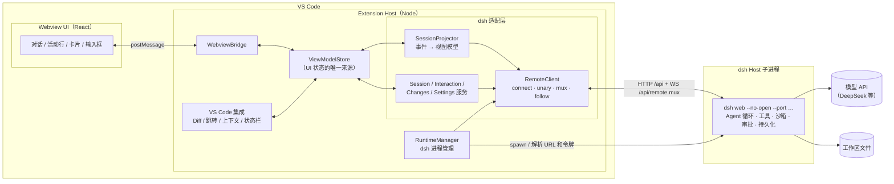
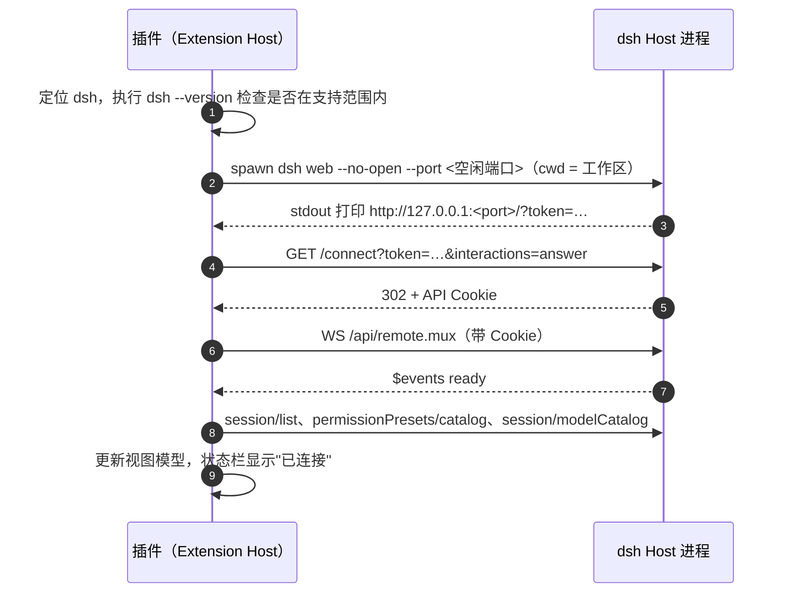
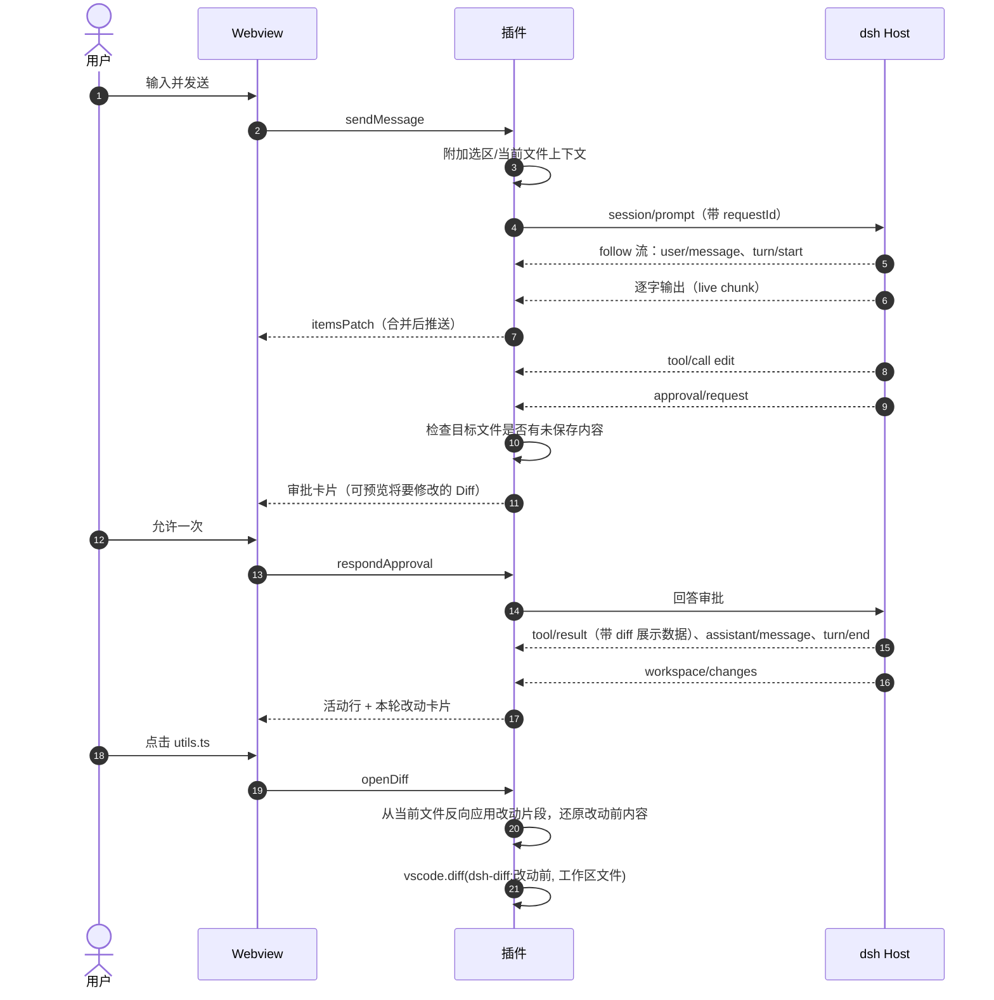

# DSH VS Code 插件整体方案

> 状态：草案 v0.2 ｜ 日期：2026-11-04 ｜ 后续开发以本文档为准，变更请同步更新本文档
>
> 相关文档：[dsh 对接说明](./DSH-INTEGRATION.md)（dsh 调研结果、参考项目分析、连接细节、M0 验证清单）

---

## 目录

0. [版本变更](#0-版本变更)
1. [背景与目标](#1-背景与目标)
2. [对接方式结论](#2-对接方式结论)
3. [产品形态](#3-产品形态)
4. [总体架构](#4-总体架构)
5. [模块设计](#5-模块设计)
6. [dsh 运行时管理](#6-dsh-运行时管理)
7. [安全设计](#7-安全设计)
8. [配置项与命令](#8-配置项与命令)
9. [工程结构与技术选型](#9-工程结构与技术选型)
10. [测试策略](#10-测试策略)
11. [构建、发布与 CI](#11-构建发布与-ci)
12. [里程碑与任务拆解](#12-里程碑与任务拆解)
13. [风险与应对](#13-风险与应对)
14. [待确认事项](#14-待确认事项)

---

## 0. 版本变更

| 版本 | 变化 |
| --- | --- |
| v0.1 | 假设 dsh 是一个协议未知的远程服务，插件自己执行工具、做审批、改文件，自定义一套协议 |
| **v0.2** | 调研 dsh 源码和参考项目 [HarcoChen/dsh-vsc-integration](https://github.com/HarcoChen/dsh-vsc-integration) 后重写。dsh（DeepSeek Harness）是**完整的开源 Agent 运行时**，插件改为**薄壳**：启动 dsh、连接 dsh、把 dsh 的会话数据转换成 Codex 风格界面，再补上 VS Code 集成。删除自研的工具层、审批引擎、改文件和执行命令模块、本地 Agent 循环、自定义协议（原 `PROTOCOL.md`）。新增界面设计原则（针对参考项目的界面问题） |

---

## 1. 背景与目标

dsh 已经包含 Agent 需要的一切：Agent 循环、读写文件、执行命令、沙箱与审批、会话持久化、上下文压缩、模型适配、MCP、skill、子 Agent、计划/目标模式（详见 [dsh 对接说明 1.1](./DSH-INTEGRATION.md#11-dsh-已经负责插件不需要再做的事)）。它自带两个面向人的前端：浏览器 UI（`dsh web`）和 DeepSeek Desktop。

**本插件是 dsh 在 VS Code 里的前端**，界面参考 Codex 的交互方式。社区已有一个同类插件 [dsh-vsc-integration](https://github.com/HarcoChen/dsh-vsc-integration)，它证明了对接路线可行，但界面体验不好（分析见 [3.1](#31-界面设计原则)）。本项目的重点是**把对话体验做好**。

### 1.1 目标

| 编号 | 目标 | 说明 |
| --- | --- | --- |
| G1 | Codex 风格、干净的对话界面 | 信息密度高但不吵：流式回复、紧凑的工具活动行、审批与提问、每轮改动汇总 |
| G2 | 只做 UI 转换 | Agent 能力全部由 dsh 提供，插件不重复实现任何 Agent 逻辑 |
| G3 | VS Code 原生集成 | 选区/当前文件/`@文件` 作为上下文，用 VS Code Diff 编辑器看改动，点击路径跳转，跟随主题 |
| G4 | 开箱即用 | 自动发现 dsh（优先用 DeepSeek Desktop 自带的 `dsh` 命令），管理 dsh 进程 |
| G5 | 能承受 dsh 的变化 | dsh 处于开发者预览阶段；兼容一个版本范围，按能力探测降级，dsh 相关代码集中在适配层 |

### 1.2 首版不做

- 不改写、不替代 dsh 的任何 Agent 行为
- dsh 的高级管理界面：插件管理/市场、定时任务、Agent Team、Agent 预设编辑、运行时终端、完整设置页。首版提供"在浏览器中打开 dsh"入口，直接用 dsh 自带的 Web UI
- 参考项目里的周边功能：Trace 面板、账号余额、Jev/Laya 集成、调试器状态上下文、运行时故障自动恢复。等核心体验稳定后再评估
- 行内补全（Inline Completion）
- 接入 VS Code 原生 Chat 视图（Chat Participant API），见 [D1](#d1-自定义-webview不用-chat-participant-api)

---

## 2. 对接方式结论

dsh 有五个对外入口：`dsh web`、Desktop、`dsh sdk`、`dsh acp`、`dsh headless`。逐一对比后（详见 [dsh 对接说明第 3 节](./DSH-INTEGRATION.md#3-为什么选-web-host-remote-api)），结论是：

**插件在 Extension Host 中启动 `dsh web`，以"API 调用方"身份接入它的 Remote API（HTTP `/api` + WebSocket `/api/remote.mux`）。**

- 这是唯一同时具备**逐字流式、停止生成、会话列表、审批、提问、改动对比**的入口，能力与 dsh Web UI 一致。
- SDK 没有取消方法，也没有逐字流；ACP 官方明确只面向自动化，不做 UI；直接嵌入 dsh Web UI 做不出 Codex 风格，而且在 Webview 里可能过不了 dsh 的 Cookie 认证。
- **参考项目 dsh-vsc-integration 走的就是这条路**（v0.11.1，已上架 VS Code 市场和 Open VSX），可行性已经得到验证。
- 协议客户端**自己写一个精简版**，不在运行时依赖 dsh 的客户端库，见 [D5](#d5-自写精简-remote-客户端兼容一个版本范围)。

---

## 3. 产品形态

### 3.1 界面设计原则

参考项目的功能很全，但对话界面问题明显。下表根据它 README 中的截图整理，右列是本项目的做法：

| 参考项目现状 | 问题 | 本项目做法 |
| --- | --- | --- |
| 每块内容上方都有"dsh / 你 / 工具"标签，右侧都有"trace"链接 | 视觉噪音大，读起来像日志 | 不显示角色标签；用户消息用浅底气泡区分；Trace 等调试信息放进"更多"菜单 |
| 每个工具调用一张大卡片，显示绝对路径和"完成 · 9 ms" | 占空间；长路径折行难读；耗时对用户没用 | 工具调用压成**单行活动行**：图标 + 动作 + 相对路径 + 增删行数；连续的只读操作合并为一行；点击展开详情 |
| 只有工具调用时出现"（无可见回答）"占位；每一步都有一个"思考过程 · 已完成" | 没有意义的重复内容 | 没有正文就不渲染；推理只在进行中显示一行"思考中…"，结束后折叠成一行 |
| 顶部两行：8 个图标的工具栏 + 状态/标题/搜索 | 拥挤，主次不分 | 顶部只有一行：会话标题（点击切换会话）+ 新建 + 更多 |
| 底部依次是 Tab 面板、模型行、输入框、快捷键提示 | 输入区占了将近三分之一高度 | 输入框是一张整宽卡片：上面多行输入，下面一行工具条（附件、权限、模型、上下文用量、发送/停止）；待办、子 Agent 等状态只在有内容时出现在输入框上方，可折叠 |
| 改动在底部"变更"Tab 里 | 和对话脱节 | 每轮结束时，在对话流中显示"本轮改动"卡片 |
| 用户消息画成输入框的样子 | 容易误以为可编辑 | 气泡样式，悬停时显示"复制 / 编辑后重发" |
| `chatView.ts`、`dshRuntime.ts` 各 4000 多行 | 难维护 | 按模块拆分（第 5 节），单文件尽量不超过 500 行 |

通用原则：

- **对话是主角**：除了输入框和一行顶栏，其他界面元素都要"有内容才出现"
- **一屏信息量**：一次典型的"读几个文件 → 改两个文件 → 跑测试"，在侧边栏里一屏能看完
- **路径一律相对**：相对于工作区显示，过长时省略中间部分
- **状态靠图标和颜色**：运行中显示旋转图标，失败显示红色，不写"完成"两个字
- **跟随 VS Code**：只用 `--vscode-*` 主题变量，字体和字号跟随编辑器设置

### 3.2 界面布局

插件注册到右侧辅助侧边栏（`viewsContainers.secondarySidebar`，参考项目已在用；VS Code 版本要求见 9.2）。也支持"在编辑器中打开"，以全宽面板显示。

```
┌──────────────────────────────────────────┐
│ 修复 parseDate 的时区问题 ▾        [+] [⋯] │  ← 一行顶栏
├──────────────────────────────────────────┤
│              ┌──────────────────────────┐ │
│              │ parseDate 在 UTC+8 下少一 │ │  ← 用户消息气泡
│              │ 天，帮我修一下            │ │
│              │ 📎 utils.ts:12-30        │ │
│              └──────────────────────────┘ │
│ 我先看一下实现和现有测试。                 │  ← 助手回复，逐字流式
│ ◦ 已查看 utils.ts、utils.test.ts，搜索 1 次 │  ← 只读操作合并为一行
│ ✎ utils.ts                        +3 −1  │  ← 文件修改，点击打开 Diff
│ ▸ pnpm test utils                         │  ← 命令（等待批准）
│ ┌──────────────────────────────────────┐ │
│ │ 运行命令需要批准                        │ │  ← 审批卡片
│ │ pnpm test utils   · 目录 ./            │ │
│ │           [拒绝]  [允许一次]            │ │
│ └──────────────────────────────────────┘ │
│ 已修复：用 UTC 解析日期字符串，测试通过。    │
│ ┌ 本轮改动 · 2 个文件 ──────────── 查看全部 ┐ │  ← 轮次末尾的改动汇总
│ │ utils.ts            +3 −1             │ │
│ │ utils.test.ts       +28               │ │
│ └──────────────────────────────────────┘ │
├──────────────────────────────────────────┤
│ ☑ 待办 3/3 · ⏳ 排队 1 条            ▾   │  ← 有内容才出现，可展开
│ ┌──────────────────────────────────────┐ │
│ │ 📎 utils.ts:12-30 ×                  │ │
│ │ 输入问题，@ 引用文件，/ 使用命令        │ │
│ │                                      │ │
│ │ [+] [workspace-write▾] [deepseek-…▾] 12%  (↑) │ │  ← 一行工具条，(↑)=发送，运行中变成停止
│ └──────────────────────────────────────┘ │
└──────────────────────────────────────────┘
```

### 3.3 功能清单

P0 是 MVP 必须有的，P1 是正式版需要的，P2 后续再做。"dsh 能力"一列说明数据从哪来，插件只负责展示和转发。

| 模块 | 功能 | dsh 能力 | 优先级 |
| --- | --- | --- | --- |
| 运行时 | 发现 dsh、启动、重启、退出 Host；找不到时引导安装 | CLI `dsh web --no-open --port …` | P0 |
| 对话 | 逐字流式回复、Markdown、代码高亮、复制 | `session/follow`（live chunk + 持久事件） | P0 |
| 对话 | 停止生成 | `session/cancel` | P0 |
| 对话 | 推理过程（可折叠） | `assistant/message` 中的推理内容 | P1 |
| 对话 | 排队消息：编辑、删除、插队 | `inbox` 投影 + `session/updateQueue` | P1 |
| 会话 | 新建、列表、切换、重命名、搜索 | `session/create` `list` `rename` `search` | P0 |
| 会话 | 从某一轮 fork、归档 | `session/fork`、`workspace/archiveSession` | P2 |
| 工具 | 按工具类型渲染活动行（见 5.3） | `tool/call` + `tool/result` | P0 |
| 交互 | 审批卡片 | `approval/request` 转发事件 | P0 |
| 交互 | 审批前预览将要修改的 Diff | 工具调用参数 | P1 |
| 交互 | 回答 `ask_user_question`（含超时后延迟回答） | user-questions 事件、`userQuestions/answer` | P0 |
| 交互 | 计划审阅（批准/反馈） | plan mode + user-questions | P1 |
| 改动 | 单次工具调用的 Diff（持久，不依赖 git） | `tool/result` 中的 diff 展示数据 | P0 |
| 改动 | 每轮改动汇总（含 shell 造成的改动） | `workspace/changes` | P1 |
| 改动 | 未保存保护：要修改的文件在 VS Code 中有未保存内容时提醒 | — | P0 |
| 上下文 | 自动附带当前文件/选区（可关闭） | 拼进 prompt 内容 | P0 |
| 上下文 | `@文件` 补全与引用 | `fileReferences/list` | P1 |
| 上下文 | `@problems`（VS Code 诊断信息）、git diff、粘贴图片 | prompt 文本 / 图片附件 | P2 |
| 设置 | 模型选择 | `session/modelCatalog` + `session/selectModel` | P0 |
| 设置 | 权限预设切换（`workspace-write` 等） | `permissionPresets/catalog` + 会话投影 | P0 |
| 设置 | 首次使用引导：配置 DeepSeek API Key | `credentials/set` 等，或跳转 dsh Web UI | P1 |
| 斜杠命令 | dsh 原生命令（`/compact` `/plan` `/goal` 等，实时从 dsh 获取） | `commands/list` + `commands/execute` | P1 |
| 斜杠命令 | 插件自带：`/new`、`/explain`、`/fix`、`/test`（转成提示词模板） | — | P1 |
| 其他 | 子 Agent、目标进度、后台任务 | subagents、goals、jobs | P2 |
| 其他 | 在浏览器中打开 dsh Web UI | 启动 URL | P0 |

### 3.4 权限与审批

插件**不定义任何权限规则**，全部沿用 dsh：

- **权限预设**：工具条上的下拉框显示 dsh 返回的预设目录。默认是 `workspace-write` 和 `danger-full-access`，用户自定义的预设也会出现；当前设置不匹配任何预设时显示 `custom`。
- **切换到 `danger-full-access`**：插件先弹出确认框，再提交给 dsh。
- **审批卡片**：选项完全来自 dsh 的审批请求，插件只负责展示和回传。
- **未保存保护**：审批一个会写文件的工具时，如果目标文件在 VS Code 里有未保存内容，卡片会提示"先保存或放弃修改"，暂不放行（dsh 直接写磁盘，否则会和编辑器里的内容冲突；参考项目也是这样处理的）。
- **未受信任的工作区**：插件不启动 dsh，需要用户先信任工作区。

### 3.5 VS Code 集成点

| 集成点 | 做法 |
| --- | --- |
| 视图 | `viewsContainers.secondarySidebar` + `WebviewView`；另提供 `WebviewPanel` 编辑器形态 |
| Diff | `dsh-diff:` 只读虚拟文档提供改动前内容，用 `vscode.diff` 打开（还原方法见 5.4） |
| 跳转 | 回复、活动行、改动列表中的路径可点击，用 `showTextDocument` 打开并定位到行 |
| 文件刷新 | dsh 直接写磁盘，VS Code 的文件监听会自动刷新已打开且没有未保存内容的编辑器 |
| 右键菜单 | `editor/context`：「DSH：问这段代码 / 解释 / 修复」 |
| 状态栏 | dsh 运行状态（启动中/已连接/断开）+ 当前模型，点击打开面板 |
| 快捷键 | 打开并聚焦输入框（默认键位开发时再定，避免冲突） |

---

## 4. 总体架构

### 4.1 架构图



### 4.2 分层

| 层 | 职责 | 依赖规则 |
| --- | --- | --- |
| **UI 层**（Webview） | 只渲染视图模型、收集用户操作 | 只通过 Bridge 消息与 Host 通信，不知道 dsh 的存在 |
| **视图模型层**（ViewModelStore） | 会话列表、当前会话条目、待处理的审批和提问、运行时状态 | 只依赖插件自己定义的视图模型类型 |
| **dsh 适配层** | 协议客户端；把 dsh 事件和 Remote 方法转换为视图模型和操作 | **唯一**了解 dsh 协议和数据结构的层 |
| **运行时层**（RuntimeManager） | 找到 dsh、启动并监控进程、提供 origin 和令牌 | 依赖 `child_process` |
| **VS Code 集成层** | Diff、跳转、上下文收集、命令、状态栏 | 依赖 VS Code API 和视图模型 |

### 4.3 关键设计决策

#### D1. 自定义 Webview，不用 Chat Participant API

Chat Participant（在 Copilot Chat 里 `@dsh`）依赖用户安装 Copilot Chat，界面也受限，做不出审批卡片、改动汇总、排队消息和会话列表。**主界面用自定义 Webview**。参考项目额外注册了一个 Chat Participant 作为轻量入口，以后可以评估是否也加。

#### D2. 接入 Web Host Remote API，不用 SDK 或 ACP

见[第 2 节](#2-对接方式结论)。

#### D3. 协议客户端跑在 Extension Host，不跑在 Webview

- dsh 支持 Node 侧的 API 调用方（`/connect` 接口）
- 避开 Webview 中的跨站 Cookie、Origin 检查和 CSP 限制
- VS Code 集成（Diff、跳转、未保存检查）本来就在 Host 侧
- Webview 刷新或隐藏不影响连接和进行中的轮次

逐字流经过一次 `postMessage` 转发，Host 侧按约 16ms 合并后推送，开销可以忽略。

#### D4. 每个 VS Code 窗口一个 dsh Host 子进程

- 用户第一次打开面板时启动，窗口关闭时退出
- 默认使用 `web` profile（与参考项目一致），模型、API Key、权限预设、已装插件都和用户自己的 `dsh web` 共用；可通过设置改成其他 profile
- 只绑定 `127.0.0.1`，端口由系统分配
- 多窗口共用一个 Host 可以节省资源。参考项目实现了跨编辑器共享（广播文件 + 启动互斥锁），但逻辑复杂，留到后续优化
- 同一个会话不能同时被两个 Host 写（dsh 有会话写锁）。遇到 `session/writer-held` 时提示"该会话正在其他窗口或 dsh 中打开"

#### D5. 自写精简 Remote 客户端，兼容一个版本范围

| | 复用 dsh 官方客户端库 | 自写精简客户端（采用） |
| --- | --- | --- |
| 版本要求 | 必须与运行时**完全同版本** | 支持一个版本范围，按能力探测降级 |
| 和 DeepSeek Desktop 配合 | Desktop 自带的 `dsh` 随 Desktop 自动更新，版本经常对不上 | 无此问题 |
| Extension Host 兼容 | 待验证（全是 ESM，Node 版本要求未知） | 只依赖 `ws`，没有兼容风险 |
| 协议细节 | 官方实现，有测试 | 要自己实现 connect、unary、mux、follow；参考项目已经做到 |
| 升级成本 | 改依赖版本，编译期发现类型变化 | 每个 dsh 版本要核对协议变化（参考项目每个 RC 都写了适配报告） |

**结论**：自写，只实现插件用到的方法；所有入站数据用 zod 校验，不认识的字段忽略，不认识的事件跳过；方法不存在（404 / `-32601`）时隐藏对应功能。官方客户端库作为**实现参考**，特别是 follow 流的结算和缺口修复逻辑，照着它的行为写并补齐测试。dsh 和参考项目都是 MIT 协议，借鉴代码时保留版权声明。

版本策略详见 [dsh 对接说明第 8 节](./DSH-INTEGRATION.md#8-版本策略)。

#### D6. 插件不读写工作区文件、不执行命令

所有文件修改和命令执行都在 dsh 里进行，受 dsh 的沙箱和审批约束。插件只**展示** dsh 记录的改动，用 VS Code Diff 编辑器呈现。读取磁盘上的当前文件内容只用于还原 Diff，不做任何写入。这样插件就不会绕开 dsh 的安全边界。

#### D7. Extension Host 持有视图状态，Webview 只渲染

- Webview 刷新或重新显示时，发 `ready` 拿一次完整快照，之后只接收增量
- 不开启 `retainContextWhenHidden`，降低内存占用
- 输入框草稿和问答卡片里没提交的选择保存在 Webview 的 `setState` 中，Host 推送状态时不覆盖它们

#### D8. dsh 相关代码集中在适配层

dsh 的协议和数据结构只出现在 `packages/extension/src/dsh/` 目录下。视图模型由插件自己定义，不直接暴露 dsh 的事件结构。dsh 出现破坏性变更时，只需要改这一层。

### 4.4 时序

**启动与连接**



**一轮对话**



---

## 5. 模块设计

### 5.1 Extension Host 模块

| 模块 | 职责 |
| --- | --- |
| `extension.ts` | `activate`：注册视图、命令、配置监听；`deactivate`：断开连接，退出 dsh 进程 |
| `runtime/RuntimeManager` | 定位 dsh、版本检查、启动、就绪检测、崩溃重启、退出（见第 6 节） |
| `dsh/remote/connect` | `/connect` 握手，管理 API Cookie |
| `dsh/remote/unary` | `POST /api` 一元调用，错误码映射 |
| `dsh/remote/mux` | `/api/remote.mux` WebSocket：多路复用流、上行、取消、转发事件订阅 |
| `dsh/remote/follow` | 会话历史分页 + follow 流：live chunk、`settle-assistant` 结算、序号缺口修复、重连 |
| `dsh/remote/schemas` | 所有入站数据的 zod schema，宽松解析（忽略未知字段） |
| `dsh/capabilities` | 记录 dsh 版本和各方法是否可用，供 UI 决定显示哪些功能 |
| `dsh/WorkspaceBinding` | VS Code 工作区文件夹 ↔ dsh Workspace；多根工作区时让用户选择 |
| `dsh/SessionService` | 会话增删改查、发送 prompt、取消、排队消息、模型选择、权限预设 |
| `dsh/projector/*` | 把 dsh 事件转换为视图模型条目（见 5.2、5.3），每类工具一个映射文件 |
| `dsh/InteractionService` | 审批、提问、计划审阅：收到请求后挂到视图模型，等用户答复后回传 |
| `dsh/ChangesService` | 收集单次工具调用的改动片段和每轮改动汇总，还原改动前内容（见 5.4） |
| `vm/ViewModelStore` | 视图状态的唯一来源，产生增量推给 Bridge |
| `webview/ChatViewProvider` | `WebviewViewProvider` / `WebviewPanel`，生成带 CSP 的 HTML |
| `webview/WebviewBridge` | 带类型的消息收发和校验 |
| `vscode/DiffContentProvider` | `dsh-diff:` 虚拟文档 |
| `vscode/DirtyGuard` | 检查目标文件在 VS Code 中是否有未保存内容 |
| `vscode/ContextCollector` | 当前文件、选区、诊断信息，转成 prompt 附加内容 |
| `vscode/StatusBar`、`vscode/Commands` | 状态栏和命令 |
| `util/logger` | 插件日志（"DSH"）和 dsh 进程输出（"DSH Runtime"）两个 `LogOutputChannel`；令牌脱敏 |

### 5.2 会话事件 → 界面条目

事件说明见 [dsh 对接说明第 7 节](./DSH-INTEGRATION.md#7-会话事件模型)：

| dsh 事件 / 状态 | 界面条目 |
| --- | --- |
| `user/message` | 用户消息气泡（含附件标签） |
| live chunk（follow 流中的客户端条目） | 正在生成的回复，逐字追加 |
| `assistant/message` | 完整回复，替换对应的流式条目；推理内容折叠成一行；正文为空时不渲染；被中断时标注"已停止" |
| `assistant/attempt` | 失败/重试时显示一行提示 |
| `tool/call` + `tool/result` | 活动行，按工具名渲染（见 5.3）；结果到达前显示旋转图标 |
| `tool/result.error` | 活动行标红，展开后显示错误信息 |
| `turn/start` / `turn/end` | 控制"发送/停止"按钮；`turn/end` 原因为中断或错误时显示一行提示 |
| `approval/request` | 审批卡片，紧跟在对应活动行下方 |
| user-questions 事件 / 投影 | 问答卡片（单选/多选/自由输入，按 dsh 给出的选项） |
| 计划模式事件 | 计划审阅卡片（批准 / 提反馈） |
| `workspace/changes` | 本轮改动汇总卡片，放在本轮末尾 |
| `inbox` 投影 | 输入框上方的排队消息 |
| `system/message`、`developer/message`、`request/*` | 不展示 |
| 未知事件类型 | 不展示，写调试日志 |

### 5.3 工具 → 活动行

工具名来自 dsh 的工具目录（`docs/tool-catalog.zh.md`）。没有专门样式的工具一律用通用活动行（工具名 + 参数摘要，展开看结果）。

| dsh 工具 | 活动行 | 展开后 |
| --- | --- | --- |
| `read` `read_image` `glob` `grep` | 连续多个合并为一行："已查看 utils.ts、utils.test.ts，搜索 1 次" | 每个操作的路径或搜索词 |
| `edit` `write` `apply_patch` `str_replace_editor` | "✎ utils.ts +3 −1"，点击打开 Diff | 改动片段 |
| `bash` `pwsh` | "▸ pnpm test utils"，失败时显示退出码 | 输出（最多显示若干行，可展开全部） |
| `terminal_*` `job_*` | "终端：dev server · 运行中" | 状态和最近输出 |
| `todo_write` | 不在对话流里重复出现，更新输入框上方的待办状态 | — |
| `subagent` | "子任务：分析依赖 · 运行中/完成" | 任务描述和结果摘要 |
| `web_search` `web_fetch` | "搜索网页：xxx" / "读取网页：域名" | 结果列表 |
| `ask_user_question` | 由问答卡片接管 | — |
| `exit_plan_mode` | 由计划审阅卡片接管 | — |
| `create_goal` `update_goal` `get_goal` | 更新输入框上方的目标状态 | — |
| `present` | "交付文件：report.md"，点击打开 | — |
| `skill` | "使用 skill：xxx" | — |
| MCP 工具及其他 | "工具名 · 参数摘要" | 参数和结果 |

### 5.4 改动与 Diff

改动数据有两个来源，互相补充：

| 来源 | 内容 | 持久性 | 用途 |
| --- | --- | --- | --- |
| **单次工具调用**：`edit`/`write` 等工具的 `tool/result` 里带有 diff 展示数据（`card: 'diff'`，每个片段有 `oldText`/`newText` 和三行上下文） | 这一次调用改了什么 | **写在会话日志里**，Host 重启、重新打开会话都还在；不依赖 git | 活动行的增删行数、点击打开 Diff（P0） |
| **每轮汇总**：`workspace/changes` 事件 + 摘要/对比接口 | 本轮所有改动的文件，包括 shell 命令造成的改动 | **只在 Host 内存中**，Host 重启后失效 | 本轮改动卡片（P1）；失效时退回"按工具调用汇总" |

**还原改动前内容**（VS Code Diff 编辑器需要完整的改动前文件）：

1. 读取磁盘上的当前文件内容
2. 把这一轮（或这一次调用）的改动片段**从后往前**反向应用：找到 `newText`，换回 `oldText`；上下文行用来定位
3. 某个片段在当前内容中找不到或出现多次时，**不猜测**，放弃还原（参考项目的原则："错的 Diff 比没有 Diff 更糟"）
4. 还原失败时，在 Webview 里直接显示改动片段（统一 diff 样式），并说明"文件之后又被修改过"

**审批前预览**（P1）：对 `edit`/`write`/`apply_patch` 的审批，用工具调用参数和当前文件内容生成"将要修改"的 Diff，审批卡片上提供"预览"按钮。

### 5.5 Webview UI

- **技术栈**：React 18 + TypeScript + Vite；状态管理用 zustand；Markdown 用 `react-markdown` + `remark-gfm`；代码高亮用 `shiki`（按需加载语言）
- **样式**：只用 VS Code 主题 CSS 变量，自动适配亮色、暗色和高对比度主题；遵循 [3.1](#31-界面设计原则) 的原则
- **主要组件**：
  - `Header`：会话标题（下拉切换会话、搜索）、新建、更多菜单
  - `ThreadView`：条目列表，长会话用虚拟列表，滚动到顶部时加载更早的历史
  - `UserBubble`、`AssistantMessage`、`ReasoningLine`
  - `ActivityRow` 及各工具专用渲染（见 5.3）
  - `ApprovalCard`、`QuestionCard`、`PlanReviewCard`
  - `TurnChangesCard`：本轮改动
  - `StatusStrip`：输入框上方的待办、排队、子任务、目标，有内容才出现
  - `Composer`：输入框、附件标签、`@` 补全、`/` 命令、工具条（权限、模型、上下文用量、发送/停止）
  - `RuntimeBanner`：dsh 未安装、版本不支持、启动中、断线重连、未配置 API Key 等状态
- **无障碍**：全部操作可用键盘完成，卡片有 ARIA 标签
- **国际化**：中文、英文两套文案，跟随 VS Code 显示语言

### 5.6 Host ↔ Webview 消息协议

统一格式：

```ts
interface BridgeMessage<T extends string = string, P = unknown> {
  type: T;
  payload: P;
  requestId?: string; // 需要响应时带上
}
```

**Webview → Host**

| type | 说明 |
| --- | --- |
| `ready` | Webview 加载完成，请求快照 |
| `sendMessage` | `{ sessionId?, text, attachments }` |
| `interrupt` | 停止当前轮次 |
| `respondApproval` | `{ approvalId, optionId }`（选项来自 dsh 的审批请求） |
| `previewApproval` | 打开审批前的预览 Diff |
| `answerQuestion` | `{ questionId, answers }` 或 `{ questionId, cancelled: true }` |
| `queueEdit` / `queueRemove` / `queueSteer` | 排队消息操作 |
| `openDiff` / `openFile` | 打开改动的 Diff / 跳转到文件和行 |
| `newSession` / `switchSession` / `renameSession` / `searchSessions` | 会话管理 |
| `loadOlder` | 加载更早的历史 |
| `selectModel` / `selectPermissionPreset` | 切换模型 / 权限预设 |
| `searchFiles` / `listCommands` | `@` 补全 / `/` 命令列表 |
| `openWebUI` / `restartRuntime` | 在浏览器打开 dsh / 重启 dsh |

**Host → Webview**

| type | 说明 |
| --- | --- |
| `snapshot` | 完整状态：会话列表、当前会话条目、待处理交互、模型和预设目录、运行时状态、可用功能 |
| `sessionsUpdated` | 会话列表变化 |
| `itemsPatch` | 条目增量：新增、替换、追加文本、移除 |
| `interactionsUpdated` | 待处理的审批、提问、计划审阅变化 |
| `statusUpdated` | 待办、排队、子任务、目标变化 |
| `runtimeStatus` | `notInstalled` / `unsupportedVersion` / `starting` / `connected` / `reconnecting` / `failed` |
| `searchFilesResult` / `commandsResult` | 补全结果 |
| `focusComposer` / `prefill` | 聚焦输入框 / 预填内容（右键菜单触发） |

消息类型和 zod schema 定义在 `packages/shared`，Host 和 Webview 共用，收到消息先校验再处理。

### 5.7 视图模型

插件自己的类型，不直接使用 dsh 的事件结构：

```ts
interface SessionSummary {
  id: string;            // dsh sessionId
  title: string;
  updatedAt: number;
  running: boolean;
  needsAttention: boolean; // 有待处理的审批或提问
}

interface SessionView {
  id: string;
  items: Item[];
  hasOlder: boolean;
  queue: QueuedMessage[];
  interactions: PendingInteraction[];
  status: { todos?: TodoView; subagents?: SubagentView[]; goal?: GoalView };
  model?: { provider: string; model: string };
  permissionPreset?: string;       // 如 'workspace-write'、'custom'
  running: boolean;
}

type Item =
  | { kind: 'user'; id: string; text: string; attachments: AttachmentView[] }
  | { kind: 'assistant'; id: string; markdown: string; reasoning?: string; streaming: boolean; interrupted?: boolean }
  | { kind: 'activity'; id: string; callIds: string[]; icon: ActivityIcon; label: string; status: 'running' | 'ok' | 'error'; stats?: { additions: number; deletions: number }; detail?: ActivityDetail }
  | { kind: 'turnChanges'; id: string; turn: number; files: ChangedFile[]; source: 'workspace' | 'tools' }
  | { kind: 'notice'; id: string; level: 'info' | 'warning' | 'error'; text: string };

interface ChangedFile {
  path: string;      // 工作区相对路径（工作区外为绝对路径）
  additions?: number;
  deletions?: number;
  flags?: ('binary' | 'oversized')[];
}

type PendingInteraction =
  | { kind: 'approval'; id: string; callId?: string; toolName: string; summary: string; reason?: string; options: { id: string; label: string }[]; previewable: boolean; dirtyFiles: string[] }
  | { kind: 'question'; id: string; questions: QuestionView[]; deadline?: number }
  | { kind: 'planReview'; id: string; planMarkdown: string };
```

---

## 6. dsh 运行时管理

### 6.1 定位 dsh

按顺序查找：

1. 设置项 `dsh.runtime.path` 指定的可执行文件
2. `PATH` 中的 `dsh`：**DeepSeek Desktop 安装的 `dsh` 命令**（推荐，自带运行时，不需要用户装 Node），或 npm 全局安装的 `@deepseek-ai/dsh`
3. 都找不到时，界面引导用户二选一：
   - 安装 DeepSeek Desktop，并在它的菜单「管理 dsh 命令…」里安装 `dsh` 命令
   - `npm install -g @deepseek-ai/dsh`（需要 Node ≥ 24.9）

插件不自己下载 dsh 运行时（参考项目做过托管下载，后来废弃了，改为引导安装 Desktop）。

### 6.2 版本检查

启动前执行 `dsh --version`：

- 在支持范围内：正常启动
- 低于最低版本：提示升级，不启动
- 高于已测试的最高版本：照常启动，状态栏提示"dsh 版本较新，部分功能可能不可用"；靠能力探测决定显示哪些功能

### 6.3 启动

```bash
dsh web --no-open --port <端口>
```

- 端口：插件先找一个空闲端口传进去（参考项目的做法）；也可以试 `--port 0`，M0 确认哪种能稳定拿到实际端口
- `cwd` 设为当前工作区文件夹；远程开发时 dsh 运行在远端（插件声明 `"extensionKind": ["workspace"]`）
- 环境变量：继承 VS Code 进程环境；VS Code 配置了 `http.proxy` 时，传 `HTTPS_PROXY` / `HTTP_PROXY`；可通过 `dsh.runtime.env` 追加
- **就绪**：从 stdout 解析带 `?token=` 的 URL 行；60 秒内没出现视为启动失败，显示 stderr 最后几十行
- 子进程放进独立进程组，退出时能连同它的子进程一起结束

### 6.4 运行中

- dsh 进程意外退出：自动重启，指数退避（1s、2s、4s…），连续失败 3 次后停止并提示用户
- 重启后令牌会变：重新 `/connect`，重新打开当前会话的 follow 流；每轮改动汇总失效，回退到按工具调用汇总
- 连接断开但进程还在：按退避策略重连（500ms 起，最长 10s）

### 6.5 退出

- `deactivate` 或用户执行"重启 dsh"：先发 SIGTERM，等待最多 5 秒，再强制结束整个进程组（Windows 下结束进程树）
- 只结束插件自己启动的进程，不碰用户手动运行的 dsh
- 有任务在运行时，面板中提示"关闭窗口会中断正在进行的任务"

---

## 7. 安全设计

dsh 负责沙箱、审批和文件/命令边界，插件负责下面这些：

| 风险 | 措施 |
| --- | --- |
| 启动令牌泄露 | 令牌只保存在内存中；日志、界面、错误信息里统一脱敏（`token=<redacted>`） |
| 端口被其他人访问 | dsh 只绑定 `127.0.0.1`；不提供修改绑定地址的设置项 |
| 不受信任的工作区 | 声明 `capabilities.untrustedWorkspaces: { supported: false }`；未受信任时不启动 dsh |
| 误开最高权限 | 切换到 `danger-full-access` 时插件弹出确认框 |
| 覆盖用户未保存的修改 | 审批写文件前检查未保存内容（[3.4](#34-权限与审批)） |
| Webview 注入 | 严格 CSP（`default-src 'none'`，脚本只允许带 nonce 的本地资源）；Markdown 渲染禁用原始 HTML；链接由 Host 校验后再用 `vscode.env.openExternal` 打开 |
| 消息伪造 | Host 用 zod 校验 Webview 消息；审批和提问的 ID 一次性有效，过期答复丢弃 |
| 绕过 dsh 安全边界 | 插件本身不写工作区文件、不执行命令（[D6](#d6-插件不读写工作区文件不执行命令)） |
| 数据外发 | 模型请求由 dsh 发出；插件说明哪些上下文会被附加，并允许关闭"自动附带当前文件" |

---

## 8. 配置项与命令

模型、API Key、默认权限预设等**都保存在 dsh 中**（与 dsh Web UI、Desktop 共用），不在 VS Code 设置里重复一份。

### 8.1 配置项（`dsh.*`）

| 配置 | 类型 / 默认值 | 说明 |
| --- | --- | --- |
| `dsh.runtime.path` | string / `""` | 指定 dsh 可执行文件；为空时自动查找 |
| `dsh.runtime.profile` | string / `"web"` | 启动用的 dsh profile |
| `dsh.runtime.env` | object / `{}` | 追加给 dsh 进程的环境变量 |
| `dsh.context.includeActiveFile` | boolean / `true` | 发送时自动附带当前文件和选区 |
| `dsh.ui.showReasoning` | boolean / `true` | 是否显示推理过程 |
| `dsh.log.level` | `error` … `trace` / `info` | 插件日志级别 |

### 8.2 命令

| 命令 ID | 标题 |
| --- | --- |
| `dsh.openChat` | DSH：打开对话 |
| `dsh.openChatInEditor` | DSH：在编辑器中打开对话 |
| `dsh.newSession` | DSH：新建会话 |
| `dsh.askAboutSelection` | DSH：问这段代码 |
| `dsh.explainSelection` | DSH：解释代码 |
| `dsh.fixSelection` | DSH：修复代码 |
| `dsh.interrupt` | DSH：停止生成 |
| `dsh.selectModel` | DSH：切换模型 |
| `dsh.selectPermissionPreset` | DSH：切换权限模式 |
| `dsh.configureApiKey` | DSH：配置 API Key |
| `dsh.openWebUI` | DSH：在浏览器中打开 dsh |
| `dsh.restartRuntime` | DSH：重启 dsh |
| `dsh.showLogs` | DSH：查看日志 |

---

## 9. 工程结构与技术选型

### 9.1 目录结构

pnpm workspace 管理多包：

```
dsh-vscode-copilot/
├── package.json                 # workspace 根：统一脚本、lint、格式化
├── pnpm-workspace.yaml
├── tsconfig.base.json
├── docs/
│   ├── DESIGN.md                # 本文档
│   └── DSH-INTEGRATION.md       # dsh 对接说明
├── packages/
│   ├── shared/                  # 视图模型类型、Bridge 消息、zod schema（Host 和 Webview 共用）
│   ├── extension/               # VS Code 插件主体（Extension Host）
│   │   ├── package.json         # 插件清单：contributes、activationEvents 等
│   │   ├── src/
│   │   │   ├── extension.ts
│   │   │   ├── runtime/         # RuntimeManager：定位、版本检查、启动、监控 dsh
│   │   │   ├── dsh/             # dsh 适配层（唯一了解 dsh 协议的目录）
│   │   │   │   ├── remote/              # connect、unary、mux、follow、schemas
│   │   │   │   ├── capabilities.ts
│   │   │   │   ├── sessions.ts
│   │   │   │   ├── projector/           # 事件 → 视图模型；每类工具一个文件
│   │   │   │   ├── interactions.ts
│   │   │   │   └── changes.ts           # 改动片段收集、改动前内容还原
│   │   │   ├── vm/              # ViewModelStore
│   │   │   ├── webview/         # ViewProvider、Bridge、HTML/CSP
│   │   │   ├── vscode/          # Diff、未保存检查、上下文、命令、状态栏
│   │   │   └── util/            # logger、config
│   │   ├── media/
│   │   └── test/
│   │       ├── fixtures/        # 从真实 dsh 录制的事件序列
│   │       └── mock-model/      # 本地假模型服务，供集成测试用
│   └── webview-ui/              # React + Vite，构建产物输出到 extension/dist/webview
│       └── src/
│           ├── components/
│           ├── activity/        # 各工具的活动行渲染
│           ├── store/
│           └── i18n/
└── .github/workflows/
    ├── ci.yml
    └── dsh-compat.yml           # 定时用多个 dsh 版本跑兼容测试
```

### 9.2 技术选型

| 方面 | 选择 | 理由 |
| --- | --- | --- |
| 语言 | TypeScript（strict） | VS Code 插件生态标准，和 dsh 同语言 |
| 包管理 | pnpm workspace | 多包共享类型 |
| 插件打包 | esbuild（CJS，`vscode` 设为 external） | 快，产物单文件 |
| Webview 构建 | Vite | 开发时热更新，生产构建体积小 |
| UI | React 18 + zustand | 生态成熟，适合流式增量更新 |
| Markdown / 高亮 | react-markdown + remark-gfm + shiki | 与 VS Code 高亮效果一致 |
| dsh 协议 | 自写精简客户端 + `ws` | 见 [D5](#d5-自写精简-remote-客户端兼容一个版本范围) |
| 数据校验 | zod | dsh 入站数据和 Bridge 消息都校验 |
| 单元测试 | vitest | — |
| 集成测试 | `@vscode/test-cli` + `@vscode/test-electron` | 官方方案 |
| 代码规范 | ESLint + Prettier | — |
| 发布 | `@vscode/vsce` | 产出 `.vsix` |
| VS Code 版本 | `engines.vscode: ^1.106.0` | 参考项目同版本，已支持 `secondarySidebar` |

---

## 10. 测试策略

| 层级 | 范围 | 做法 |
| --- | --- | --- |
| 单元测试 | 协议客户端（connect、mux 分帧、follow 结算与缺口修复）、事件 → 视图模型转换、工具映射、改动前内容还原、URL/令牌解析、重启退避 | vitest；输入用从真实 dsh 录制的事件序列（fixture） |
| 组件测试 | 各类活动行和卡片、Composer、流式渲染 | vitest + Testing Library |
| 集成测试 | 插件真实启动 dsh，跑完对话、审批、提问、改动 Diff、停止、重启恢复 | `@vscode/test-cli`；dsh 使用临时 `DSH_HOME`，模型提供方指向本地假模型服务（`test/mock-model/`），按脚本返回回复和工具调用，不需要真实 API Key（参考项目也是这样联调的） |
| 兼容测试 | 用最低支持版本、`latest`、`alpha` 三个 dsh 版本跑集成测试 | GitHub Actions 定时任务，失败只提 issue，不阻塞主线 |
| 界面验收 | 按 [3.1](#31-界面设计原则) 的原则逐条检查；亮色/暗色/高对比度主题截图对比 | 手工 + Playwright 截图 |
| 手工验收 | 每个里程碑的验收项（见第 12 节） | Windows / macOS / Linux + Remote-SSH |

fixture 录制方法：用真实 dsh 跑典型场景（纯问答、改文件、跑命令、审批、提问、计划模式、子 Agent、中途停止），通过 `session/page` 导出事件，存到 `packages/extension/test/fixtures/`。dsh 升级时重新录制并比较差异。

---

## 11. 构建、发布与 CI

- **本地开发**：`pnpm dev` 同时启动 esbuild watch 和 Vite watch；按 F5 打开扩展开发宿主。本机需要能运行 `dsh` 并配置好 API Key（或使用假模型服务）
- **打包**：`pnpm package` → 构建 webview-ui → 构建 extension → `vsce package --no-dependencies`（依赖已由 esbuild 打进产物）
- **不打包 dsh 运行时**：由 6.1 的方式获取
- **CI**（GitHub Actions）：
  - PR：lint、类型检查、单元测试、集成测试（Linux 下用 xvfb）、打包
  - 定时：多版本 dsh 兼容测试
  - 打 tag：产出 `.vsix` 上传到 Release
- **版本**：插件自己用语义化版本；`CHANGELOG.md` 写明每个版本支持的 dsh 版本范围

---

## 12. 里程碑与任务拆解

工期按 1 名全职开发估算，仅供参考。

### M0：技术验证 + 脚手架（约 1 周）

- [ ] 工程脚手架：pnpm workspace、空白侧边栏 Webview、CI 骨架
- [ ] 协议客户端骨架：启动 `dsh web`、解析 URL → `/connect` → unary 调用 → mux 连接
- [ ] 跑通：列出会话、新建会话、发 prompt、收到逐字流、停止
- [ ] 本地假模型服务能驱动 dsh 跑完一轮带工具调用的对话
- [ ] 对照 [dsh 对接说明第 9 节](./DSH-INTEGRATION.md#9-m0-技术验证清单)确认方法名和数据结构

**验收**：验证报告更新到 DSH-INTEGRATION.md；确定支持的最低 dsh 版本。

### M1：运行时 + 基础对话（约 2 周）

- [ ] `RuntimeManager`：定位、版本检查、启动、就绪检测、重启、退出、安装引导
- [ ] follow 流：历史分页、逐字流结算、缺口修复、断线重连
- [ ] `SessionService`：新建、列表、切换、发送、停止
- [ ] 视图模型：用户消息、流式回复、完整回复、推理
- [ ] UI：Header、ThreadView、Composer、RuntimeBanner、状态栏；按 3.1 原则完成视觉设计
- [ ] 模型选择

**验收**：装好 dsh 后打开面板即可流式对话、停止、切换会话；dsh 进程被杀掉后能自动恢复。

### M2：工具、交互与改动（约 2 周）

- [ ] 活动行：只读合并、文件修改、命令、通用
- [ ] 审批卡片、问答卡片（含超时后延迟回答）
- [ ] 权限预设切换（含 `danger-full-access` 确认）
- [ ] 单次工具调用 Diff：改动前内容还原、`dsh-diff:` 文档、还原失败时的片段视图
- [ ] 未保存保护
- [ ] 本轮改动卡片（`workspace/changes`，失效时回退）

**验收**：完成"读代码 → 改两个文件 → 跑测试（需审批）"的完整流程，一屏能看完，Diff 能打开；重启 dsh 后历史 Diff 仍能打开。

### M3：VS Code 上下文集成（约 1 周）

- [ ] 自动附带当前文件和选区
- [ ] `@文件` 补全与引用
- [ ] 右键菜单「问这段代码 / 解释 / 修复」
- [ ] 斜杠命令：dsh 原生命令 + 插件自带模板

**验收**：选中代码右键提问，dsh 收到的消息中带有正确的路径、行号和代码。

### M4：完善（约 1.5 周）

- [ ] 排队消息、计划审阅、审批前预览 Diff
- [ ] 输入框上方状态条：待办、子任务、目标
- [ ] 会话搜索、重命名、加载更早的历史
- [ ] 首次使用引导（检测未配置 API Key）
- [ ] 长会话性能（虚拟列表、合并推送）、中英文界面

### M5：稳定性与发布（约 1 周）

- [ ] 集成测试 + fixture 回归测试 + 多版本兼容 CI
- [ ] 安全自查（第 7 节逐条）、界面原则自查（3.1 逐条）
- [ ] 三平台 + Remote-SSH 手工验收
- [ ] 用户文档、CHANGELOG、发布 v0.1.0

**合计约 8.5 周**。

---

## 13. 风险与应对

| 风险 | 影响 | 应对 |
| --- | --- | --- |
| dsh Remote API 是内部预稳定接口，升级可能破坏兼容 | 部分功能不可用 | 宽松解析 + 能力探测降级；适配层隔离；多版本兼容 CI；关注 dsh 的 release notes，也可以参考 dsh-vsc-integration 的适配报告 |
| 自写的 follow 流在边界情况下出错（结算、缺口、重连） | 消息重复、丢失或错位 | 照着 dsh 官方客户端的行为实现；fixture 覆盖中断、重试、断线等场景；出现序号异常时整段重新拉取 |
| 用户没有 dsh，或没有 Node ≥ 24.9 | 用不了 | 推荐安装 DeepSeek Desktop（自带运行时和 `dsh` 命令）；面板内给出清晰的安装指引 |
| 改动前内容还原失败（文件之后又被改过） | Diff 打不开 | 不猜测，退回片段视图；每轮汇总可用时优先用它 |
| 多窗口或与用户自己的 dsh 争用同一会话 | 会话打不开 | 识别 `session/writer-held` 并给出明确提示；后续考虑共享 Host |
| 远程开发场景 | 远端缺 dsh 或访问不了模型 API | dsh 跑在远端；文档写明远端要求；启动失败时显示 dsh 的报错 |
| Webview 长会话卡顿 | 体验差 | Host 合并流式推送；虚拟列表；只读操作合并；代码高亮放到空闲时执行 |
| 功能范围膨胀（参考项目功能非常多） | 核心体验做不精 | 首版严格按 3.3 的 P0/P1 范围；新功能先评估是否值得占用界面 |

---

## 14. 待确认事项

需要你来决定：

| # | 问题 | 当前假设 |
| --- | --- | --- |
| Q1 | 运行时获取方式：推荐用户安装 DeepSeek Desktop（自带 `dsh` 命令），同时支持 npm 安装，可以吗？ | 可以；插件不自己下载 dsh |
| Q2 | 默认共用用户的 `web` profile，还是用独立 profile？ | 共用 `web`（与参考项目一致，配置互通） |
| Q3 | 首版是否需要 DeepSeek 平台账号登录和余额显示，还是只支持 API Key？ | 只支持 API Key，账号登录跳转到 dsh Web UI |
| Q4 | 参考项目里有哪些功能是你首版一定要的？（Trace 面板、余额、调试状态上下文、运行时终端、插件管理、Chat Participant 等） | 首版都不做，先把核心对话体验做好 |
| Q5 | 你们会不会 fork 或定制 dsh（比如加插件、改默认配置）？ | 不 fork，直接用官方发布版本 |
| Q6 | 分发方式：VS Code 市场 / Open VSX / 内部 vsix？ | 先出 vsix，稳定后再上市场 |
