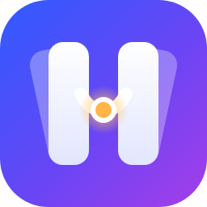

<p align="center"></p>

# Harness Deck

编程代理（coding agent）的 VS Code 对话面板：侧边栏对话、逐字流式回复、紧凑的工具活动行、审批与提问、用 VS Code Diff 查看每次改动。

面板背后的「底层」可以切换：

- **dsh**（内置）：[DeepSeek Harness](https://github.com/deepseek-ai/deepseek-harness)。功能最全，会话和 dsh Web UI、DeepSeek Desktop 共用。
- **ACP 代理**：任何支持 [Agent Client Protocol](https://agentclientprotocol.com) 的代理。内置了 [oh-my-pi](https://github.com/can1357/oh-my-pi)（`omp acp`）、腾讯 [CodeBuddy](https://www.codebuddy.ai/cli)（`codebuddy --acp`）和 Anthropic 的 [Claude Code](https://github.com/agentclientprotocol/claude-agent-acp)（`claude-agent-acp`），也可以自己加（例如 Gemini CLI）。

Agent 能力（读写文件、执行命令、审批、会话、模型）都由底层提供；插件负责启动和连接底层、显示界面，并补上 VS Code 的集成。这个插件以前叫 **DSH Copilot**。

[English](#english) below.

## 准备

**用 dsh**

1. 安装 dsh（`0.2.1-rc.5` 及以上，已测试到 `0.2.2-alpha.3`），任选一种：
   - 安装 [DeepSeek Desktop](https://www.deepseek.com/en/download/)，在它的菜单「管理 dsh 命令…」中安装 `dsh` 命令；
   - 或执行 `npm install -g @deepseek-ai/dsh`（需要 Node ≥ 24.9）。

   插件在 `PATH` 里查找 `dsh`，也可以在设置 `harnessDeck.dsh.path` 中指定路径。
2. 第一次打开对话时按提示配置 DeepSeek API Key（保存到 dsh 的凭据存储，不会写进工作区）。

**用 oh-my-pi**

1. 安装 [Bun](https://bun.sh)（1.4.4 及以上），再执行 `bun install -g @oh-my-pi/pi-coding-agent`，确认终端里 `omp --version` 能运行。
2. 按 oh-my-pi 的说明配置模型提供方（API Key、`~/.omp/agent/models.yml` 等）——模型和 Key 在 omp 自己的配置里，不经过这个插件。
3. 在对话面板右上角「…」→「底层」里选 **oh-my-pi**（或命令「Harness Deck: 切换底层」）。

**用 CodeBuddy**

1. 执行 `npm install -g @tencent-ai/codebuddy-code`，确认终端里 `codebuddy --version` 能运行。
2. 在对话面板「…」→「底层」里选 **CodeBuddy**。第一次使用时会让你选登录方式（iOA、Google/GitHub、微信、企业域名），在打开的浏览器页面里完成登录；登录信息由 CodeBuddy 自己保存。也可以先在终端运行一次 `codebuddy` 登录。
3. 不想用浏览器登录（例如远程开发时浏览器打不开），可以用 API Key：在 `harnessDeck.backends` 里覆盖内置的 CodeBuddy，通过 `env` 传 `CODEBUDDY_API_KEY`；中国版还要加 `CODEBUDDY_INTERNET_ENVIRONMENT: "internal"`（见 CodeBuddy 文档）。

**用 Claude**

1. 执行 `npm install -g @agentclientprotocol/claude-agent-acp`（需要 Node 22 及以上），确认终端里 `claude-agent-acp` 能找到。这是 Claude Code 的官方 ACP 适配器，自带 Claude Code。
2. 登录：装了 Claude Code 的话在终端运行 `claude`，输入 `/login`（登录状态和 Claude Code 共用）；或者用 API Key：在 `harnessDeck.backends` 里用 `id: "claude"` 覆盖内置项，通过 `env` 传 `ANTHROPIC_API_KEY`。没登录时发消息，对话里会提示怎么登录。
3. 在对话面板「…」→「底层」里选 **Claude**。默认是 Auto 模式（由 Claude 判断要不要问你），想每次都确认可以在输入框的权限选择里切到 Manual。

**其他 ACP 代理**：在设置 `harnessDeck.backends` 里加一项，写上名称和以 ACP 模式启动它的命令。`id` 和内置项相同（`oh-my-pi`、`codebuddy`）时替换内置项，例如写上完整路径或环境变量：

```json
"harnessDeck.backends": [
  { "name": "Gemini CLI", "command": "gemini", "args": ["--experimental-acp"] },
  { "id": "codebuddy", "name": "CodeBuddy", "command": "codebuddy", "args": ["--acp"],
    "env": { "CODEBUDDY_API_KEY": "…", "CODEBUDDY_INTERNET_ENVIRONMENT": "internal" } }
]
```

两种底层都需要**信任工作区**：代理会在工作区里读写文件、执行命令。

## 使用

- **打开对话**：右侧辅助侧边栏（Secondary Side Bar）里的 Harness Deck 视图，或命令「Harness Deck: 打开对话」。Enter 发送，Shift+Enter 换行；回复时继续发送的消息会排队。
- **切换底层**：第一次打开面板时会让你选底层（显示每个底层是否已安装、没装时的安装命令）；之后在首页点底层标签，或「…」→「底层」切换。同一时间运行一个底层，每个底层的会话分开保存。
- **上下文**：输入框上方显示当前编辑器——有选区时附带选中的代码和行号，否则只附带文件路径。点一下标签这条消息就不附带。
- **`@` 引用文件、`/` 命令**：`/explain`、`/fix`、`/test`、`/new`，以及底层自己的命令。
- **编辑器右键「Harness Deck」**：解释、修复、写测试、添加到对话。
- **图片**：在输入框里粘贴截图或图片（底层支持时）。
- **改动**：修改文件的那一行显示增删行数，点击在 Diff 编辑器里查看。
- **审批**：底层要执行需要确认的操作时，对话末尾出现审批卡片。
- **模型、模式**：输入框工具条切换模型（有多个思考等级时先选模型再选等级）和权限 / 模式。
- **字体与字号**：「…」→「字体与字号」。

### 不同底层的差别

| 功能 | dsh | oh-my-pi | CodeBuddy | Claude |
| --- | --- | --- | --- | --- |
| 流式回复、推理、工具行、审批、待办、停止 | ✅ | ✅ | ✅ | ✅ |
| 文件修改的增删行数和 Diff | ✅ | ✅ | ✅ | ✅ |
| 切换模型、思考等级、模式（计划模式） | ✅ | ✅ | ✅ | ✅ |
| 会话列表、重新打开历史会话 | ✅ | ✅ | ✅（列表由插件记录） | ✅ |
| 图片 | ✅ | ✅ | ✅ | ✅ |
| 同时在几个会话里回复 | ✅ | ✅ | 一次一个（见下） | ✅ |
| 每轮改动汇总（含命令造成的改动）、会话改动栏、多开标签 | ✅ | — | — | — |
| 消息插队、子代理卡片、提问卡片、`/goal`、在浏览器中打开 | ✅ | — | — | — |

CodeBuddy 的一个进程只给一个会话推送回复。回到别的会话发消息时，插件会重启 CodeBuddy 并重新加载那个会话（大约 2 秒）；一个会话正在回复时，要等它结束或先停止，才能在另一个会话里发送。

## 设置

| 设置 | 默认 | 说明 |
| --- | --- | --- |
| `harnessDeck.backends` | 空 | 额外的 ACP 底层：`name`、`command`、`args`、`env`、`installHint`；`id` 与内置项（`oh-my-pi`、`codebuddy`、`claude`）相同时替换内置项 |
| `harnessDeck.dsh.path` | 空 | dsh 可执行文件路径；为空时在 `PATH` 中查找 |
| `harnessDeck.dsh.profile` | `web` | 启动 dsh 用的 profile，默认与你自己运行的 `dsh web` 共用设置 |
| `harnessDeck.context.includeActiveEditor` | `true` | 发送时默认附带当前编辑器 |
| `harnessDeck.ui.language` | `auto` | 界面语言：跟随 VS Code，或固定 `zh` / `en` |
| `harnessDeck.ui.fontSize` | `0` | 对话面板字号（px）；`0` 表示比 VS Code 工作台字号大 1px |
| `harnessDeck.ui.fontFamily` | 空 | 对话面板字体 |
| `harnessDeck.ui.codeFontFamily` | 空 | 代码、文件路径和命令输出的字体 |
| `harnessDeck.ui.showTurnChanges` | `false` | 每轮回复结束时在对话里显示改动文件卡片（dsh） |

从 DSH Copilot 升级时，原来的 `dsh.*` 设置会在第一次启动时自动搬到 `harnessDeck.*` 下。DSH Copilot 是另一个扩展 id，升级后可以把它卸载。

## 常见问题

- **「找不到 dsh / omp / codebuddy / claude-agent-acp」**：确认终端里能运行；VS Code 从图形界面启动时可能读不到 shell 里设置的 `PATH`，这时写完整路径（`harnessDeck.dsh.path`，或在 `harnessDeck.backends` 里用相同 `id` 覆盖内置项，写上 `command` 的完整路径）。
- **启动失败**：「…」→「查看日志」看插件日志；底层自己的输出在输出面板的「Harness Deck: Backend」里（令牌和 Key 已脱敏）。
- **oh-my-pi 回复报错**：多半是模型提供方没配好，在终端里运行 `omp` 先确认能对话。
- **Claude 提示需要登录**：在终端运行 `claude` 并输入 `/login`，或给内置的 `claude` 配置 `ANTHROPIC_API_KEY`（见上面的「用 Claude」）。
- **CodeBuddy 登录**：取消了登录方式选择或进度，下次发消息时会再问。浏览器登录不方便时用 `CODEBUDDY_API_KEY`（见上面的「用 CodeBuddy」）。

## 隐私

插件本身不发网络请求：模型请求都由底层发出。随消息附带的上下文是你在输入框上方看到的那些标签，可以逐条关闭。

---

## English

A VS Code chat panel for coding agents: streaming replies, compact tool rows, approvals, and VS Code diffs for every change. The agent behind the panel is switchable: **dsh** ([DeepSeek Harness](https://github.com/deepseek-ai/deepseek-harness)), or any agent that speaks the [Agent Client Protocol](https://agentclientprotocol.com) — [oh-my-pi](https://github.com/can1357/oh-my-pi) (`omp acp`), [CodeBuddy](https://www.codebuddy.ai/cli) (`codebuddy --acp`) and [Claude Code](https://github.com/agentclientprotocol/claude-agent-acp) (`claude-agent-acp`) are built in. Formerly **DSH Copilot**.

**Setup**: for dsh, install it (DeepSeek Desktop → "Manage dsh command…", or `npm install -g @deepseek-ai/dsh`) and set the API key when asked. For oh-my-pi, install Bun ≥ 1.4.4, run `bun install -g @oh-my-pi/pi-coding-agent`, configure a model provider for omp, then pick **oh-my-pi** under "…" → Backend (or run "Harness Deck: Switch Backend"). For CodeBuddy, run `npm install -g @tencent-ai/codebuddy-code`, pick **CodeBuddy**, and choose a sign-in method when asked (finished in the browser); or pass `CODEBUDDY_API_KEY` through `env` by overriding the built-in entry (same `id`, `codebuddy`) in `harnessDeck.backends`. For Claude, run `npm install -g @agentclientprotocol/claude-agent-acp` (Node 22+), sign in with `claude` → `/login` (shared with Claude Code) or pass `ANTHROPIC_API_KEY` through `env` on an entry with `id` `claude`, then pick **Claude**. Add other ACP agents there too (`name`, `command`, `args`, `env`). The workspace must be trusted.

**Differences**: dsh supports everything; ACP backends cover streaming, tool rows, approvals, to-dos, stop, diffs, models and modes, session list and reload, and images when the agent offers them. Per-turn change summaries, the session changes bar, tabs, steering, subagent cards, questions, `/goal` and the browser link are dsh-only. A CodeBuddy process streams to one session at a time: sending in another session restarts CodeBuddy and reloads that session (about 2 s), and while one session is replying you need to wait or stop it before sending elsewhere.

**Settings** moved from `dsh.*` to `harnessDeck.*` (old values are migrated on first start): `harnessDeck.backends`, `harnessDeck.dsh.path`, `harnessDeck.dsh.profile`, `harnessDeck.context.includeActiveEditor`, `harnessDeck.ui.language`, `harnessDeck.ui.fontSize`, `harnessDeck.ui.fontFamily`, `harnessDeck.ui.codeFontFamily`, `harnessDeck.ui.showTurnChanges`.

**Privacy**: the extension itself makes no network requests; the backend makes all model requests. Only the context chips you see above the input box are attached to a message.
